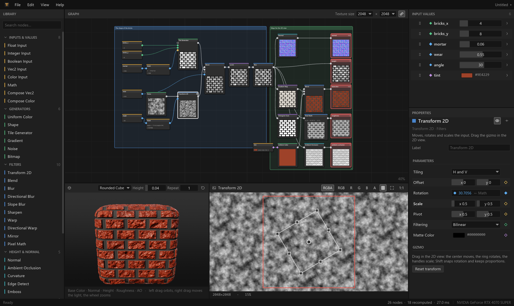

# Brewed Texture Designer

A node-based procedural texture editor in the spirit of Substance Designer — the first program of the Brewed family. Free and open source: [MIT](LICENSE-MIT) or [Apache-2.0](LICENSE-APACHE), at your option ([more](#лицензия)).
Rust · **wgpu** (nodes are drawn on the GPU by WGSL shaders) · **iced** (the interface) · **SIMD + multithreading** (`wide` + `rayon`) for the CPU side.


## Running

```bash
cargo run --release
```

Runs on Windows, Linux (X11 and Wayland) and macOS. Nothing but Rust is needed to build it: the system libraries (X11, Wayland, PipeWire) are loaded at run time, and only if they are needed.

On Linux and the BSDs the main window and the Color Editor window give the system the name `brewed-texture-designer`: the app id on Wayland, the window class (`WM_CLASS`) on X11. The eyedropper's windows on Wayland have the same name, and it is set in one place (`brand::APP_ID`). Without it the window had no name: on Wayland, a generic icon and no tie to a launcher. By this name the desktop ties the windows to the launcher `brewed-texture-designer.desktop`; the program does not install the launcher itself yet.

It needs a GPU with Vulkan, DX12 or Metal, and a processor with AVX2 (Intel Core since 2013, Haswell; AMD since 2015) or Apple Silicon (M1 and later). The program is built for them (`.cargo/config.toml`: `x86-64-v3` and `apple-m1`), on whatever machine it is built, and not for "everything the build machine has" (`native`: a build made on a Ryzen would use SHA instructions, which Intel Core of the 6th–10th generations lack, and would crash there). The SIMD kernels are no slower for it (`--bench`). On a processor without AVX2 the program says so at once instead of crashing silently.

**Home screen.** As in Adobe's programs: started without files, the program opens on it, not on the demo. It lives in a crate of its own, `home-screen`, which knows nothing of the program: the program gives it what to show (name and logo, templates, recent files, lessons, resources) and gets back what was chosen. So the same screen fits into any program of the set. At the top left are **New Package…** and **Open…**; under a separator, the pages **Home** and **Learn** (the chosen one darker, in white bold); **Back to …** if something is already open in the editor; and at the bottom, under its own heading, **Resources**: Shortcuts, Settings, Third-Party Notices, About. The website, documentation, forum and community resources are not there yet; they are marked "later". **Home**: a greeting, the row **Start from a template** (a template of each kind — Base, Studio, Convolution, Noise, Metallic Roughness, Empty — as the same cards as in the New Graph window, with a picture, a category and (i); one click on a template creates a package with the size and precision from the settings; the last card, **More templates…**, opens the New Graph window with all the templates) and **Recent**: the packages opened recently (as many as File → Open Recent Package offers), as cards or as a list (a switch on the right). A card has the package's picture, name and folder, when it was opened and how large it is; the list has the columns Name, Opened, Modified, Size, Location: a click on a heading sorts by it, a second click the other way. A long package name is shortened in its middle and a folder from its start, to the width of the card or the column (before, they were cut off at the edge, and in the list the folder showed only what all of them start with); in a narrow window the columns Size, then Modified, give way until the name has at least 180 px (otherwise, in a window 1000 px wide, the name and the folder were left 70 px each) — "Not found" for a missing file then stands in the Opened column. The view and the sorting are remembered. A package's picture is made when it is saved and is kept in the package's file itself (`thumbnail.png`): the 3D view's model in the package's material maps, from the starting camera, in the studio light, however the view is turned, moved or zoomed at that moment (the model's shape, height and repeat are the ones chosen); if the graph has no outputs with a Usage, the thumbnail of the first output. The picture is not part of the package: a save in which only it (or the view) changed does not become a new version in the history. A file that is no longer there is labeled so. A click opens the package, as does a file dropped on the window. **Learn** opens the examples as packages of their own: a brick wall (the demo), five FX-Map programs, and Pixel Math with vectors; each has a picture of its model, and in every graph of an example a frame explains in a paragraph what the nodes inside do and what comes out. To get back to the Home screen: File → Home Screen, or a click on the logo in the menu bar; Esc goes back to what is open. While the Home screen is shown, the editor's keys do not act on what is behind it, except New, Open, Settings and Help; and the engine is already running: About names the graphics card at once. A package created or opened takes the place of the empty untitled one the program started with, rather than sitting beside it.

**Font.** The interface is drawn in the Inter font (SIL Open Font License, files in `crates/brewed-texture-designer/assets/fonts`), the same on every system: the system fonts of Windows, Linux and macOS have different metrics and shapes, and bold Segoe UI in small text hardly differed from regular. Inter is a variable font: its bold and heavy weights are real ones, as is the italic of changed parameters.

**A new graph from a template.** File → New Graph… (Ctrl+N), New Graph… on the Home screen and "+" in the Explorer open a window like "New Substance Graph" in Substance Designer. On the left, on a dark background, are the templates of Substance Designer 16, with its own names and outputs — those that make sense here: without the templates that only work inside other programs or read other formats (the Painter and Sampler filters, AxF, CLO), and without Adobe Standard Material — that is Adobe's own model, which Adobe itself, with Autodesk, replaced with the open standard OpenPBR. **OpenPBR** — Base, Anisotropy, Coat, Subsurface, Fuzz and Complete: the outputs are named as the standard's parameters are (base_color, base_metalness, specular_roughness, height, normal, ambient_occlusion, and for the layers coat_weight, fuzz_color and so on; Complete has all 43), and each has the Usage of its parameter (Coat Weight, Fuzz Color, Specular IOR …), as in the templates of Substance Designer; each is fed a Uniform Color, to be replaced with a graph of your own. The values are as in the templates of Substance Designer, but chosen so that the layer is visible and recognizable: Anisotropy — brushed metal with vertical highlights (the tangent up the texture, anisotropy 0.7: the highlight is stretched, but not into a thread, which on a sphere looks like a seam), Coat — red metal under a clear coat, Subsurface — skin (the color of skin; the redder the light, the farther it goes under it), Fuzz — a thin white fuzz over a dark turquoise base, as on a peach or a kiwi (weight 0.35, roughness 0.6), Complete — the standard's default values (every layer but the base is off). What can be greater than 1 (IOR, depth, luminance in nits, the Abbe number) or less than 0 (scattering anisotropy, from −1 to 1), the Output writes as float; otherwise 8 bits would hold it between 0 and 1. The 3D view shows every layer. **HDRi** — Studio: an environment as a panorama (square, as in Substance Designer: the 3D view reads it as one turn across and from zenith to nadir top to bottom, whatever its shape) in 32-bit float, built, like the Substance Designer template, of HDRI Tools nodes: Gradient Linear (HDRI) makes a dark room, Shape Light a softbox overhead with a hotspot, Line Light a slanting tube lamp on the right, Plane Light a large panel behind (it goes past the seam, so it shows at both edges of the panorama); the lights are brighter than white. The Output's Usage is Panorama; the 3D view is lit by it only when that is asked for on the Output node itself (the switch "Light the 3D view with this panorama") or in the lighting menu, and an export to EXR gives it to other programs. Choosing this template sets a square size and 32 bits by itself, and another template brings back the ones before. **Pixel Processor** — Convolution: a grayscale image is blurred the more, the lighter the amount map is (Pixel Math reads it around each pixel). **FX-Map** — Grid (a coordinate grid: squares x_amount × y_amount at FX-Map depths 0 to 2, the small ones over the large, adding up to lines with ticks between them) and Noise (noise of splats at every depth). **Scan Processing** — Metallic Roughness: a material from a scan; color, normals and height are image inputs of the graph, Make It Tile makes each one tile, the color is divided by the blurred light it was shot in, the roughness is taken from the color, and there is no metal in the scan. **Filters** — Grayscale and Color Filter: an image input of the graph and an output; the graph, as a node, filters what is connected to it. **Others** — Empty. In each template a frame with a description explains what is in it and what to replace. The templates are shown as cards — the same cards as in the row of the Home screen (they are in the `home-screen` crate): a square picture, a name and a category (or as a list: a switch above them). The pictures are real renders. The materials are on a sphere in the 3D view, in the light of a dark studio with one softbox on the left (half the sphere lit, half in shadow; the coat and the metal reflect the softbox and the darkness around it, not a bright sky, in which the edge of the coat glowed like fuzz; the studio's key light was added to the softbox from the same side — from it come the stretched highlight of anisotropy and the sheen of fuzz): Base — white plastic, Anisotropy — the vertical blurred highlight of brushed metal, Coat — the softbox reflected in the coat over red metal, Subsurface — skin with a reddish terminator, Fuzz — a light, pale haze of fuzz, Complete — all four in a 2 × 2 grid. HDRi — an HDR icon: a frame and the letters HDRI (`assets/templates/studio-panorama.svg`). Grid — what the template makes: a coordinate grid. Convolution — the same grid, blurred by the template the more, the farther right (the amount map is a gradient). Scan Processing — "before and after": on the left a photo of stone, lit unevenly, on the right the material the template makes of it, on a sphere. Grayscale and Color Filter — on the left a color picture, on the right the same one in gray and tinted. Noise — the noise itself, Empty — the graph's grid. Each card has an (i) circle: point at it, and a card appears beside it with the name, the type (Standard material, Environment light, Filter, Generator), a description and the list of outputs; it stays while the pointer is on the circle or on the card itself, and goes not at once but a moment later. There is only ever one such card: point at another circle, and its card takes the place of the one before at once, and two never lie over each other. On the right: **Create graph in** (a new package, the default, or one of those open), the graph's name, the size — width and height apart, and a chain button between them links them — and the precision (by default from the settings). A graph created in an open package is one undo step. The window remembers the last template and the view.

**The package's picture.** When saved, a package gets a picture — the thumbnail of the first Output of the graph being edited (or of the node the 2D view shows), a 128×128 PNG in `thumbnail.png` inside the file. The Home screen shows it, reading only that entry of the file. A package saved without its graph being edited keeps the picture it had.

When the program starts with a file, and for screenshots and the autopilot, the demo graph "Brick Wall" opens: five Input Values (`bricks_x`, `bricks_y`, `mortar`, `wear`, `tint`), Tile Generator, Noise, Blend, Levels, Blur, Gradient Map, Histogram Scan, Normal, Ambient Occlusion, Pixel Math and five Outputs with a Usage (Base Color, Normal, Height, Roughness, AO). They show on the 3D model at once. Two comment frames show where in the graph the shape of the bricks is and where the maps for 3D are, and explain what each node does. Every image of the demo tiles without a seam — a test checks it.

## Interface

```
menu: File · Edit · View · Help                    package — graph   ─  ☐  ✕
───────────┬─────────────────────────────────────────────┬────────────────────────────
Explorer:  │ graph      texture size (default 2048²)     │ Input Values
packages,  │                                             ├────────────────────────────
graphs,    ├──────────────────────┬──────────────────────┤ Properties of the selected node
files      │ 3D: model, FPS       │ 2D: image            │
───────────┤                      │                      │
Library    │                      │                      │
of nodes   │                      │                      │
───────────┴──────────────────────┴──────────────────────┴────────────────────────────
status bar: a message, if there is one              nodes · VRAM · GPU
```

Every border between panels can be dragged, and the program remembers them: the layout, the window's size, whether it is maximized, the Real-time Rendering mode and the 3D view's lighting (environment, recent pictures, exposure, background) are saved on quitting to the settings folder (`%APPDATA%\Brewed Texture Designer`, `~/Library/Application Support/Brewed Texture Designer`, `~/.config/brewed-texture-designer`) and come back at the next start. View → Reset Panel Layout brings back the original layout. In a narrow window the side columns are no narrower than 190 px (Explorer and Library) and 270 px (Input Values and Properties) while the window has room for the graph as well: the names in them are not cut, and the fields of Properties keep their room; when the window is wider again, the columns go back to where they were left, and that is what is saved. Properties scrolls whatever it shows: a graph, a node, a comment or several nodes (for a comment and for several nodes, in a low panel, the fields and buttons were cut off at the bottom and could not be reached). The Tiling and Precision buttons of several selected nodes wrap whole onto the next line in a narrow panel, the option they all share is highlighted, and each press is an undo step of its own. For a Math node in a narrow panel, what a variable is ("own value · connect or name a graph input") goes under its field in two lines — beside it, it stood a word to a line, ten lines high — and the fields of the plot (function, from, to) wrap whole onto the next line: the last one went past the edge of the panel. The hint "Set the Usage of Output nodes…" and the frame rate in the corner of the 3D view stand one under the other: in a low view the frame rate lay over the hint, and if there is no room for both, the frame rate goes past the edge of the view. The 3D view's lighting menu scrolls when it lacks room (in the smallest window, with eight pictures, its lower fields could not be reached). A long path in a tooltip, in a message of Properties and in the dialogs for recovery and for missing files, like a file name in the list of the export window, wraps even in the middle of a word: a folder with a long name without spaces went past the frame to the edge of the window, and a graph name without spaces, become a file name, onto the next column. On the graph canvas a node's title is shortened in its middle to the room the icons of its header leave (an error, the mark of the node shown, the Output's format), and "(bypassed)" stays whole while the name has room beside it: before, the title was cut on an estimate of 7 px a letter, and with wide letters ran over the icons and past the edge of the node. Socket names are shortened to their room the same way (a graph used as a node has its own, and an input and an output on one row ran into each other), and so are an error message and a value in the body of a node; a comment's title, a sentence, is cut at the frame with "…" at the end (with wide letters it went past the frame). The column of names in Properties is from 118 px in a wide panel down to 60 px in a narrow one (a long name wraps onto a second line), so that the field has somewhere to be. A name that lacks room — of a graph, a folder or a file in the Explorer, of an Input Value, of the node in the 2D view's header, of a file in a field and in the lighting menu, of the export folder, of the document in the title bar, and the status bar's message — is shortened in its middle, with "…": the start and the end stay, and "Graph 2" and "Graph 3" do not look the same (cut at the edge, they read as one and the same name); where not even "…" fits, nothing is shown. In a narrow field the name of the chosen option (a pattern, a noise) is shortened the same way, rather than running under the arrow; for a value that comes through a link, the value itself gives way, and the "← node" button, which selects that node, stays whole while it fits, and a long node name in it (also for a picture that comes to an input of a graph node, and for a Math variable) is shortened in its middle: before, it was cut at the edge of the button; a long one-word node name (an Output's name) wraps in the header of Properties. For an expanded Input Value, the buttons Reset to default and Set as default, if they do not fit side by side, stand whole one under the other. The 3D view's header in a narrow panel drops the labels of its fields (Height and Repeat become "h" and "×" in the fields themselves, with tooltips), and in a very narrow one moves the fields to a line below it; the buttons of the 2D view's header move closer together; the headers are clipped at their own edge and do not draw over the next panel. A menu is as wide as its longest item: the keys ("Ctrl+G" for Create Graph from Selection) show whole, as do the long names of recent packages. The context menu and other pop-ups open where they were asked for — at the edge of the window they move by just as much as they do not fit, and stay whole inside. When one menu is open, pointing at another switches to it. The window is never larger than the graphics card can draw (8192 pixels a side): Windows stretches a window that moves to a screen of a larger scale (to a TV at 300 %, by 2.4 times), and before, a window wider than 8192 pixels stayed blank for good, even when moved back: iced kept a texture for that size, which cannot be made. Now such a size is held back before anyone sees it (on Windows by a subclass of the window that intercepts each change of size; on the other systems by the window's maximum size).

**Scrolling.** Everything that scrolls — panels, the menus of nodes and options, the lighting menu, dialogs — is one and the same box: the shared crate `scroll-box` (the Home screen of the `home-screen` crate scrolls with it too; `widget::scroll` in the program is the same box in the program's look). Its bar stands beside the content and never over it. While there is something to scroll, the bar's room is taken from the content, and when there is nothing, it is given back. Before, each such place saw to its own bar: here a thin bar over the ends of lines, there a margin on the right "for the bar", elsewhere a gap or nothing — and where this was forgotten, the bar covered the content (the categories in the node menu, the marks in the Explorer). A test goes through all such places and checks that no bar lies on what it scrolls; the "monkey" checks the same in any state of the window. Another test reads the sources of the program and of the Home screen and lets through no scrolling place made around this box: how wide the bar is, where it stands and what it looks like is said in one place.

**A title bar of its own.** On Windows and Linux the program does not depend on the system's frame: the window's title bar is the menu bar itself. On its right are the window buttons (minimize, maximize or restore, close — 46 px each, as the system has them; close turns red under the pointer and, when the window is maximized, also works in the very corner of the screen); between the menus and the buttons is the place by which the window is dragged (with the document's name); a double click on it maximizes the window or restores its size, and a right click opens the window's system menu (Windows, Wayland). The edges and corners of the window (4 px each; a corner is an angle of 14 px along each side) change its size, and the pointer shows which way; a maximized window has none. An open dialog darkens everything below the bar, but not the bar: the window can be moved, minimized and closed, while the menus are dimmed and do not respond until the dialog is closed. Closing with the button is the same as quitting: the program first offers to save unsaved changes. On Windows 11 the window keeps its shadow and rounded corners. A window minimized to the taskbar reports (on Windows) a size of zero; the program does not remember it: quitting from a minimized window, it used to remember the size "zero", and the next time the window opened at its smallest. On macOS the program keeps the system's title bar (the window buttons are on the left there, and the menus are in the screen's menu bar).

The window does not flash white when it opens or when it closes: on Windows it opens hidden from the screen (DWM cloaking) and is shown only once its first frame is drawn, and on quitting it is first hidden, then closed.

On its left the status bar shows messages ("Saved …", errors) and empties a few seconds later. On its right, packed close with no empty fields, is what is happening right now, over the last second; nothing older than a second is ever there:
- **`23 nodes · 10 recomputed · 7.7 ms`** — how many nodes the graph has, how many of them the last change recomputed (only those it touched), and how long the changes of the last second take on average: from the change to the moment the GPU has finished the images, the thumbnails and 2D/3D. If nothing changed in the second, `0 recomputed · 0.0 ms`; a change that takes longer than a quarter of a second to compute shows at once: `computing… 1.2 s`;
- **`VRAM 64 MB`** — how much video memory the images take; the tooltip says on what exactly: what the views show, what is kept for the next change, working textures, files (how little of it is taken is told below).

How many frames the 3D view draws, it writes in its bottom right corner, whole at any width of the panel: **`144 FPS · 6.9 ms`** — the frames of the last second and the average length of a frame (the tooltip gives the longest). The 3D view counts them itself. It draws frame after frame, like a 3D engine, and View → Real-time Rendering switches it to drawing only on changes (then, with no changes, it shows `0 FPS`). The graph keeps what it has drawn on the GPU and is redrawn only when something in it has changed, so a frame of the interface costs about 0.05 ms of CPU.

### Graph
- wheel: zoom to the pointer; middle button, right button or Alt+left button: pan; right click: context menu;
- dragging from a socket connects; let go on empty space, it opens the search, and the new node is connected at once (only the nodes that fit stay in the list);
- dragging a connected input moves the link (one undo step) or, let go on empty space, deletes it; let go on a socket that does not fit, the link stays where it was;
- sockets are typed: a circle is an image, a diamond a value (colored by type: Float, Integer, Boolean, Vec2, Color). Incompatible connections and cycles are refused with a message; while a link is being dragged, only the sockets it can be dropped on are shown larger (what would make a cycle is found once a frame: on a chain of 200 nodes in 0.05 ms, not in 1.4 s as before); numbers convert into one another, and a scalar is widened to Vec2 or Color;
- Space or a double click on empty space: search for a node (↑↓, Enter; the description of the selected node under the list takes as many lines as it has — before, five were always set aside for it); Del: delete; Ctrl+C/X/V (Ctrl+V pastes what is on the clipboard now: if, after nodes were copied, a word from another program got there, no nodes are pasted — before, the earlier ones were; what was copied here is taken only when the clipboard cannot be read), Ctrl+D, Ctrl+A; F: frame everything or the selection; Ctrl+B: bypass; C: frame the selection in a comment (here and below, the default keys: they can be changed in Settings → Shortcuts);
- a node has a strip of its category's color at the top, and Output nodes have their whole header in their color: the end of the graph shows at once;
- **comments** — a frame around a group of nodes, as in Unreal or Substance Designer: C makes one around the selection; dragged by its title it moves with the nodes inside, by its bottom right corner it changes size; a double click on the title puts the cursor in its text, and a right click offers "Color…" (any color, with the same palette as the other colors) and deleting it. Besides the title a frame has a description, like the Description of a Frame in SD: a paragraph under the title, wrapped to the width of the frame and cut at its edge; it is written in the frame's properties, in a field of several lines, and everything typed is one undo step. The title can be read on the overview of the graph too (it is larger than the text of nodes, as far as its strip allows), the description when the graph is zoomed in;
- Ctrl+Z / Ctrl+Y: undo/redo (dragging a slider or typing text is one step, and each press of a button — Reverse and Spread for a gradient, deleting one of its stops, "Upside down" and "Straight" for a curve, Reset transform, a middle click on a parameter's row — is a step of its own, even right after another; a step that leads into another graph opens it as it was, with the same pan and zoom; if a step removes the node the 2D view of that graph showed, the view shows its Output, as when a graph is opened); Ctrl+S, Ctrl+O, Ctrl+N (new package); Ctrl+G: the selected nodes into a graph of their own; Ctrl+E: the export window; F1: all the keys;
- shortcuts are tied to keys, not to the letters they type: Ctrl+Z works on a Russian layout too (the key "я"), on a Greek one and on any other — on all three systems. On layouts that move Latin letters (AZERTY, QWERTZ), a shortcut stays on the key with its letter;
- a file dropped on the window: a package (`.brewtex`) opens in the Explorer, a picture becomes a Bitmap node, vector graphics and fonts are added to the package. On Wayland too: winit 0.30, which iced 0.14 is built on, takes no dropped files on Wayland (that comes in winit 0.31), and before, a dropped file was silently lost; XWayland is no way out — on niri, xwayland-satellite does not carry drags between Wayland and X11 at all. There the files are taken by the clipboard's data device — the program is built with the `smithay-clipboard` of `patches/smithay-clipboard`, where this was added — which tells the program on which window and where they were dropped: a picture becomes a node where it was let go. Why the clipboard and not winit: GNOME (Mutter) gives a drag to one data device of a program only — the one made last, and that is the clipboard's; a device of winit's own (as it was done first, after the [wayland-dnd branch](https://github.com/MixaDoDs/photocraft/tree/wayland-dnd) of PhotoCraft) got nothing on GNOME. Tried in a GNOME session on Wayland (Fedora 44, Mutter 50) with a real drag, the pointer driven by a script through the compositor's RemoteDesktop interface: a picture from Files, let go over the graph, became a Bitmap node at that place, and copying and pasting nodes through the same device work as before; the details are in [patches/README.md](patches/README.md). Files copied in a file manager can be pasted too (Ctrl+V): GNOME Files and Dolphin put them on the clipboard as lines — paths or `file://` (text/uri-list, with CRLF line ends), and "Copy as path" in File Explorer as quoted paths — and pasted ones are taken as dropped ones are. While a dialog is open, what is dropped is not taken (the status bar asks to close the dialog first): before, a picture became a node of the graph hidden behind the dialog. What is read in the background for a graph (a dropped picture, a file chosen for a node's field, a graph from a library folder) goes to that graph, even if another was opened meanwhile: before, it went to the graph open when the reading ended, and a file to the node with the same number in it.

### 2D and 3D

Both views are shown at once, as in Substance Designer: the model on the left, the image on the right. The border between them can be moved.

- **2D**: channels RGBA/RGB/R/G/B/A, an eyedropper for pixel values, 1:1 and Fit. Transform 2D has a gizmo: the center moves, the ring rotates, the handles scale; with Shift, steps of 15° and the proportions kept. The gizmo does not change exposed parameters. The HDRI Tools nodes are placed with the mouse right on the panorama, as in Substance Designer. Gradient Linear (HDRI) has a point where the top color is, Line Light two points, the start and the end of the lamp. Shape Light has a gizmo like Transform 2D's: the outline of the softbox is drawn on the panorama as it is seen (away from the middle it is curved, and going past the edge of the panorama it goes on from the other side), the circle in the middle moves it, the squares on the edges and in the corners change its size (the opposite side likewise), the handle above the top edge turns it; Plane Light has the same gizmo, as a trial. Handles that could only be seen through a pole (a light overhead) are not shown, and the rotation handle then stands at the bottom edge. With Shift, a point and a light go along one axis, a size keeps its proportions, a rotation goes in steps of 15°; past the edge of the panorama a point comes out on the other side, and an exposed parameter stays put. In the properties the same values can be typed as numbers.
- **Tiling** (the button with a grid): the image repeats endlessly over the whole view, every copy the same. The repeat follows how the node reads its input: for Transform 2D, along the gizmo's axes, so with a rotation and a scaling down the copies meet. If the image has no whole repeat (a rotation without scaling down, for example), the view shows the truth — the image itself, edge to edge with itself. A red frame marks the copy that is the texture, and shows only while the pointer is on it.
- **3D**: a rounded cube (the default; its edges are rounded just a little — a radius of 1/32 of an edge, so that the faces are flat almost all over — before, a quarter of each face was rounded, then 1/16, 1/32 and 1/64 of an edge). The model is drawn with four samples a pixel (the edges were stair steps), a highlight one or two pixels wide on an edge is widened to a pixel (it was a broken line of sparks), and the studio has one light, as the view says: a second one, opposite, gave a second highlight and a dark line along each rounded edge between the sides each of them lit; the shadow side is now lit by the studio's sky, a sphere, **Matball** — the shader ball "Shader Ball JL 01" (by Craneo, license CC BY 4.0, see Help → Third-Party Notices): a ball of shells and rings on a stand with flat, concave, rounded and small details, to see how a texture lies on different surfaces (the model was converted from Blender — modifiers applied, MikkTSpace tangents, stood upright and sized to the other models, its UVs enlarged so that a tile lies on it as on the sphere; its own textures are not used), a cube, a rounded cylinder, a cylinder, a torus, a plane or cloth in folds, with PBR lighting. The height map displaces the surface as in Substance Designer: middle gray (128) leaves it in place, white pushes it out, black pushes it in (before, height only pushed out, from black); the Height field says how far black and white are apart, so the relief of earlier packages kept the same depth. The maps are taken from the Outputs by their **Usage**, and the Usages are as in Substance Designer: every parameter of OpenPBR (Base Weight, Base Color, Metallic, Diffuse Roughness; Specular Weight, Color, Roughness, Anisotropy, IOR; Transmission Weight, Color, Depth, Scatter, Anisotropy, Dispersion Scale, Abbe Number; Subsurface Weight, Color, Radius, Radius Scale, Anisotropy; Coat Weight, Color, Roughness, Anisotropy, IOR, Darkening, Normal, Tangent; Fuzz Weight, Color, Roughness; Emission Luminance and Color; Thin Film Weight, Thickness, IOR; Opacity, Thin Walled, Normal, Tangent, Ambient Occlusion, Height), the maps of earlier material models (Diffuse, Specular, Glossiness, Specular Level, Displacement, Bump, Detail Normal, Anisotropy Angle, Mask, Ambient, Reflection, Refraction) and **Panorama** — an environment that lights the scene; 57 in all. An Output with the Usage Panorama lights the 3D view not by itself (nobody wants to see a panorama in the making in the background) but when asked to: with the switch "Light the 3D view with this panorama" in the properties of that Output node, or with an item of the lighting menu; the environment behind the model is also shown only when asked for (Show It Behind the Model, off by default). While the graph is changing, the engine sends its picture scaled down (512 pixels wide, so that the light keeps up with the edits), and once everything is quiet, whole; from there it goes the same way as an HDR file (irradiance, blurred reflections, background). In the lighting menu it comes first — "The Graph's Panorama: \<output name>"; choosing the studio or a picture puts them in its place, choosing the panorama brings it back. The Usage menu is one list under group headings (each group can be collapsed and expanded; by default all are expanded), with a search (by the names of Substance Designer too: baseColor, metalness, sheenColor …) and a tooltip on each. The Usage field writes the group before the name only when the name does not repeat it ("Specular · Roughness", but just "Subsurface Weight") and there is room for both; in a narrow panel the name is cut at the edge of the field, and the menu shows it whole. The 3D view draws the material the way OpenPBR puts it together, layer by layer from the top down: fuzz (fuzz: Charlie's sheen, Neubelt's visibility — it glows toward the edges and fades smoothly toward the terminator; in the reflection of the environment it has no mirror highlight — the fibers catch light along the surface), a clear coat (coat: a GGX of its own, with its own roughness, IOR, normal and tangent; anisotropy stretches the reflection of the environment in it too; under it the base is darker and more saturated, as if wet, and tinted with its color by the length of the light's path through it), the base — metal (F82 Fresnel, with the edge tint from Specular Color) or a dielectric, which reflects by its IOR and weight, with a matte color under the reflection (Oren–Nayar, as Fujii simplifies it, by Diffuse Roughness), light under the surface (subsurface: light wraps past the terminator, each channel by its own radius — red farther; Subsurface Anisotropy — which way the light scatters, by the Henyey–Greenstein phase function: forward, it goes deeper and wraps farther, and what is lit from behind glows through; backward, it wraps less and comes back toward the light) or light through (transmission: the environment refracted by the IOR, each color at its own angle by the Abbe number, tinted by depth and cloudy by Scatter; Transmission Anisotropy: forward scattering clouds less and carries a blur of what is behind the glass, backward is milkier, with light from the side of the eye; with Thin Walled, without refraction); a thin film (thin film: interference of the reflections from the top and the bottom of the film, by its thickness and IOR — the rainbow sheen of a soap bubble) tints the reflection of the base; anisotropy stretches the highlight along the tangent (the Tangent or Anisotropy Angle map), and the reflection of the environment too — it is read at 16 points along the tangent, with a weight that falls off toward the ends — rather than only shifting it; emission is Emission Color × Luminance (1000 nits glow as the color itself, and Emission Color without Luminance as Emissive did before); Opacity makes the surface transparent (the far faces are drawn, then the near ones over them). Each layer is lit by the studio's light and its sky, or by the environment (its irradiance and its light blurred by roughness), weighted by how much light the layer reflects (a table of GGX and fuzz, computed at start) and how much it lets through to the layers under it. A material can have fifty maps, while the GPU iced draws with gives a shader sixteen textures: uniform maps (a Uniform Color is a one-pixel picture) the GPU itself reads into a row of values, a pixel per parameter; image maps take a texture each, and if there are more than eleven of them, the rest are copied into the layers of one more texture, with their own mip levels. A test renders the templates without a window and checks that each layer does its part: the coat gives white reflections over red metal, the fuzz lightens the edges, anisotropy stretches the highlight, subsurface light reddens the shadow, the film adds colors, and Opacity, glass, emission and metal change the picture. A second test goes through all 57 Usages one by one: each one the 3D view shows changes the picture of the sphere — together with what it cannot be seen without (the coat's roughness with the coat, the glass's color with glass, the tangent with anisotropy), and for scattering anisotropy, values below 0 too; Mask, Ambient, Reflection, Refraction, Custom and Panorama (that is not a material map: it lights the view when asked to) change nothing, nor do Diffuse beside Base Color, Glossiness beside Roughness, Specular Level beside Specular Weight and Displacement beside Height. It was this test that found two maps — Transmission Anisotropy and Subsurface Anisotropy — that the 3D view used to accept but not show. Height displaces the vertices. Vertices that stand in one place with one normal (a UV seam, the edges of the cubes, the joins of surfaces) read the height at one point of the map, so the model does not come apart at its seams under relief (the cube used to open up along its edges). Height is read from the level of the map whose pixel is no smaller than the distance between the model's vertices: a sharp step of height (the edge of a brick) came out jagged. The models themselves are denser now (the cube has 192 vertices along an edge), and both cubes are one and the same rounded box with different radii. Tests check both the seams and the density on every model. If there is no normal map, the lighting takes the normal of the surface the displacement makes: it leans as far as the height rises (the surface gradient of the height, as Mikkelsen has it), so relief shows on flat faces too, not only on the silhouette of the rounded parts. The lighting is the studio (a key light under the studio's sky; the light stays put in the scene and the camera goes around, so each face is lit as it stands to the light — before, the light turned with the camera and lit whatever face you looked at; the right button or the menu's Turn and Height fields turn it, and it does not go below the horizon) or an **environment** from an HDR picture (`.hdr`, `.exr`): the button with the sun opens a menu with the studio, the recent pictures and loading a new one, the exposure in stops (EV), the turn and the background — the environment is shown behind the model with the blur wanted. The choice and the recent pictures are remembered between runs, and each graph's scene is saved in its package: the model, the relief's height and Repeat in the graph itself, the lighting and the exposure in `editor.json`; a package opens as it was saved. The model, Height and Repeat are part of the graph, so changing them is an Undo step like any change to the graph (a drag of the Height field is one step), and after it the package is marked unsaved: Ctrl+Z brings back the previous height (it did not before); where the camera looks is not part of the graph and is not undone. A graph from the HDRi template lights the 3D view with its panorama at once. The left button orbits the camera around the model, the middle button moves the camera, the right button turns the light (or the environment), the wheel zooms. The view opens with the model whole and in the middle: each model has its own starting camera (with one shared camera the cylinder and Matball were cut off at the bottom, the plane at the sides, and the cube touched the bottom edge), and it looks at the model's axis, so the model does not wander as it turns. If the view was not moved or zoomed, choosing another model sets that model's starting camera, and if it was, the view stays as it is; the reset button brings back the starting camera of the chosen model. The field of view is measured along the shorter side of the view, so the model is seen whole in a narrow, tall view too. The view is drawn into exactly the screen pixels given to it, at any screen scale (100, 125, 150, 175, 200, 300 %): before, its edge was rounded differently from the panels next to it, and at some sizes a line one pixel wide was left along the edge; the picture's proportions are taken from the same pixels, not from the view's size in points (the sphere came out a pixel or two out of round). The line under the view (the maps on the model and how to move it) is always one line: what does not fit is cut with "…" and shown whole in a tooltip (in a narrow view it took five lines, and the model was left a strip).



### Parameters and expose
Each parameter has an expose diamond on its right. An exposed parameter gets a socket on the node and is locked at once: instead of the editor it shows the value that came to the socket (with the name of the source node; a click on it selects that node), or a warning that the socket is not connected and the value taken instead of a link ("not connected · uses 0.5"): always on one line — where the field is narrow, the words go first, then "uses", while the value stays, and the tooltip says it all (in the narrowest panel a pair of numbers stood in four lines — the "monkey" found this). A parameter hidden by a condition (for example Corner Radius, while Shape has something other than Rounded Square chosen) has no socket; its link is kept meanwhile and comes back when the parameter is visible again. Tiling is not exposed, nor are the modes that decide what the other parameters mean: Color Mode of the HDRI lights, Placement of Plane Light and Position Mode of Line Light — they are set, not fed to a socket (the shape and pattern of a light are exposed, as on other nodes).

Number fields: dragging changes the value (Shift: finer, Ctrl: in steps), a click: typing from the keyboard, and expressions like `2*pi` can be written.

A drag can go on as far as you like: for the time of the drag the pointer is put back where it all started, and the edge of the screen does not stop the drag (on Wayland, where a program may not move the pointer, the compositor holds it in place and says how far the mouse has gone). Let go, and the pointer is where you started.

For most sliders the values do not end at the ends of the scale: unusual numbers make interesting textures. There are limits only where nothing makes sense beyond them — gamma, fractions and probabilities, tile counts, the number of sides, radii (not less than zero).

A field whose value is not what it came as writes its digits bold and lighter, the slider's bar is brighter, and the label turns italic with an asterisk: `Gamma*`. This is one property of the field itself, so it works the same everywhere — for node parameters and in Input Values. **A middle click on the row** brings back the original value.

**Color** is set right in the field, as in Substance Designer: an eyedropper, a color swatch, a strip a color is taken from with a click or a drag (hues, darker toward the bottom), and under the field a slider per channel: R, G, B, A or (the **HSV** button) H, S, V, A; the channels are shown from 0 to 255 or, if the **Float** button is pressed, from 0 to 1 (one toggle button, not two) — the choice is remembered between runs. The buttons and sliders stand under the field itself and are as wide, starting from the eyedropper — for a node's parameter just as for a color Input Value (before, in Properties they started from the parameter's name and ran under the button that exposes a socket, as if they were a parameter of their own). No channel goes past its limits, whatever is typed and whatever comes through a link (before, a color could be given negative channels): so it is for the colors of parameters, of Input Values and of gradient stops. Numbers that are not a color (an index of refraction of 1.5, an Abbe number of 20, a scattering anisotropy from −1 to 1) come from the **Uniform Value** node — a plain number field without the limits of a color: the OpenPBR templates put it on such maps, and a gray Uniform Color of an older file that held such a number opens as a Uniform Value with the same number, in the same place and with the same links — it does what it did. Uniform Color has the choice of **Output** first (Color or Grayscale), and the color under it. In **Grayscale** mode the color is a level of gray: one strip from black to white with a mark, and one slider L, and whatever it is given (by the eyedropper, by pasting), it takes that color's gray. The same fields are on a color Input Value (in its expanded settings and in the properties of its Color Input node: there the color has one row, Value — the field itself with its channels; before, there was another row above it with a swatch and the code, and the labels of these rows were of another width than the rest), on the selected stop of a gradient and on the color of a comment. The swatch opens the **Color Editor** — a real window of the system, not a panel drawn inside the program's window (such a panel could not be taken out of the program's window and could not be resized): it is moved anywhere, even to another monitor, and resized by its edges and corners, and the color square grows with the window. It stays above the main window, does not hide under it on a click on the main window, is not on top of other programs, and is minimized with it: on Windows it is a window owned by the main one (without its own button on the taskbar), on X11 a transient window of the main one, on macOS a floating panel that hides while another program is in use; Wayland does not let a program say so, and there it is an ordinary window. Where the program draws the window's title bar itself (Windows and Linux), the window has a title bar of its own with × and edges that resize it; on macOS the title bar is the system's. It stays open until it is closed (×, Esc, or closing the window); a click elsewhere and turning the model in the 3D view do not close it (before, the palette closed, and the color had to be found again for each look at the model); the next time it opens where it was left, and at the same size (on Windows and X11 the place is remembered in screen pixels, so the window goes back to its place even between monitors of different scales; if the monitor it stood on is gone, or the place has ended up past the edge of the screens, the window goes whole onto the nearest screen; the first time, it opens by the pointer; closed and opened again at once — before the system has said where it stood — it goes to that place as soon as the system says). Its title says whose color it is. Ctrl+Z, Ctrl+Y and Ctrl+S do in it what they do in the main window; the main window's other keys do nothing from it (Delete in the color editor does not delete the graph's nodes). In it are a square of saturation and brightness with a strip of hues (its frame is now around the colors: before, a frame with rounded corners lay over a strip with square corners, and the color showed past it), two swatches — at the top the color as it is now, at the bottom as it was when the editor was opened (a click on the bottom one brings it back, as an Undo step of its own), **Pick** (the eyedropper), **Invert**, **To Gray**, **Copy** and **Paste** — a hexadecimal code through the clipboard, as Photoshop and Unreal copy it (`#RRGGBB`, `RRGGBB`, `#RGB`, `#RRGGBBAA`), the **Float** button, sliders R, G, B, H, S, V, A, and at the bottom of the window a field with the code, which can be typed or pasted: the color is taken as soon as the code names it. For a gray (a Uniform Color in Grayscale mode) the same color editor opens, as in Substance Designer, which has no separate editor for gray: the color is chosen like any other, and the parameter takes its gray; the editor meanwhile shows the color chosen (the square and the sliders stay where they were put), and the parameter's field shows its gray. The editor remembers the hue and the saturation of a color, not just the color itself: the square's point, dragged past its bottom edge, stays at the bottom under the pointer — the color there is black, as the bottom edge should be, but the hue and saturation are what they were, and once the point or the V slider is raised, the color comes back (before, black remembered neither: the point jumped to the corner of the square, the H and S sliders fell to 0, and a raised brightness gave a gray). The **Float** and **HSV** buttons are buttons in both states: off, one looks like an ordinary button; on, it is light (before, an off one was just a word beside the sliders).

**Choosing by pictures.** The type of a noise, the figure of Shape, the pattern of Tile Generator and the type of Gradient are chosen not from a list of names but from a menu of pictures: beside each name, what a node of this type makes with that option, as it is when just added. The pictures are one set for all nodes of a type; the engine draws them once per run, in the background, as soon as such a node appears in the graph, and never recomputes them. The field itself shows the node's own thumbnail. The menu opens under the field, or above it if there is more room there, and never covers it. The arrow keys move through the options, Enter chooses, Esc or a click elsewhere closes; a choice is one undo step.

Long menus (the noises have 40 options) have a **search**: it gets the keyboard at once, and what is typed leaves the options that are called so or look so. `voronoi` leaves Cells, Voronoi, Voronoi Fractal, Cracks, Crystal, Mosaic and Stones, `hair` — Flow and Fibers, `water` — Raindrops, Caustics and Moisture; the names of Substance Designer's noises find theirs too: `fractal sum` — Perlin, `creased` — Ridged, `fur` — Fibers, `anisotropic` — Streaks, `bnw spots` — Spots. Several words must all fit. While the field has text in it, ←/→ move the cursor in the text, ↑/↓ go through what was found, Enter chooses.


### Input Values
They work like material parameters in Unreal. A graph variable appears with an Input node (Float, Integer, Boolean, Vec2, Color or **Image Input**) and is defined by its name: several Input nodes with one name read one variable, and when the last such node is deleted, the variable goes. In the panel each variable has a value, a description, a default value, min/max, "Reset to default" and "Set as default"; its name is changed in the panel itself, and with it in every node that reads it. A row can be dragged onto the graph: one more Input node appears.

**An image input is an input value like the others**, only its value is a picture. It stands in the same list with the same set: a name, a description, a picture and a default picture (a changed one has an asterisk; the middle button brings it back), "Reset to default", "Set as default", and also **Kind** (Grayscale or Color: what comes is converted to it) and **Color** — what the graph sees while there is no picture. A picture can be chosen or dragged from the Explorer; the one chosen becomes a file of the package. Image Input nodes with one name show one picture.

**A name being typed** — of a graph in the Explorer, of an input value in the panel or in the properties of an Input node — is taken not only on Enter but also on a click anywhere else in the window; Esc cancels. The window does not see a click in another program, so the name stays half-typed — a word can safely be copied somewhere else. Saving (Ctrl+S, Save As) first takes the name being typed, so what is seen is what goes into the file.

### Math
The node's property is a line with an expression, for example `(1+x)*sin(myVar)-2.4/cos(myVar2)`. Every word that is not a function or a constant becomes an input of the node.
- operators `+ - * / % ^` (or `**`), comparisons, `&& || !`, `cond ? a : b`, implicit multiplication `2x`, `3(a+b)`;
- functions `sin cos tan asin acos atan atan2 sinh cosh tanh sqrt cbrt exp exp2 ln log log2 log10 pow abs sign floor ceil round trunc fract min max clamp saturate lerp/mix step smoothstep mod hypot degrees radians if hash rand`, constants `pi tau e phi true false`; `rand(k)` is the k-th random number from 0 to 1: its own for each splat of an FX-Map and for each pixel of Pixel Math, and in Math the same one for the same k; `#` starts a comment to the end of the line;
- errors do not crash the program: the node is highlighted, and the properties underline where the error is and say what is wrong (with hints like "Did you mean 'sin'?"). The editor does not lose focus meanwhile, and the sockets do not vanish while an expression is being typed;
- **vectors**: `vec2`, `vec3`, `vec4` (of numbers and vectors: `vec3(v.xy, 1)`; one number goes into every component), components are taken with `.x .y .z .w` or `.r .g .b .a` in any order and as many times as you like (`c.bgr`, `v.xx`); arithmetic and functions work component by component, and a number with a vector works as a vector of that number; `dot`, `length`, `distance`, `normalize`, `cross`. For an image input, `.rgb`, `.a` and so on are its channels (without a `.`, the channel of Read Channel), and `sample(img, x, y).rgb` gives the channels at any point. A vector with a vector of another length, or a vector in a comparison or where a number is needed, is an error that says how to fix it;
- **names**: before the expression's value, names can be given in lines `name = value` (or separated by `;`), `#` is a comment to the end of the line; a name is read in the lines that follow and stays a number or a vector of the same length, and the expression's value comes as the last line:
  ```
  n = normal.rgb * 2 - 1   # the normal from the map
  saturate(dot(n, normalize(vec3(1, 1, 1))))
  ```
  Implicit multiplication does not carry over to a new line: `length(n)` at the end of a line and `n / l` on the next are two lines, not `length(n) * n / l`;
- the built-in `width` and `height` are the size of the texture the graph is computed at, in pixels (like `$size` in the functions of Substance Designer; for a graph used as a node, the size it is computed at there): they have no sockets, the properties show their value marked "the texture's size, in pixels (built in)", the function reference names them, and when the texture size changes, the value and everything that depends on it are recomputed at once (`width / 64` in the radius of Blur is the same look of blur at any size); an Input Value with such a name cannot be made — it becomes `width_`;
- a variable that is not connected takes its local value or, if Auto-bind is on, the value of the Input Value with the same name;
- the properties have syntax highlighting, a table of variables, a plot of f(x) (the labels of its largest and smallest values lie on a backing, and the curve passes under them) and a function reference; in a narrow panel a function's description goes under its signature (beside it, it stood a word to a line, up to seventeen lines).

**Pixel Math** is the same expression, but compiled to WGSL and computed for each pixel: the variables are images, the built-in variables are `u v px py width height`, and `rand(k)` gives each pixel its own random number. A vector makes a color picture: `img.bgr` swaps the channels around, `vec3(u, v, 0)` makes a color of the coordinates. `sample(image, x, y)` reads an image input at any point (`x` and `y` from 0 to 1, like `u` and `v`; between pixels bilinearly, across the edges by the node's tiling): `sample(img, 1 - u, v)` mirrors, `(sample(h, u + 1/width, v) - h) * width` is a slope, and offsets by a map are warps. The first argument is the name of an input, not an expression; a value variable read anywhere is equal to itself (`sample` works the same way in Math on the CPU). One value makes a grayscale picture, a list of two to four separated by commas makes a color one: red, green, blue, alpha (the missing ones are 0 and opaque), for example `u, v, 0.5` or `sample(img, u, v), 0, img`. Math on the CPU gives one number and answers a list with an error. What is not a number (`sqrt(-1)`, `0/0`), Pixel Math writes as 0, and infinity as the largest number of half float (±65504): NaN does not spread further down the graph (Blur, Levels and Normal would smear it). One expression has at most 128 operations in a row (`a + b + c + …`): a graphics card does not take a deeper shader, and parsing such a tree overflowed the stack (4096 characters of expression hold 2048 additions). Functions that read their argument twice (`fract`, `lerp`) are written into the shader as functions, not by substitution: nested `fract(fract(fract(…)))` used to double the shader at each level, up to gigabytes.

### Gradient Map
A gradient with any number of stops (up to 64): a click on the strip adds a stop, the handles can be dragged, and dragging a handle down deletes its stop; interpolation Linear, Smooth or Constant; there are reverse and even spacing (after a reverse the same stop stays selected, at its new place: before, the one that came to its old place was selected). The stop being dragged is that very stop, however many mouse moves come before the next frame (before, a second move in one frame moved the stop that had taken its place, and a stop just added and dragged at once vanished; the same with the curve). A gradient can be taken from the screen with the eyedropper (see below).

### Curve
A tone curve in a square under the parameter's row: the handles of its points can be dragged (horizontally only between their neighbors), a click on an empty place in the square adds a point and drags it at once, and a handle taken out of the square deletes its point (two always stay); a whole drag is one undo step. The buttons in the row turn the curve upside down and straighten it. Between the points is a monotone cubic spline (Fritsch–Carlson): smooth, and never going past its points, so a rising curve never sags, and the values do not go past 0 and 1. The curve is baked on the CPU into a table of 1024 values (like the gradient of Gradient Map), and the graphics card reads it with interpolation; for a color picture the chosen channels change (RGB or one).

### Eyedropper
Every color editor has "Pick color" (color parameters, color Input Values — the value and the default value, gradient stops), and Gradient Map has "Pick gradient". The eyedropper is live, as the system ones are: nothing is captured in advance and nothing on the screen is stopped (a video under the pointer keeps playing); exactly what is on the screen now is taken, from anywhere — from a reference on a second monitor, from a browser, from the program itself.

- **color** — a click anywhere on any monitor. The pointer itself becomes a round magnifier: enlarged pixels, the chosen one outlined; so the magnifier never lags behind the mouse and never gets into what is read from the screen;
- **gradient** — press and move the mouse any way you like, not necessarily in a straight line: a black line trails behind the pointer (showing where the colors come from), and on release the colors along the path become a gradient. The stops are chosen so that it follows the colors passed over (up to 64 stops);
- the line itself does not get into the result: the pixels are read before it covers them;
- Esc, a right click or a change of monitors cancels; a click without a move takes nothing. The screen has no transparency, so the color keeps the alpha of the parameter it goes into.

On each system this is done with that system's own means:

| | how | what the system takes on itself |
|---|---|---|
| Windows | the monitors are covered by invisible windows (opacity 1/255, so that clicks land on them), which Windows leaves out of screen capture; the pixels are read by GDI straight from the screen, and the path is drawn by a click-through window | — |
| X11 | the pointer and the keyboard are grabbed, and the screen is not covered by anything; the pixels are read with `GetImage`, the path is drawn by two shaped windows (SHAPE), and the magnifier is an ARGB cursor | — |
| Wayland (Sway, Hyprland, river, niri…) | transparent layers over the monitors catch the mouse, and the pixels are read region by region through `wlr-screencopy` | — |
| Wayland (GNOME, KDE) | the same, but the pixels come as a live stream of the screen | the color is taken by the system's eyedropper (the `PickColor` portal), and the screen stream comes from the ScreenCast portal through PipeWire; permission is asked once and remembered |
| macOS | — | the color is taken by the system's magnifier, `NSColorSampler`; the gradient is taken on a screenshot shown pixel for pixel (it needs the "Screen Recording" permission) |

PipeWire is loaded only where there is no way around it, and only while the eyedropper works: it is not needed for the build.

### Packages and graphs

A project is a **package**, as in Substance Designer: one `.brewtex` file holds several graphs and the list of files they use (pictures, vector graphics, fonts). The **Explorer** panel above the Library of nodes shows all the open packages: their graphs and files. A double click on a graph opens it in the editor; a right click on a package, a graph or a file opens its menu (New Graph…, Rename, Duplicate, Delete; Import and Link Files…; Save, Close; Locate…). Any number of packages can be open at once: File → Open Package adds a package to the Explorer, and an untitled, untouched one (the demo at start, an empty new one) gives way to it. The last eight packages opened or saved are offered by the submenu File → Open Recent Package, by name and folder (when there are none, it says so); a package that is no longer in its place is taken off the list when clicked, and Clear Recent Packages empties the list. The list is kept in `workspace.json` with the window's layout.

**A package may have no graphs**, as in Substance Designer: only files (a set of pictures that other packages refer to). A right click on an empty place of the Explorer opens a menu with **New Package** (a new empty package: no graphs and no files; what is being edited stays open) and **Open Package(s)…** (the dialog opens one package or several at once; the File menu has the same items). The last graph of a package is deleted like any other, and comes back with Undo; while there is no graph, the graph view and Properties say so, no node can be added (and it is said why), and New Graph… in the package's menu gives it a graph. A package without graphs is saved and opens as such. **A package's files** are in its **Resources** folder, the graphs at the root of the package, all graphs equal. There is no Resources folder while there are no files; while the files are of one kind, they lie right in it; as soon as there is more than one kind, each has a folder of its own: **Bitmaps**, **Vector Graphics**, **Fonts**. Each file shows its picture: a picture scaled down, vector graphics drawn, a font as the letters "Aa" in that font; pointed at, larger, with its size, pixel format and file size. The pictures are made in the background, and the program looks at the files on disk every two seconds, also in the background: if a file is gone, has appeared or has changed, its mark and picture show it; the window itself does not touch the disk. A file changed in another program (or back in its place) is read again by itself: the textures that read it are recomputed without a Reload button. On a file's right is a mark of where it is: a chain — the package **links** to the file on disk; a box — the file **is held in the package itself** (embedded in the `.brewtex`). Further right, as in Substance Designer, is ⓘ: point at it for **Notes**, what uses this ("Used by Brick Wall ×2" for a graph, "Read by Bitmap in Brick Wall" for a file); what has no ⓘ is used by nothing, which shows at once when a project is cleaned up. ⚠ is **Warnings**: the file is not where it is said to be. A right click on a package or on the Resources folder: **Import and Link Files…** (links to the files where they are), **Import and Embed Files…** (the files are put into the package) — both ways are called importing, because that is the word looked for in a menu (before, they were called Link Files… and Import Files…, and the File menu had only the first; now it has both), **Embed the Linked Files** (all links into the package), **Remove Unused Files** (take out the files no node reads); a right click on a file: **Rename** (the file's name in the package: the file itself, and how nodes read it, do not change), **Embed in the Package** or, for an embedded one, **Save as a File and Link It…** (the save dialog offers the file's name in the package, with the extension of what it is; before, it offered the internal name `embedded:<hash>`, with a colon, which file names on Windows may not have; a name typed without an extension gets one, but an existing file of that name is not written over without asking). An embedded file lies in the `.brewtex` as an entry of its own, byte for byte, and is named by its content (`embedded:<sha256>.<ext>`; the name the Explorer shows is kept apart and can be renamed): one name is always the same bytes, so a node copied to another package brings its file with it, and two packages with one file have it once (and the package's file has one entry for it, however many names it has). SHA-256 is computed in the background while a file is read from disk, and on all cores when a package is opened; a file whose bytes do not match its name (the package was edited by hand, or is damaged) is not taken: the package opens and says which file is missing. In a node's parameters an embedded file is shown by its name, not by a path; Collect Files leaves it alone — it is inside already.

**The file field** of Bitmap, SVG, Text and of image input pictures is one and the same: the file's picture, its name (the path when pointed at, with the size and format), and the "Choose a file" and "Read no file" buttons (there is no need to read a file again by hand: a file changed on disk is read again by itself). Instead of choosing a file in a dialog, it can be **dragged from the Explorer** right onto the field: while it is being dragged, each field says at once whether it will take it — "Drop to use bricks.png", or in red "✕ letters.ttf is not a picture" if the file is of the wrong kind. The file chosen becomes a file of the package (it appears in Resources). A picture larger than 8192² is not decoded at all and gets a clear error at once; the largest allowed (8192² in 32-bit float, 1 GB in memory) open — before, the decoder's built-in limit of 512 MB kept them out. Files larger than 2 GB are not read: such a file is certainly not a picture or a font, and memory would run out. Nor is anything read that is not a file — a folder, a device (`/dev/zero`), a pipe: they would be read forever. The packages whose graphs an open package uses are read the same way: the path to them is written in its file and can be anything.

**A graph as a node.** Any graph dragged from the Explorer onto another graph becomes a node there — whether of its own package or another. Its inputs are the graph's **Image Input** nodes (grayscale or color: what comes is converted to it), its outputs are the graph's Outputs, its parameters the graph's Input Values, with their ranges; the parameters can be opened as sockets (expose) and driven by values, like any others. A graph of another open package, renamed or deleted in the Explorer, shows at once in the graph that uses it: the node takes the new name or says that the graph is gone (before, the graph went on drawing what was deleted under its old name until it changed itself).

**Pictures of inputs are parameters like all the others.** A graph's image input, on a node that uses that graph, is an ordinary parameter in the common list Parameters, among the other input values and in their order. It has a picture field: empty, the graph shows its own ("the graph's: bricks.png" or its color), or a picture of your own can be chosen or dragged from the Explorer — for this node only (a changed parameter has an asterisk; the middle button brings back the graph's picture). And like any parameter it has **expose**: while it is not exposed, the node has **no pin** — nothing can be plugged by accident into an emblem that should just be a picture; exposed, a socket of the kind the input takes (grayscale or color) appears, and what comes through it is what the graph sees (if nothing comes, a warning and its own picture). The order is always this: what comes through the exposed socket, then the node's picture, then the graph's picture, then its color. A grayscale input makes all it shows gray; a color without a picture is one pixel, like Uniform Color (Uniform Color now has an Output too: Color or Grayscale, as in Substance Designer). A picture that could not be read gives an error on the input itself or on the node that uses the graph. An input renamed or deleted in the graph loses the picture it was given — as it loses its wires. Projects of the previous version open as they were: the name, kind, picture and color of their Image Inputs become an input value, and the connected inputs of nodes stay connected (exposed). If a graph has changed, all the nodes that use it change with it — in open packages at once. Right click → **Open Reference** opens the graph a node uses: if it is in another package, that package appears in the Explorer. **Ctrl+G** (right click → Create Graph from Selection) turns the selected nodes into a new graph of the package and puts a node that uses it in their place: everything that came into the selection from outside becomes its inputs (pictures as Image Inputs, values as Input Values with the parameter's value and range), everything that went out becomes its outputs. Input Values that both the selected nodes and the others read stay outside and drive a parameter of the new graph, so changing them still reaches everyone. A graph from a selection computes exactly what its nodes computed — a test checks this: it turns random selections of the demo, and of a graph with all the hard cases (a color on a grayscale input, one picture into a grayscale and a color input, a channel of a color picture, values by name and through a socket), into graphs and compares all the outputs pixel by pixel, and again, making a graph of a part of the new graph. A selection with an unselected node between its nodes (what one selected node makes reaches another through it) does not become a graph: such a node would end up both before and after the new one, and the status bar names the nodes to select as well. A graph cannot use itself, neither directly nor through others, and the program says so at once, while the graph is still being dragged: the hint at the pointer and the caption on the canvas turn red and name the reason ("'Brick Wall' cannot use itself", "'Wall' uses 'Bricks': a graph cannot use a graph that uses it"), and the pointer over the graph shows "not allowed"; dropped all the same, the graph is not added, and the status bar repeats the reason. In the same way, a node that uses this graph, or a graph that uses it, is not pasted from the clipboard ("Not pasted: …"). Two Outputs with one name get a warning, and the graph as a node takes the upper one as its output of that name. Nodes that use graphs of a package with no file are pasted only into that package: another package finds graphs by their file, so the program does not make such a paste and asks for the package to be saved. A new graph never gets the number of a deleted graph, after a save neither: a node that used the deleted graph will not pick up another one.

A node whose graph is not found keeps all its sockets, links and values and says what is missing: once the file is found, everything works as it did.

**Paths.** The files a package uses, and the packages whose graphs it uses, are written relative to the package's file where possible (`textures/bricks.png`, `../lib/stone.brewtex`; on another Windows drive, as a full path). The project's folder can be moved or handed over whole, and everything will be found. If, when a package is opened, some file is not where it is said to be, the program shows a list of the missing ones: for each, where it is now can be given (a package is taken only if it has the graphs needed), and the others that were in the same folder are looked for beside it. From then on the package remembers the new place — an ordinary undo step, one for all the files found together (before, each was a step of its own). The file becomes what the new one is (an SVG given as a font becomes a font; before, it stayed an SVG until opened again) and gets a name of its own in the package ("stones 2.png" if "stones.png" is already there: before, two files had the same name); a file the package cannot use is not taken, and the status bar says so (before, it said "Relinked", and on opening again the file dropped out of the package). What is missing can also be left as it is: it simply does nothing.

**Collect Files** (File, and the package's menu in the Explorer) gathers a package's files beside it: everything outside the package's folder is copied into the folder `<package name>_files` beside its file (equal names are numbered — `bricks (2).png`; existing files are not written over), and the package uses the copies — in one undo step; after a save the paths are written relative to the package, and its folder can be moved or handed over whole. The copying runs in the background; what could not be copied is listed in the status bar. An unsaved package has nowhere to gather to — the program asks for it to be saved first.

**Saving over an open package.** A package saved to the file another package was opened from becomes that file: the other one, if it has nothing to save, is closed (the file's version history keeps what it was), and if it has unsaved changes, it stays open as Untitled with them — before, they were silently lost; the status bar says so. The context menu of something that is no longer there (a closed package, a deleted graph or file) closes with it.

The engine knows nothing of graph nodes: before evaluation each graph used is laid out in the graph that uses it, node by node, with the values it was given, to any depth. The nodes laid out have permanent ids of their own, so incremental recomputation and the cache work as usual: when a parameter of a graph node changes, only what depends on it is recomputed. A graph node computes exactly what the same nodes would compute without it, pixel for pixel.

### Files and export
A package is saved as a `.brewtex` — a ZIP archive that any archiver opens: `package.json` (which graphs and files the package has and what they are called), a JSON per graph in `graphs/<id>.json`, the embedded files as they are in `files/<sha256>.<ext>`, and `editor.json` (which graph was open, what its 2D view showed, and the scene of its 3D view: what lights it — the studio, an HDR picture (its path relative to the package where possible) or the graph's own panorama — and the exposure; the model, the relief's height and Repeat are written in the graph's own JSON, and are read into the graph from the `editor.json` of older packages; a package opens with the same scene, and a package saved before this leaves the scene as it is). Nothing is said twice in `package.json`: where in the archive a graph or a file is, what kind a file is, which packages are used — all of this follows from the rest and is not repeated (a repetition could only come to disagree with the original). And what a package can be opened without (a counter, the program's signature, a file name) is taken as its default when there is rubbish in it: the package does not stop opening because of it. The format is described for other programs in [docs/package-format.md](docs/package-format.md) — a package can be read even from Python with the standard `zipfile` — and grows the way glTF does: a reader skips fields it does not know, `extras` (of a package, a graph, a node, a file) and the archive's entries of others are kept as they were, and what a package cannot be read without, the package names itself (`extensions_required`) — and a program that does not know it had better refuse than open the package wrong and save it without it. A package of a newer version of the format the program does not open, but says to update. A parameter's chosen option is written by name (`"format": {"choice": "directx"}`), not by its number in the list, so options can be added and reordered; a test checks against the list `tests/fixtures/nodes.txt` that no node type, socket, parameter or option that can be in files has gone or been renamed. One and the same package is always saved to the same bytes (the times of the entries are fixed) — git shows only real changes. A package unpacked and packed again (`zip -r`, Python, Windows' Compress-Archive) opens as it was; on saving, the graphs' JSON and the compression are prepared on all cores, and each part of the JSON is checked before it is written to read back. When a package with unsaved changes is closed, or the program quit, the program asks whether to save them — for each package in turn. A quit cancelled halfway (Cancel or Esc) asks again the next time about each package — also about the one it was decided this time not to save: it may have changed (before, after Esc its changes were lost without a question at the next quit). While a dialog is open, the keyboard belongs to it: Ctrl+S, Ctrl+O and Ctrl+E do not act under it, and Enter does what its first button does: Save in the question about unsaved changes, Create in the New Graph window, Export in the export window (when a folder is chosen); About, Shortcuts and the package's history close; a field that takes Enter itself keeps it, and windows with a search, settings or a choice wait for a click. If saving before quitting fails (the disk is full, the file is read-only), the quit is cancelled altogether: before, it waited for its moment, and the next successful Ctrl+S closed the program unexpectedly. A name typed without an extension in the package's save window (`walls`) gets `.brewtex`, but the program does not write over an existing `walls.brewtex` without asking: the save windows of Windows, macOS and KDE add the extension themselves and ask themselves whether to replace the file, while those of GNOME (the GTK portal) and zenity add no extension and ask only about a file `walls`. If `walls.brewtex` is already there, nothing is written and the package stays unsaved; the status bar says that the file is already there and that it can be replaced by saving the package under its name, and what was waiting for the save (quitting, closing the package) is cancelled, as when a save fails. Before, such a file was silently written over, and what it held before was left only in the version history — and only if versions are kept. A recovered package whose file was saved after the snapshot (by another copy of the program) opens untitled: Ctrl+S asks where to save it, and does not write the old over the new. File dialogs do not keep anyone from working with the window while they are open, so their answer belongs to the package and graph the dialog was opened for: if another one was switched to meanwhile, the program goes back to the right one and does everything there (saves that package, gives the file to that node, exports the outputs of that graph), and if it was closed, does nothing. Before, the answer went to whatever was open at the moment of the answer: the wrong package was saved, and one being closed through "Save" was closed unsaved. An Output is exported to PNG 8/16 bits or EXR 32-bit float, in the format RGBA/RGB/RG/R/G/B/A; Ctrl+E saves all the Outputs into the chosen folder under their names. An image is read from the graphics card in bands of at most 256 MB — as much as one buffer may take on the device iced creates: color at 8192² in 16- and 32-bit float (512 MB and 1 GB) used not to be exported at all (the autopilot now exports 8192² in every format).

**Opening and saving do not hold up the window.** A package is read — with the packages whose graphs are used in it — and written on a thread of its own: a package with hundreds of megabytes of embedded files does not freeze the interface, and work can go on while it is being written. A package is written as it was when its saving began: an edit made during the writing stays unsaved (a package counts as saved only if it is as it was written). Saving the same package again during a write waits for it, a file that is just being written opens after the write, and quitting and closing a package wait until everything being saved is written.

**Extensions in capitals.** The dialogs that open files — Open Package(s)…, Import and Link Files… and Import and Embed Files…, the search for a missing file, the choice of a file for a node's field, and Load an Environment Image… — show a file however its extension is written: `SCAN.PNG` and `IMG_0001.JPG` as well as `wall.png`. On Windows and macOS this was always so, but not on Linux and the BSDs: rfd hands the XDG portal (and zenity, where there is no portal) a name pattern `*.png` for each extension, and the pattern is matched letter for letter. Now each letter of an extension is a class of its lower and upper case there, `*.[pP][nN][gG]`, as the portal's documentation advises. The save dialogs (Save As…, Export Output…) get the extensions as they are: KDE's dialog adds the extension to a name typed without it, and asks before writing over a file of that name, only when the first pattern of the filter is a plain one (`*.brewtex`, not a class: KDE's portal makes it plain itself, but only from Plasma 6.4 on); otherwise a package saved as `walls` would silently land on top of `walls.brewtex` — the extension would be added by the program itself. All the filters of file dialogs are set in one place (`file_dialogs`): a test reads the program's sources and lets through no filter added around it, and another checks both forms on any system — the one for Linux and the BSDs, and the one for the others.

**Unsaved work is not lost.** Every 2 minutes (or as the settings say) the packages with unsaved changes are written in the background as snapshots — only those that changed since their last snapshot. The snapshots are kept in the `Recovery` folder beside the settings, not in the temporary folder: the system may empty that as it restarts after a power cut, that is, just when the snapshots are needed. The files a package holds in itself are kept there apart and once each (they are named by the hash of their bytes and never change), and the snapshots refer to them: a package with a gigabyte of embedded textures is not written whole at every snapshot. The program does not touch the package's file itself — the user saves it, and the snapshot is deleted then; a package closed without saving loses its snapshot too; a normal quit leaves nothing behind. Each run of the program is a session that keeps its file locked while the program runs; the system releases the lock however the program stopped — whether it crashed, was killed, or the power went. So the next run tells a crashed program from one running beside it (it leaves the snapshots of a running one alone) and asks what to do with what it found: **Recover** — the packages open with the changes they had, unsaved, and where they were saved (Ctrl+S writes them in place), and the program shows the recovered graph at once (before, it stayed on the Home screen, and the graph waited behind its button), **Later** — ask next time, **Discard** — delete. For each package it shows when it was written, and whether its file has been saved since. Two programs started at once do not share one crashed session: the one that found it first holds it.

**Earlier versions of packages, with no clutter beside the package.** Each save leaves a version of the package — as Local History does in JetBrains IDEs, not as `.blend1` does in Blender: the versions are kept in the `History` folder beside the settings, and nothing ever appears beside the package. Before writing over a file, the program also keeps what it held before, if the history does not have it yet: another program saved the file, it was changed from outside (it came from git or the cloud), or it was saved before there was a history; a file that does not read as a package is kept byte for byte. The files a package holds in itself are kept apart and once each, by the hash of their bytes, as in the snapshots for recovery: a package with a gigabyte of textures, saved 50 times, takes a gigabyte in the history and 50 times a few kilobytes. A new version appears only when the package has really changed: a second Ctrl+S, or a moved view of the graph, makes no version (the view's position and zoom are no longer kept in the package — a package opens with the graph whole in view). The last 20 versions of each package are kept (Settings → Recovery → Earlier versions, from 0 to 100; 0 keeps none). Old versions go by themselves, as do the files no version refers to any more — but not earlier than an hour later: a second program running may be just writing a version that refers to them. **File → Package History…** shows the versions of a package with the date and time by the system's clock, newest first. **Restore** puts a version in the package's place, unsaved: Ctrl+S writes it to the file, and until then the file does not change. The unsaved changes it replaces first become a version themselves, so nothing is lost. A version is read in the background; if the package was changed meanwhile, it stays as it is (those changes would not have been saved anywhere), and the status bar says that nothing was restored and that it can be restored again. **Open a Copy** opens the version beside it, without a file. A save for which the version could not be written (when the disk is full, say) still saves the package, and says there is no version.

**Saving does not damage files.** A package, an exported texture and the settings are written beside the file, forced to disk (fsync) and put in its place in one step (on Linux and macOS the file's entry in its folder is forced to disk too): whatever stops on the way — the program, the system, the power — the file is either the old one or the new one, whole. An engine that watches a folder of textures (Unreal, Unity) does not import half a file. A file that an antivirus, an indexer or OneDrive holds for a moment on Windows, the program waits for, up to a second, rather than reporting an error. Before, a package was written beside the file and renamed, but without fsync: after a power cut an empty file could turn up in the file's place.

**The export window** (File → Export…, Ctrl+E) writes the open graph: its Outputs as they are — each with the name, channels and format of its node, as before — or the files a game engine expects of a material. Such a preset assembles the files from the Outputs by their purpose (Usage):

- **Unreal Engine** — `T_<graph>_BaseColor`, `_Normal` (DirectX normals, Y−), `_ORM` (ambient occlusion, roughness and metallic in red, green and blue), `_Height` and `_Emissive` if the graph has them;
- **Unity (URP)** — `<graph>_BaseMap`, `_Normal` (OpenGL, Y+), `_MetallicSmoothness` (metallic, with smoothness = 1 − roughness in alpha), `_Occlusion`, `_Height`, `_Emission`;
- **Unity (HDRP)** — `_BaseMap`, `_Normal`, `_MaskMap` (metallic, occlusion, detail mask, smoothness), `_Height`, `_Emission`;
- **glTF 2.0** — `_baseColor`, `_normal`, `_occlusionRoughnessMetallic` (both textures of a glTF material read the one file), `_emissive`.

A preset takes the image that comes into an Output at the graph's precision (16-bit float by default) and at full size: an Output's own channels and format belong to its own file. So a 16-bit PNG from a preset is a real 16 bits, even if the Output itself writes 8, and an Output that writes only alpha does not turn the base color into a white sheet. A preset's file is always the size of the texture, even if the map is one pixel of Uniform Color. A channel of a packed file for which the graph has no Output gets the default value: without AO, 1; without roughness, 0.5; without metallic, 0. If there is no Output of the Usage needed, the one that stands in for it is taken, as in the 3D view: Diffuse as base color, Glossiness turned over as roughness (and Unity's smoothness is Glossiness itself), Displacement as Height. Opacity becomes the base color's alpha (glTF and Unity read it from there); if the graph has no base color, its RGB is 0.8, as in OpenPBR. The graph makes its normals in one convention (the OpenGL/DirectX switch, by default as its Normal nodes have it); if the preset needs the other, the green channel is turned over. The preset files are PNG 8 or 16 bits. Before writing, the window shows what files will come out and what is in each channel; the preset and the folder are remembered while the program is open. A preset's files are assembled in bands, straight into the file's samples, like an ordinary export, without an intermediate copy of the whole picture.

Export reads an Output's image as the graphics card keeps it (RGB 8 bits is 4 bytes a pixel, R 8 bits one) and converts it into the file's samples in bands of a million pixels: it takes memory for the image itself and for the finished file, no more. The demo's five maps at 8192² are exported in about 1.4 GB of RAM; before, each map first became RGBA float (1 GB a map), and all five went at once — about 7 GB. Levels' histogram is computed the same way, in bands. An Output's name becomes a file name the same way on every system: forbidden characters are replaced with `_`, names that Windows keeps for devices (`aux`, `con`, `nul`, `com1`…) get a `_` (`aux_.png`), and a long name is cut to 200 bytes.

**Rendering without a window** — for scripts and for building a game, like Substance's `sbsrender`: a package's graphs are computed on the graphics card without the interface, and their Outputs are written just as File → Export… writes them with the preset Outputs as They Are. The graphs a package uses from other packages are read from their files, however deep they go.

```bash
brewed-texture-designer --render walls.brewtex --out textures
brewed-texture-designer --render walls.brewtex --graph "Brick Wall" --set bricks_x=6 --set tint=#9E4229 --size 4096 --precision 32 --out textures/red
```

`--graph` picks graphs and can be repeated; with several graphs each is written into a folder of its own name, with one, right into `--out`. Without `--graph` the **package's finished textures** are rendered — the graphs that are not used as nodes in its other graphs; helper graphs (the graph "Bricks" inside "Wall") are computed inside those that use them and are not exported apart — stderr says so of each (`note: 'Bricks' is used in other graphs…`), and `--graph "Bricks"` exports it too. `--set NAME=VALUE` sets an Input Value (`0.5`, `4`, `true`, `0.2,0.8`, `#9E4229` or `0.6,0.3,0.2`, by the type of the value, and an image input with a picture file: `--set emblem=logo.png`; what it drives in the graphs the graph uses gets it too), `--size` the texture size (`2048` or `2048x1024`), `--precision 8|16|32` the precision of the images (by default as the graph says; a node with a precision of its own keeps it). Each file written is printed as a line on stdout, problems (a node with an error, a package depended on that cannot be read) on stderr; the exit code is 0 if all is well, 1 if something went wrong on the way, 2 if rendering is impossible (no package, graph or Input Value of that name, a value of the wrong type).

The command line is read as it is, not as text: a file manager on Linux can pass a file name in an old encoding, and before, such a name crashed the program before its window appeared. Now the options, and their values read as text (`--graph`, `--set`, `--size`…), are compared as text, and paths (files to open, `--render`, `--out`) stay as they were given. A text value that is not Unicode is a usage error with that value in the message (code 2). A file to open with such a name is not opened, and the status bar (and the log) says why: the program keeps paths as text, and under the name it could write, it would read another file or none; renamed, the file opens.

The pictures of Bitmap nodes are decoded in the background and kept in video memory while at least one Bitmap node reads them: a deleted node or another document opened lets them go. 8- and 16-bit pictures are converted from their channels straight into half floats through a table, on all cores, without an intermediate float buffer: on the way, 8K RGBA takes no more than 0.8 GB of RAM instead of 1.9 (the values are the same bit for bit — a test checks it). If the file was changed while it was loading, the old load does not get into video memory.

### Settings

**Edit → Settings…** (Ctrl+, — the comma's key on any layout) opens the settings — as in Substance Designer or Unreal: the pages on the left, on the right the settings of the chosen page only, each on a strip of its own (what it is on the left, the value on the right; every other strip lighter, with a line between them). Changes do not take effect at once: a setting changed but not applied is marked by a bar at the left edge of its row and by a dot at its page. **Apply** is off while nothing is changed, and applies everything changed; **Cancel** (and Esc) forgets the changes and closes the window, and when there is nothing to forget, the button is called **Close**. Esc in a field where a number is being typed only stops the typing. The ↺ button in its row brings back a setting that is not as it is by default; **Reset Page to Defaults** does so for the whole page. A click outside the window does not close it: the changes would go with it. The window opens on the page that was open last.

The settings bring out what was fixed in the program, and by default it behaves as before:

- **General** — **Undo steps**: how many steps back Undo remembers in each package (10–1000; 256 by default, as it always was); **Recent packages**: how many packages File → Open Recent Package offers (0–20; 8 by default, as it was; the program remembers 20, so a larger number shows older ones at once too); **File dialog folder** (formerly "File dialogs open in"): **Automatic** (the default, as it was: Save As and saving a package's file open in the package's folder, the search for a missing file where it was, the others where the system opens them), **Package** (all in the folder of the package being edited; for one not saved yet, where a dialog was answered last) or **Last used** (all where a dialog was answered last; the folder is remembered between runs, and if it is gone, the package's folder is taken); **Invert zoom**: the mouse wheel zooms the other way — in the graph and in the 2D and 3D views alike.
- **Packages** — **File import mode** (formerly "A file chosen or dropped"): what becomes of a file chosen in a node's field or dropped on the window: **Embed in the package** (the default) — the package holds it in itself and stays one file, which can be copied or sent; **Link to the package** (formerly "Link to the file": both options are now named after the package) — the package refers to the file where it lies. A file to embed is read and hashed in the background and goes to the package and graph it was chosen in — in one undo step. Import and Link Files… and Import and Embed Files… in the Explorer and in the File menu still do exactly what they say. **New Graphs** — the size of a new graph, width and height apart (in `settings.toml` one number, a square, or `[width, height]`), and its precision.
- **Library** — the folders whose packages show their graphs in the Library panel (see "Package library"): **Add Folder…** and **Remove**; under each folder it says how many graphs were found in it. By default there are no folders, and the Library shows only the program's own nodes, as before.
- **Recovery** — whether to keep unsaved work to recover after a crash (**Keep unsaved work**) and how often (**Auto-save interval**, formerly "How often"; every 2 minutes by default, from a minute to half an hour): a snapshot is written only for the packages that changed since the last time. Turned off, the snapshots already written in this session are deleted, and no new ones are written. **Earlier versions** — how many earlier versions of each package to keep on saving (see "Earlier versions of packages"). This is not a constant brought out but a new feature: before, a save simply wrote over the file. It is on by default (20 versions), because a backup that is off helps only those who turned it on beforehand; 0 brings back the old behavior, and at the next start the program removes the versions already written.
- **Graphics** — **Graphics API** and **Antialiasing** (smoothing the edges of the links, nodes and curves the program draws; on by default, as it was; off, it saves video memory, most of all on large screens) are marked **Restart**: the program takes them when it starts. While they are applied but the program has not yet started with them, the row says "Taken when the program starts again", and after Apply an offer **Restart the program?** appears — in the settings window above the buttons, and when the window is closed, as a box in the bottom right corner, as in Unreal: **Later** dismisses it, **Restart Now** asks about unsaved changes as quitting does ("before restarting"; if that is cancelled, the offer comes back), and starts the program again with the same packages open. The API: Vulkan or DirectX 12 on Windows, Vulkan on Linux, Metal on macOS; by default wgpu chooses among these, and never OpenGL, even where there is nothing else (without a Vulkan driver on Linux the program says that one needs to be installed, rather than crashing silently); the environment variable `WGPU_BACKEND`, if set, comes first (the row says so). If the chosen API did not start (no driver), the program says so and next time chooses by itself — otherwise it would never start again. OpenGL is not in the list: wgpu shares one OpenGL context between threads and takes a thread that waits for it longer than a second for hung — and the window waits while the engine compiles a large shader (Tile Sampler), so the program crashed.
- **Shortcuts** — the keys of all commands, in groups (Packages, Editing, Graph, 2D View, Program): click a key, and the next key pressed takes its place (Esc to think better of it), "Add a key" for a second key, × to take one away, ↺ to bring back the command's default keys. A key another command already had in the same place (Space over the graph and Space over the 2D view do not get in each other's way) leaves that command, and the page says which command has what left. As before, an extra Shift or Alt does not get in the way: Shift+Del deletes, Ctrl+Shift+C copies — unless such a combination is given to another command. The file commands work while text is being typed too, but only with a key with Ctrl or an F key — a letter key types. Menus, context menus and F1 show the keys as they are now. Esc always closes what is open and cannot be reassigned.

The settings are kept in `settings.toml` beside `workspace.json` (Windows: `%APPDATA%\Brewed Texture Designer`, macOS: `~/Library/Application Support/Brewed Texture Designer`, Linux: `~/.config/brewed-texture-designer`); while no setting has been changed, there is no file. It is ordinary TOML with comments, and it can be edited by hand. It holds only what differs from the defaults: a setting that is not in the file follows the program's default, even if that changes later, and a setting brought back to its default the program takes out of the file (in `[shortcuts]`, only the keys that differ from the default keys: `redo = ["Ctrl+Y"]`, `frame = []` for no key; Ctrl on macOS is ⌘). Changing a setting, the program rewrites only its value, and comments, order and keys it does not know stay as they were (what it does not know — from another version, say — is simply not read). A file of the first version of the settings, in which all the defaults of that time are written, is read as it is: `[files] new`, `[new_graphs]`, `[recovery] keep` and `[graphics] api` mean what they meant, and `[recovery] every` in seconds is no longer read (the interval is now `every_minutes`, and the default applies: 2 minutes). What cannot be taken (a value of the wrong kind or out of range, a key that cannot be read) is shown at the top of the settings window and taken as the default or as the nearest value allowed; a file that is not TOML at all the program does not write over, but says why. The settings are in TOML, the window's layout in JSON: a person writes the first, the program the second. The autopilot and the screenshots for the README neither read nor write the settings.

**Log.** The program writes its log not only to the standard error stream but also to the file `brewed-texture-designer.log` in the same folder: a release build on Windows starts without a console, and after a crash a program opened with a double click would otherwise leave nothing behind. The log of the previous run stays beside it as `brewed-texture-designer.log.1`, and the one before that is deleted. Each is at most 4 MB, so that a warning repeated without end does not fill the disk: on reaching the limit, the log writes that it is falling silent, and after that takes only a panic (64 KB more are kept for it). A panic, wherever it happens, goes into the log — what it says, the file, line, column and thread — before the standard handler says it. If the file could not be created, the log goes only to stderr, and the program works on. **Help → Reveal Log File** shows the file in the file manager: on Windows, File Explorer opens the folder with the file selected; on macOS, Finder (`open -R`); on Linux and the BSDs the program asks the file manager over D-Bus (`org.freedesktop.FileManager1.ShowItems`), and if nobody answers, opens the folder (`xdg-open`). Rendering from the command line, screenshots and the autopilot write only to stderr (the autopilot has its own log), so as not to push out the log of the window's last run.

## Nodes

| Category | Nodes |
|---|---|
| Inputs & Values | Float / Integer / Boolean / Vec2 / Color Input, **Math**, Compose Vec2, Compose Color, **Image Input** (an input of a graph used as a node) |
| Generators | Uniform Color, **Uniform Value** (a number in every pixel: an index of refraction, a distance, a luminance — what in a map is not a color), **Shape** (14 figures and profiles), **Tile Generator** (offset rows or columns), **Tile Sampler** (patterns on a grid: up to four pictures chosen at random, maps of mask, scale, rotation and color, tile colors of its own, overlapping by Max, Add or Stack), **FX-Map** (splats, each as a program says: where, which, how turned, of what brightness or color, in a grid that splits into four at each depth), Gradient, **Noise** (40 noises, each made its own way, all tiling: Perlin, Simplex, Value, Gaussian, Billow, Ridged, Plasma, Liquid, Marble, Wood, Veins, Streaks, Flow, Curl, Fibers, Scratches, Directional Scratches, Ripples, Waveform, Turing, Raindrops, Caustics, Cells, Voronoi, Voronoi Fractal, Cracks, Crystal, Mosaic, Stones, Scales, Weave — plain, twill, basket and satin, Blocks, Truchet, Maze, Spots, Blotches, Moisture, Dirt, Craters, White Noise), Bitmap (PNG, JPEG, TGA, BMP, TIFF, EXR, HDR), **SVG** (vector graphics from a file: in their own colors or as a coverage mask), **Text** (a line of text in a font of its own or in the built-in Inter) |
| Filters | **Transform 2D**, **Blend** (19 modes, a mask), **Blur**, Directional Blur, **Non-uniform Blur** (radius by a map), Slope Blur, **Sharpen**, Warp, Directional Warp, Mirror, Pixel Math, **Distance** (a distance field), **Flood Fill** (a random gray or color for each separate shape of a mask), **Make It Tile** (makes a picture that does not tile into one that does) |
| Height & Normal | Normal, Ambient Occlusion, Curvature, Edge Detect, Emboss, **Bevel** (a bevel along a mask: linear, smooth, round, concave, inward or outward), **Height Blend** (two height maps, whichever is higher on top), **Normal Combine** (the details of one normal map on another: Reoriented, Whiteout, UDN) |
| Adjustments | **Levels** (a histogram, Auto levels), **Curve** (a tone curve: points are dragged with the mouse, a click adds one, taking one out of the square deletes it; RGB or one channel), Histogram Scan, Invert, Grayscale, HSL, **Gradient Map**, **Gradient Dynamic** (the gradient is a picture: the colors along one of its rows or columns, chosen by a parameter or, pixel by pixel, by a map), Channel Shuffle, **RGBA Merge** (four grayscale maps into the channels of one picture: ORM for engines), Posterize |
| HDRI Tools | Environment panoramas, as in Substance Designer: **Gradient Linear (HDRI)** (from the color at a point of the panorama to the color opposite, with contrast and exposure; by default from white to black, so that it shows at once which color is where), **Shape Light** (a softbox — a rectangle or a disc facing the center of the scene, with a hotspot), **Line Light** (a tube lamp between two points, as in Substance Designer — a real tube in the scene, not a line on the panorama: in the Ground / Ceiling mode, the default in SD, its ends lie on the ceiling above the center of the scene — or on the floor, if a point is below the horizon — so overhead it is nearer and thicker, and toward the horizon it goes off into the distance and becomes a thin line; in the Distance from Origin mode the ends are at one distance from the center; across, Smooth Square, Sharp Square, Cone or Hemisphere), **Plane Light** (a panel facing the center, or the ceiling, or the floor; plain, in stripes or in a grid). Each light is drawn where it is seen from the center of the scene (on the panorama, rounded if it is far from the middle), over the panorama fed to the Background input; brightness is in EV (each stop doubles it), color is RGB or a color temperature in kelvins (the Planckian locus after Kim et al.); the edges are smoothed over a pixel of the panorama. A test checks that the gradient is of the top color at the top and of the bottom color at the bottom, that the softbox is seen from the front and not from behind, that the tube lies between its points (and on the ceiling overhead is thicker than at the horizon), and that the ceiling is above and not underfoot |
| Output | **Output**: a name, the format RGBA/RGB/RG/R/G/B/A, 8/16/32 bits, Usage (57 options, see the 3D view) |

Every node has **tiling** (No tiling / Horizontal / Vertical / H and V): on tiling axes sampling wraps across the edge, and the generators come out seamless. On value nodes the parameter is shown but disabled. A node with an input can be switched off for a while (**bypass**, Ctrl+B): it passes its first input on unchanged.

**Grayscale and color images**, as in Substance Designer. Noises, shapes, gradients, AO, Curvature and Histogram Scan make a grayscale image (one channel), Gradient Map, Normal, Uniform Color and Bitmap a color one (RGBA), and filters give out what they got. Sockets and links show this by color: grayscale ones gray, color ones orange; an input that takes either is colored by what came into it. Color on a grayscale input is read as luminance (Blend's mask too), grayscale on a color input as gray in every channel. Gradient Map takes either: the channel it reads can be a channel of a color picture.

**SVG and Text** draw vectors on the CPU (resvg), at exactly the size of the texture and with their own offset, rotation and scale applied at once, so the edges are sharp at any resolution; in bands on all cores, in the background, as Bitmap files are decoded. While a new picture is being drawn, the node shows the previous one: dragging a slider does not flash empty. Where the texture tiles, a shape that went past the edge comes back on the other side. Text is laid out by usvg (with shaping by rustybuzz) in the node's font, and what the font lacks in the built-in Inter (SIL Open Font License, `crates/brewed-texture-engine/assets/fonts`): the same text looks the same on every system. This is how, for example, a parametric puzzle floor is made from the vector outline of its pieces: SVG as a mask, Flood Fill gives each piece a color of its own, Bevel a bevel.

**SVG is read safely, whatever is in the file.** An `.svgz` is unpacked to no more than 256 MB, and once (a file packed twice is not unpacked twice): otherwise a small "bomb" file would unfold into gigabytes. Groups with opacity, clipping, a mask or a filter are each drawn on a layer of their own while what is in them is drawn; such groups nest no deeper than 8, and the bands where they are become narrower and are not all drawn at once — so their layers never take more than a gigabyte (resvg lets a layer be 5 times wider and taller than the band). Links `<image href>` are read only to SVG — from the file itself (`data:`) or as a file on this computer, by default beside the file; such an SVG loads nothing more itself. Raster pictures inside an SVG the program does not draw, so it does not read them either. Network paths (`\\server\share`) and what is not a file are not read: nobody sees such a link, and Windows, opening a shared folder, hands the server the user's credentials. Text inside an SVG is drawn in the built-in Inter if its font is missing — system fonts are not looked for, and the file looks the same everywhere (before, such text was not drawn at all).

**Tile Sampler** lays patterns out on a grid, like Tile Generator (offset rows or columns, random offset, scale, rotation, brightness, gaps), and each tile is also changed by maps read at its center: Mask Map keeps a tile where the map is no darker than a threshold (or, inverted, no lighter), Scale Map shrinks it, Rotation Map turns it, Color Map colors it. A tile's figure is one of 14, or one of the pictures connected (up to four), chosen at random for each tile; tiles can be mirrored at random and painted in random colors of their own. Each pixel looks only at the tiles of the neighboring cells that can reach it. A picture is read from its mip levels — from the one whose pixel is the size of a pixel of the tile (pictures without mip levels are copied into an image with them), so a large picture on small tiles does not shimmer. Overlaps: the brighter (Max), the sum (Add), or one over the other (Stack): each tile has a random depth, and a pixel keeps the four uppermost by depth and lays them on each other from the bottom up, with smoothed edges.

**FX-Map** is a programmable "sprinkler", like the FX-Map of Substance Designer, only instead of a graph of Quadrant, Iterate and Switch nodes and functions in every parameter there is one program. The picture is split into four again and again: at depth 0 it is one cell, at 1 four, at 2 16 (**Depth**); each cell of each depth from **From Depth** to **Depth** draws **Count** splats, the smaller over the larger, in order. The program is lines `name = value` (or separated by `;`, with `#` for a comment), and each name set is read as a variable from then on:
```
# Each splat: where it is in its cell, how large, how turned and how bright.
x = rand(1)
y = rand(2)
size = 0.05 + 0.15 * rand(3)
angle = 360 * rand(4)
value = 0.3 + 0.7 * rand(5)
```
A splat is set by `x`, `y` (where in the cell, from 0 to 1; 0.5 by default, the middle), `size` (a fraction of the cell, or two values, width and height; 1), `angle` (degrees counterclockwise, 0), `value` (brightness, 1), `color` (red, green, blue and alpha — then the picture is in color), `opacity` (1), `draw` (0 not to draw, 1) and `image` (which of the inputs Pattern 1–4 to draw, 1). The program can read `i` (the number of the splat in its cell, from 0), `count`, `depth`, `cells` (cells in a row at this depth), `col` and `row` (the cell), `u` and `v` (the middle of the cell on the picture, from 0 to 1), `seed`, `width` and `height` (the picture's size in pixels) and `rand(k)` — the splat's k-th random number, from the seed, the depth, the cell and the number. Any other name is an input of the node, as in Pixel Math: a picture connected is read at the middle of the cell (`sample(image, x, y)` anywhere: so maps control size, rotation, dropping out), and the name of an Input Value of the graph reads its value. A splat is one of the 14 figures of Shape (with their softness, number of sides and so on) or a picture from an input Pattern 1–4: a grayscale one covers what is under it as much as it is light, a color one by its alpha; the picture is read from the mip level the size of the splat. How splats combine (**Blending**): Max, Add, Stack (the one drawn later on top), Subtract, Min, Multiply — over the **Background** input or black (opaque in a color picture). For example, clouds, as Clouds is made in SD: `size = 1.4` and `value = (rand(1) - 0.5) * 0.6^depth` at depths 0–8, as Gaussians through Add over gray; bricks: two splats in a cell, `y = 0.25 + 0.5 * i`, `x = 0.5 * i`, `size = 0.94, 0.44`, as rounded squares at depth 3.

Each splat is a quad the graphics card draws, blending it with what is under it (hardware blending keeps the order): the program runs in the vertex shader for each corner, and which splat it is follows from the instance number — depth, cell, number — so there is no buffer of splats at all, and a million splats take no memory. A splat that goes past the edge of a tiling axis is drawn once more on the other side: each splat is three by three copies (on tiling axes), and those that miss the picture are thrown away before rasterization. Splats are drawn in batches, each of no more than about 16 million pixels (how much the splats of a depth cover is found out by running the program on the processor for 32 of them): the system resets a graphics card kept busy by one command for longer than two seconds. At 2048² (RTX 4070 SUPER, Vulkan; DX12 the same): 1000 splats take 0.7 ms, 87 thousand (depths 0–8) 0.9 ms, 1.4 million (0–10) 8 ms, 4.2 million 22 ms. At most 16.7 million splats (Count × cells at all depths); beyond that the node says there are too many. A graphics card does not have to blend a picture in 32-bit float (that is a special feature of WebGPU), so in a 32-bit graph FX-Map draws into a copy in half float and carries it over. The program is WGSL, compiled once for the program and the blending mode: in 12 ms on Vulkan and 0.2 s on DX12 (which keeps what it compiled by its text), on the engine's thread, not the interface's.

**Package library**, like library paths in Substance Designer. The folders are set in Settings → Library. Each package in them (at any depth of nesting) shows its graphs that have an Output in the Library panel: under the category the graph names itself or, if it names none, under the package's name. They are dragged onto a graph (or added with a double click) like the program's nodes, and become nodes that use that graph; the package is read in the background meanwhile, with the packages it uses itself. What a graph says of itself is set in the properties when nothing in the graph is selected (the Attributes section). **Description** — what it does: this is the tooltip in the Library and the description in the properties of the nodes that use it. **Category** — where it lies in the Library (`Noises/Grunge`). **Show in Library** is turned off for a helper graph that other graphs need but that is no use by itself. The search in the Library finds such graphs by name, description, category and package name. The folders are looked through in the background: at start, after Apply, when the window gets the focus again (every 2 s at most), after a package is saved into such a folder, and with ⟲ in the Library's header. Only the files whose size or time changed are read again, and of them only the graphs, without the embedded pictures. If a file cannot be read, the settings page says so. Links to folders are not followed, the depth is 12 levels, and no more than 50 thousand entries are looked through in all: a folder holding a whole disk is not read forever.

**Distance, Bevel and Flood Fill** are computed on the graphics card with jump-flooding distance fields: each pixel learns the nearest pixel of a shape in log₂ passes (plus one), and only up to the distance needed; where the texture tiles, across its edges. Coordinates are kept as integers (`r32uint`: a place of 8192 does not fit exactly in a 32-bit float), which is half the memory of pairs of floats. Flood Fill labels the pixels of each shape with the smallest place in it: the labels spread to neighbors, jump the whole distance inscribed in the shape (the distance field to its edge), along rows and columns to the ends of the shape, and along pointers (a pixel takes the label of the pixel its label points to). After each batch of passes the graphics card compares the labels before and after the last pass, reduces the difference by maximum down to one pixel, and the passes repeat while the labels change: each shape gets one value whatever its form — bricks, a snake of thin strips, a spiral (tests check the number of values against the number of shapes counted on the CPU).

**Noises** are each made their own way, not as variants of one: gradient noise on a square lattice (Perlin) and on a triangular one (Simplex), value noise, Gaussian bells of random weight scattered over cells (Gaussian, a sparse convolution — with no trace of a lattice), the ridges of a multifractal, a fractal folded into itself by a sine (Plasma), fields twisted by noise (Liquid, Marble), contour lines (Wood), the zeros of a fractal (Veins), grain smeared along a flow (Flow) and along the curl of a noise — a flow without sources or sinks, which swirls in eddies (Curl), strands and scratches — in every direction or in almost one (Directional Scratches), Gabor noise (Ripples) and a single wavelength of it, cut in half (Turing), bars of sound loudness (Waveform), rings of waves from drops (Raindrops), light gathered by waves as by lenses (Caustics), Voronoi cells in seven different ways (the distance to a cell's edge is Voronoi, and the same octave after octave is Voronoi Fractal) and scales, the threads of a fabric, round, now rising over the crossing ones, now going under them, as the chosen weave interlaces them (Weave; the scale is rounded to a whole number of repeats of the weave, so that the fabric tiles), blocks, Truchet tiles and a maze, spots, blotches, wet stains with a rim where the water dried last (Moisture), dirt in patches, specks of three sizes and grain (Dirt), craters and white noise. The same seed gives different patterns for different types.

## Архитектура

Три крейта, зависимости идут только вниз:

| Крейт | Что внутри | Зависит от |
|---|---|---|
| `brewed-texture-core` | модель: реестр нод (`NodeDef`), граф, типы сокетов, переменные, выражения (лексер → Pratt-парсер → AST → свёртка констант → вычислитель и кодоген WGSL), вычисление значений на CPU, команды `Edit`, пакеты (графы, файлы, графы как ноды и их раскладка), документ с undo, файлы проекта (ZIP, JSON) | serde, log, flate2, sha2, rayon |
| `brewed-texture-engine` | GPU: ядра на wgpu с перехватом ошибок, инкрементальный пересчёт (у ноды есть хэш типа, эффективных параметров, разрешения и версий входов), SIMD-код, экспорт, поток-сервис с запросами и событиями | core, wgpu |
| `brewed-texture-designer` | интерфейс на iced (демон: главное окно и окна пипетки) | core, engine, iced |

Интерфейс ничего не меняет сам. Каждое действие пользователя становится сообщением, `App::update` превращает его в команду `Edit` (правка графа) или `PackageEdit` (правка пакета), а `Document` применяет её: проверяет, записывает шаг undo (или объединяет его с предыдущим) и отмечает документ изменённым. Шаг undo — пакет, каким он был: графы в нём общие со снимками (`Arc`), и правка копирует только тот граф, который меняет. Потом граф вычисляется на CPU, в него раскладываются используемые графы, и он уходит в поток движка. Движок отвечает событиями (изображения, миниатюры, статистика), они приходят в интерфейс через подписку. Всё, что движок читает с GPU обратно (миниатюры нод, картинки вариантов в меню, пиксель под курсором, экспорт), он дожидается: «GPU закончил всё, что ему дали» ещё не значит «копия у меня» — о готовой копии сообщает тот поток, который опросил устройство первым, а его опрашивает и отрисовка окна, так что копия могла прийти мгновением позже. Раньше движок смотрел сразу и считал, что копии нет: миниатюры всех нод, изменённых за один пересчёт, пропадали разом (ноды оставались чёрными или с прежней картинкой), картинки в меню вариантов оставались чёрными насовсем, экспорт мог не удаться. На программном GPU Linux это случалось примерно с каждой шестой копией, если устройство опрашивали ещё три потока; тест делает именно так и проверяет каждую из трёх тысяч копий. 2D- и 3D-вид рисуют текстуры движка прямо на GPU, без копирования через CPU: iced и движок работают на одном устройстве wgpu.

Граф рисуется так, что каждая нода лежит в своём слое рендера: в пределах одного слоя iced рисует картинки поверх всех фигур, и иначе миниатюра проступала бы сквозь ноду над ней.

Логотип — обычный SVG (`crates/brewed-texture-designer/assets/logo.svg`), его можно править в любом векторном редакторе. При сборке `build.rs` растрирует его и вставляет в `.exe` в восьми размерах вместе с информацией о версии, без внешнего компилятора ресурсов; окна рисуют его из того же файла. Демо-граф — обычный проект `crates/brewed-texture-core/assets/demo.brewtex`: его можно открыть в программе, поменять и сохранить поверх, и следующая сборка откроется уже с ним. Оба файла вшиваются в программу при сборке, она остаётся одним исполняемым файлом.

**Видеопамять.** Серое изображение хранится в `r16float` (2 байта на пиксель: 8 МБ при 2048²), цветное — в `rgba16float` (8 байт); при точности 8 бит — в `r8unorm` и `rgba8unorm`, при 32 бит float — в `r32float` и `rgba32float`. Ядра — не compute-шейдеры, а рендер-проходы: один треугольник накрывает изображение, и фрагментный шейдер ядра считает каждый его пиксель. Рендер-проход пишет любой формат, в который видеокарта умеет рисовать, а compute-шейдер на устройстве, которое создаёт iced (без дополнительных возможностей), мог записать один канал только 32-битным: серое изображение считалось в `r32float` (16 МБ при 2048²) и отдельным проходом сохранялось в `r16float`, теперь оно пишется сразу. Ядро пишется один раз, а для входов конвейер собирается с override-константами `GRAY0…GRAY7`: серый вход читается через `widen`.

**Точность.** Как в Substance Designer: у графа есть точность по умолчанию (в заголовке графа, рядом с размером текстуры), а у каждой ноды с изображением — своя (**Precision** в её параметрах, под Tiling): **As the Graph** (как у графа), 8 bits, 16 bits float или 32 bits float; выделив несколько нод, точность можно поставить всем сразу. По умолчанию граф считает в 16 bits float — для игр этого хватает с запасом, а демо занимает 64 МБ видеопамяти. 8 бит — 256 ступеней от 0 до 1, вчетверо меньше памяти, чем float; значения за 0 и 1 обрезаются. Половинный float (16 бит) хранит значения и за 0 и 1, но точность у него — 11 бит: около белого шаг 1/2048, ниже мельче. Поэтому очень пологий склон высоты на большой текстуре в нём становится ступеньками, которые normal map показывает полосами (склон в двухсотую долю диапазона через 256 пикселей — меньше 20 разных значений). Где это важно, ноде высоты (или всему графу) ставится 32 bits float: 24 бита точности, вдвое больше памяти, и тот же склон — все 256 значений. Настоящего «16 бит целыми», как в SD, здесь нет: такие форматы wgpu даёт только с особой возможностью устройства (`TEXTURE_FORMAT_16BIT_NORM`), а устройство создаёт iced без неё. 16-битные серые картинки Bitmap загружаются во float, 8-битные — в половинный. Non-uniform Blur и Tile Sampler читают свои входы на всех масштабах (из mip-уровней) в той точности, какая у входа: трилинейное чтение сделано в шейдере (`trilinear` в `common.wgsl`, через `textureLoad`), потому что фильтровать float 32 бит умеет не каждое устройство (это отдельная возможность WebGPU), а аппаратный фильтр к тому же взвешивает пиксели шагами в 1/256; mip-уровни таких входов движок строит в их собственном формате. Ambient Occlusion делает около двухсот чтений на пиксель и читает высоту аппаратным фильтром — во float из копии в половинном float с mip-уровнями (затенению этой точности хватает); 2D- и 3D-вид показывают такую же копию. Тест проверяет, что склон во float проходит через Non-uniform Blur (и неразмытым — бит в бит, и размытым — прямой, как позволяет float) и через Tile Sampler без ступенек, а нода со своей точностью держит её в графе любой. Точность хранится в графе и в ноде.

Output хранит то, что он записывает: свой вход в своих каналах (**Channels**: RGBA, RGB, RG, R, G, B, A) и в своём формате (**Format**, как у Output в Substance Designer): **8 bits** и **16 bits** — PNG, **16 bits float** и **32 bits float** — OpenEXR, **DXT1/BC1, DXT2/BC2, DXT3/BC2, DXT4/BC3, DXT5/BC3** — DDS, сжатый так, как текстуры читают игровые движки, со всеми mip-уровнями (DXT2 и DXT4 — с цветом, умноженным на альфу; сжатие — `texpresso`, на всех ядрах). RGB 8 бит — это `rgba8unorm`, 4 байта на пиксель (трёхканальных текстур у видеокарт нет, альфа просто непрозрачная), R 8 бит — `r8unorm`, один байт, DXT — тоже 8 бит; 16 bits float — половинный float, 32 bits float — float, а 16 bits — то, что пришло, в той точности, в какой пришло (половинный float или float: 16-битный PNG из float получает все свои ступени). Это изображение и рисуют 3D-модель и 2D-вид, без копий, с mip-уровнями (+⅓: без них текстура, которая на экране мельче себя, рябит), — кроме float, которое они рисуют из копии в половинном float. Его же пишет экспорт. Выключенные ноды своего изображения не имеют и показывают вход, Uniform Color — один пиксель, и Output от него тоже.

**Окружение 3D-вида** — HDR-картинка всей сферы (равнопромежуточная проекция), которая освещает модель. Файл читается в фоне (больше 2048 пикселей в ширину — уменьшается вдвое, пока не станет не больше), и готовится один раз. На CPU — рассеянный свет: освещённость со всех сторон как девять сферических гармоник на канал (Ramamoorthi–Hanrahan), по ним шейдер получает свет матовой поверхности для любой нормали. На GPU — сама картинка с mip-уровнями и глянцевый свет: картинка, размытая лепестком GGX для шести шероховатостей (0; 0,2 … 1), по mip-уровню на каждую. Каждый пиксель усредняет 128 направлений лепестка по выборке по значимости и читает каждое из того mip-уровня, чей пиксель размером с ту часть сферы, за которую отвечает выборка, — так сотня выборок не даёт шума. Поверхность берёт глянцевый свет из уровня своей шероховатости и умножает его на долю отражённого (аппроксимация Кариса для второй половины split-sum), рассеянный — на оставшуюся. Фон за моделью — сама картинка с нужного mip-уровня через кубический B-сплайн (четыре фильтрованных чтения): размытие без квадратов mip-уровней и без длинных хвостов GGX, которые разнесли бы солнце по всему небу. Поверхность, видимая с изнанки (плоскость, ткань), освещается с той стороны, которая видна. Тесты проверяют гармоники по точным значениям (равномерный свет, небо над горизонтом), чтение `.hdr` и `.exr`, что mip-уровни хранят свет, что равномерное окружение остаётся равномерным при любой шероховатости, полосы в 10° видны при шероховатости 0,2 и уходят в серое к 1, а солнце с шероховатостью тускнеет и расплывается, не освещая то, что от него отвёрнуто; у каждой модели каждый треугольник смотрит туда же, куда нормали, и текстура на нём не зеркальна.

Движок держит только то, что кто-то прочитает: изображения, которые показывают виды; те, о которых спросили (статистика, пипетка, экспорт); и то, что последнее изменение читало извне себя, — пока тянут ползунок, это же читает следующий шаг. Остальные изображения живут, пока их читают ноды того же вычисления: изображение уходит в пул, как только его прочитала последняя из них, и следующая нода того же размера пишет в ту же текстуру. Считаются ноды цепочками: выход сразу после того, что он читает, чтобы ветка заканчивалась и отдавала свои текстуры до начала следующей (в порядке графа выходы стоят последними, и все изображения ждали бы их). Нода, которую пришлось посчитать заново, не изменившись, сохраняет версию, и ноды после неё не пересчитываются. Текстура, которую получил вид, в пул не возвращается: вид рисует её, пока не получит новую. Через полсекунды без изменений движок отпускает всё, кроме того, что показывают виды.

Демо в 2048² после этого занимает 64 МБ, что бы до этого ни меняли: 48 МБ — пять карт модели (base color и normal по 16, height 8, roughness и AO по 4) и 16 МБ — их mip-уровни (раньше 802, потом 331, 219 и 117). Двойной клик по ноде сразу даёт итог: карты модели и изображение этой ноды (64 + 11 МБ для серой, 64 + 43 для цветной). Цепочка до неё считается заново в рабочих текстурах, которые нужны на миллисекунды (при клике по цветному Blend демо — до 163 МБ за 12 мс) и отпускаются сразу же, как и изображение ноды, которую показывали до этого.

Между вычислениями рабочие текстуры остаются, только если следующее изменение уже ждёт, то есть пока тянут ползунок, и то не все. Новая текстура стоит выделения памяти у драйвера: на Vulkan около 0,7 мс плюс 0,06 мс на мегабайт. Поэтому держатся самые маленькие, пока помещаются в память шести серых изображений размера текстуры (48 МБ в 2K в половинном float), а цветную в 32 МБ дешевле сделать заново. Держатся и входы, которые читает следующий шаг (16 МБ). AO читает высоту с её собственными mip-уровнями, без копии (во float — из копии), Non-uniform Blur и Tile Sampler — любой точности. Перетаскивание `wear` в 2K: 108 МБ при шаге 11 мс (Vulkan, RTX 4070 SUPER; DX12 — 8,3 мс). Если держать все рабочие текстуры, было бы 172 МБ и 9,7 мс, если ни одной — 80 МБ и 13,4 мс; до перехода на рендер-проходы было 204 МБ и 12 мс.

Работа уходит на видеокарту частями — по 64 прохода или 16 миллионов пикселей, — и каждая следующая часть отправляется, когда видеокарта закончила предыдущую. Интерфейс и движок работают на одном устройстве, и кадр окна ждёт не всю работу изменения, а две части: переход на 8192² или шаг ползунка на большом графе больше не подвешивает интерфейс на 200–400 мс (за 10 минут автопилота на Vulkan кадр ни разу не ждал дольше 0,25 с). Видеокарта считает часть, пока записывается следующая: полный пересчёт демо на 12 % быстрее. И списки команд остаются короткими: аллокатор команд D3D12 держит память самого длинного списка, который в нём когда-то был, а wgpu хранит аллокаторы, чтобы пользоваться ими снова, — граф из 207 нод, записанный целиком, оставлял на DX12 около 220 МБ системной памяти насовсем, частями — около 30. Параметры проходов пишутся в буфер, общий для части, одной записью, а не в новый буфер на каждый проход (это были два выделения памяти на проход, на D3D12 по 64 КБ каждое).

Шум собирается отдельным конвейером на каждый тип (override-константа `KIND`): так тип собирается примерно за 15 мс, а шейдер со всеми тридцатью собирался 3,7 с. Blur считается сепарабельным гауссом, для больших радиусов — через пирамиду, так что время не зависит от радиуса. Параметры вида «px @1K» не зависят от разрешения.

`%` от отрицательного числа в шейдерах не используется: Vulkan-драйвер NVIDIA (проверено на 616.92 Studio) в некоторых ядрах считает его неверно, хотя DX12, Mesa и спецификация WGSL сходятся. Поэтому `wrap_i` берёт остаток только от неотрицательных чисел — и только от беззнаковых: в шейдерах DX12 нет деления знаковых целых, и компилятор FXC разворачивает каждое в десяток с лишним инструкций, а таких мест в ядре, читающем картинки с повтором, десятки (в Tile Sampler — около сотни). Из-за этого Tile Sampler на DX12 собирался почти 2 с, а все ядра вместе — 10 с. Кроме того, билинейное чтение спрашивает размер картинки и заворачивает её столбцы и строки один раз, а не для каждого из четырёх пикселей; паттерны Tile Sampler выбираются только в самом чтении пикселя, без четырёх копий трилинейного фильтра; и то, какие входы серые, передаётся вместе с размером рисуемой картинки, а не собирается в конвейер. Теперь одно ядро — один шейдер для любых входов (DX12 держит собранные шейдеры по их тексту, и повторная сборка занимает 3–5 мс), Tile Sampler собирается за ~0,7 с, все ядра — за 2,6 с (на Vulkan — 0,14 и 1,4 с). А пока пользователь открывает пакет, отдельный поток заранее собирает каждое ядро для цветных и серых картинок (3 с на DX12, меньше секунды на Vulkan): первая нода любого типа, Tile Sampler в том числе, собирается за миллисекунды.

### Как добавить ноду

1. `brewed-texture-core/src/nodes/<категория>.rs`: описать `NodeDef` — id, имя, категорию, описание, сокеты и параметры (`float`, `int`, `choice`, `color`, `gradient`…, с диапазонами, подсказками и условиями видимости `.when(…)`).
2. `brewed-texture-core/src/nodes/mod.rs`: константа `NodeKind` и строка в `NodeKind::ALL`.
3. `brewed-texture-engine`: шейдер в `src/gpu/shaders/`, строка `kernel!(…)` в `src/gpu/mod.rs` и функция в `src/kernels.rs`, которая передаёт параметры шейдеру; её нужно вписать в `kernel_for`.

Интерфейс менять не нужно: библиотека, поиск, свойства, сокеты, expose, undo, сохранение и экспорт строятся по описанию ноды. Тесты `every_image_node_has_a_kernel` и `every_image_node_runs_with_defaults_in_every_tiling_mode` проверяют, что ничего не забыто. У каждого варианта `choice` есть id — то, чем он записывается в файл (маленькие буквы, цифры и `_`); без него, с повтором или неверным id программа не соберётся. Новая нода, параметр или вариант дописываются в список того, что бывает в файлах: `BREWED_WRITE_NODES=1 cargo test -p brewed-texture-core what_files_say`. Переименовать или убрать то, что уже есть в списке, нельзя — тест не даст: файлы с этим именем перестали бы читаться.

## Проверка

```bash
cargo test --workspace                                            # 490 тестов
WGPU_BACKEND=dx12 cargo test --workspace                          # они же на другом бэкенде (vulkan, dx12, metal)
cargo test --workspace -- --ignored                               # живые тесты пипетки и захвата указателя (нужен рабочий стол), замеры, стресс-тесты
cargo run --release --features dev-tools -- --autopilot 30 --seed 3                  # программа 30 минут гоняет себя сама (ниже)
cargo run --release --features dev-tools -- --bench                                  # замеры GPU и SIMD
cargo run --release --features dev-tools -- --contact-sheet sheet.png                # все ядра на одной картинке
cargo run --release --features dev-tools -- --screenshot ui.png --scenario gradient  # снимок интерфейса (сценарии: --help)
cargo run --release --features dev-tools -- --scenario "template:pbr;shape:sphere" --picture pbr.png         # рендер шаблона (картинки шаблонов и уроков: --picture, --export, --compose)
cargo run --release --features dev-tools -- --third-party                          # заново собрать список крейтов (имя, лицензия, ссылка) для Help → Third-Party Notices
```

**Third-Party Notices** (Help → Third-Party Notices…, такой же пункт в Resources главного экрана и кнопка в About) — список, как у программ вроде Nomad Sculpt: каждая чужая работа, из которой сделана программа, — имя, в квадратных скобках лицензия и справа значок ссылки; щелчок открывает её репозиторий (или страницу) в браузере. Работы разбиты по разделам (Models — Matball, Fonts — Inter, Software — стандартная библиотека Rust и крейты), сверху поиск. Крейты — только те, что входят в программу на Windows, Linux и macOS (без сборочных зависимостей, процедурных макросов и чужих платформ), каждый один раз, какие бы версии ни были, и без тех, чью лицензию можно взять такую, что ничего не требует (Zlib, Unlicense, 0BSD, CC0, BSL-1.0). Тексты лицензий программа больше не носит: список (имя, лицензия, ссылка) собирается командой `--third-party` из `cargo metadata` и хранится сжатым — 8 КБ; тест проверяет, что он собран по тому Cargo.lock, который есть, — новый крейт без обновлённого списка не пройдёт тесты. About больше не перечисляет, на чём собрана программа: это всё в этом окне.

Инструменты разработки — автопилот, снимки интерфейса, замеры и contact sheet — собираются только с фичей `dev-tools`. В обычной сборке, которую получает пользователь, их нет вовсе: ни кода, ни флагов (`--autopilot` для неё — неизвестный флаг), ни строк в исполняемом файле. Тесты собирают снимки и автопилот всегда, поэтому этот код не устаревает; `cargo clippy --workspace --all-targets --all-features` проверяет его и в сборке с фичей.

Тесты покрывают модель, GPU-ядра (по значениям пикселей) и интерфейс. Модель гоняется и случайными правками — разумными и нет (ноды, которых нет, NaN, огромные значения, пути не тех файлов), в графах пакета и в самом пакете: отклонённая правка и правка «без изменений» ничего не меняют, каждый шаг отменяется ровно в то, что было, и повторяется в то, что сделал, а пакет читается из своего файла таким же, каким был (так нашлись файл, указанный файлом другого вида, два файла с одним именем, нода, добавленная с параметром, которого задать нельзя, — правка отклонялась, а нода оставалась в графе, — и значение-пара у ноды графа вне диапазона её параметра, которое при чтении файла становилось другим). Файлы пакетов, испорченные наугад (числа за пределами, строки не того вида, пустые и удвоенные списки, пропавшие поля), либо открываются целыми, либо отказываются с причиной, и открытое, записанное снова, читается тем же самым (так нашлось имя файла из одного управляющего символа: открывалось пустым, пустой строкой в Explorer). UI-тесты строят настоящие панели без окна и подают им события мыши и клавиатуры: например, проверяют, что редактор Math не теряет фокус, пока выражение становится то ошибочным, то верным, что ноду можно перетащить из библиотеки на граф, что связь переносится одним шагом, что меню картинок открывается по клику, не закрывает своё поле, слушается стрелок и ищет по названиям и по виду, что в реальном времени 3D-вид просит кадр за кадром и пишет свои FPS, строка состояния показывает ноды, пересчёт и память и ничего не держит дольше секунды, что раскладка панелей возвращается такой, какой её сохранили, что пипетка по нарисованному «экрану» даёт нужный цвет и градиент, что кнопки своей строки заголовка, перетаскивание за неё, двойной щелчок и края окна просят у окна то, что должны (и работают поверх диалога, а меню под ним — нет), и что ни одна строка текста не обрезана: при каждом размере окна от самого маленького (1000×640) до обычного, во всех меню, контекстных меню и меню добавления ноды, в свойствах каждой ноды и в каждом диалоге и странице настроек ширина, отведённая строке, не меньше ширины её текста (измеренной шрифтом интерфейса), — так нашлись меню, у которых обрезалась клавиша, и узкие панели, в которых полю оставалось несколько пикселей; то же проверяется для свойств каждой ноды всех шаблонов и примеров Learn, а короткие надписи (имя, кнопка) не должны разбиваться на две строки. Тесты холста графа проверяют выделение щелчком (Shift добавляет, Ctrl переключает) и рамкой, перетаскивание выделенных нод вместе и отмену одним шагом, Delete (не из поля ввода), Ctrl+D, двойной щелчок с поиском и Enter, стрелки и Page Up/Page Down в меню добавления (не дальше его концов, выбранная строка всегда видна, Enter добавляет её), связь, брошенную на пустое место, колесо (точка под курсором остаётся под ним, 12–300 %) и F; тесты панелей — звёздочку изменённого Input Value и средний щелчок, который возвращает значение по умолчанию одним шагом, кнопки Reset to default и Set as default (только когда они что-то делают), перетаскивание Input Value на граф, поиск и сворачивание категорий библиотеки, двойной щелчок по ноде библиотеки (нода появляется в середине вида графа) и открытие, дублирование («Brick Wall 2») и удаление графов в Explorer (и последнего графа пакета: пакет может остаться без графов), а длинные имена в узком Explorer — сокращёнными в середине и различимыми; что меню освещения прокручивается до последнего поля в самом маленьком окне, что длинный путь в сообщении Properties не рисуется за рамкой (по пикселям справа от неё) и что значки шапки ноды с длинным заголовком нарисованы так же, как с коротким, а за рамкой узкого комментария с длинным заголовком — так же, как с коротким; что надписи не наезжают одна на другую там, где их видно (прокрученное за край не считается) — в свойствах каждой ноды, при каждом размере окна, в каждом диалоге (сам по себе), на главном экране и у «обезьяны», когда ничего не открыто поверх окна; что главный экран с двадцатью недавними пакетами длинных имён в глубоких папках, карточками и списком, при каждом размере окна ничего не обрезает, не сжимает и не накладывает; что каждая граница между панелями, сдвинутая до упора в одну и в другую сторону, с выбранной нодой, нодой Math, комментарием или всеми нодами, оставляет каждую панель целой; что пакеты и вставки нод, испорченные случайным образом (числа далеко за пределами, странные строки, пустые и удвоенные списки, пропавшие поля), открываются и вставляются в окне: каждая нода показывается в Properties, окно рисуется, а интерфейс не держит того, чего нет (один прогон на 3000 пакетов и 3000 вставок — без единой ошибки); что ни одна надпись не сжата в столбик по слову в строке (четыре строки и больше в колонке уже 80 px) — в свойствах каждой ноды, в меню и диалогах, на главном экране, при любом размере окна и у «обезьяны»; что длинные имя и категория графа из папки библиотеки в самой узкой библиотеке видны целиком, а число графов рядом с категорией не сжимается ни при какой ширине библиотеки, как бы ни переносилось название (так нашлась цифра «1», которой название, чья самая длинная строка доходила до края, оставляло 3 px из 5; при какой ширине — зависит от шрифтов системы); тесты 2D-вида — что его кнопки каналов показывают свой канал, а 1:1 ставит пиксель картинки на пиксель экрана посередине, что колесо приближает вокруг курсора (точка картинки под ним остаётся под ним, 2–6400 %), перетаскивание любой кнопкой сдвигает вид ровно на столько, на сколько сдвинулась мышь, двойной щелчок снова вписывает картинку, а пиксель под курсором тот, что надо, и в копиях картинки по краям, когда они показаны; кнопки градиента и кривой и средний щелчок по строке параметра — что каждый из них отменяется отдельно (нажатые за полторы секунды, они отменялись одним Undo вместе); гизмо Transform 2D — что центр двигает картинку (с Shift — по одной оси), кольцо поворачивает её туда, куда идёт мышь (с Shift — по 15°), угол меняет масштаб по обеим осям, край — по одной, каждый раз одним шагом отмены, а параметр, который приходит из сокета, гизмо не трогает. «Обезьяна» (`a_monkey_at_the_window`, тысячи случайных событий по всему окну) проверяет после каждого шага, что граф цел так же, как граф из файла (у нод и комментариев свои номера, все меньше следующего; места в пределах; нода-граф знает свой граф; у комментариев цвет и размер, у входных значений — числа), что каждая связь — та, которую граф оставляет по своим правилам (между существующими сокетами подходящих типов или ждущая вернувшегося сокета), и что интерфейс не держит то, чего в графе уже нет: выделенные ноды, связь, комментарий, ноду в 2D-виде, редактируемое выражение, открытую палитру цвета и переименовываемое Input Value, а также меню выбора, имя входного значения, набираемое у ноды Input, описание комментария, сокет, к которому меню добавления подключит ноду, переименовываемые граф и файл, то, для чего открыто контекстное меню, и граф, который редактирует каждый пакет; так нашлись комментарий, остававшийся выделенным после отмены его создания, палитра цвета, открытая для удалённой ноды, и имена, которые набирались для того, что убрал Ctrl+Z (он работает и в поле ввода): входного значения у ноды Input, Input Value, файла и графа, не того, что редактируется, — они держали следующий Esc, а Enter отдавал имя тому, чего нет. Каждые несколько сотен шагов она проверяет и то, что ни одна строка не обрезана, — так нашлось имя графа «Normal from Height 2» в узком Explorer, обрезанное до «Normal from Height», такое же, как у графа над ним, последняя из кнопок Tiling нескольких выделенных нод, сжатая в узкой панели в две строки шириной 9 px, и комментарий, поля которого в низкой панели Properties были недостижимы. Ещё один тест сравнивает пиксели окна: где бы ни стояли ноды, связи и комментарии (у каждого края вида графа, при любом масштабе), всё за пределами вида графа должно быть таким же, как без графа, — так нашёлся текст комментария, который рисовался поверх строки меню и заголовка окна. GPU-тесты проверяют, что неподключённая нода не держит изображения и не пересчитывается зря, что серое изображение хранится в одном канале (16 бит, половинный float) и так и показывается, что картинки меню одни на все ноды типа и не рисуются второй раз, что каждый из 40 шумов (Weave — в каждом плетении) и каждое изображение демо тайлятся: разница между соседними пикселями через край не больше, чем между любыми двумя соседними столбцами внутри. Каждое ядро собирается во всех вариантах, в каких его собирает движок (серые и цветные входы и выходы, все типы шума). С `BREWED_UI_SNAPSHOTS=<папка>` они сохраняют отрисованные состояния окна в PNG.

**Несколько мониторов и масштабы.** Куда встаёт окно, решает одна функция (`tool_window::fit`), и тест даёт ей столы из нескольких экранов разного размера, которые стоят не вровень и левее первого (отрицательные координаты): окно, которое целиком на экране, остаётся на месте; свисающее с края или лежащее на двух экранах встаёт целиком на тот, где его больше; оставшееся без своего монитора или за краем — на ближайший; окно больше экрана — углом на экран. Ещё четыре тысячи случайных столов и окон проверяют, что угол окна всегда на каком-то экране, а окно, целое на экране, не сдвигается. На Windows тест спрашивает у системы её настоящие экраны. На X11 тест в своём Xvfb делит экран сервера на два монитора RandR и ставит настоящее окно на каждый, на стык, за край и на место убранного монитора (`Xvfb :98 -screen 0 5760x2160x24 & DISPLAY=:98 cargo test -p brewed-texture-designer -- --ignored --test-threads 1 tool_window`). 3D-вид рисуется без окна при масштабах от 100 до 300 % и с краями между пикселями: закрашен каждый пиксель, отведённый виду, и ни один чужой, модель того же размера и той же формы, а её край шириной в пиксель-два экрана (а не растянутая картинка поменьше). Каждая модель проверяется на то, что в начале она целиком в виде любой формы и посередине. Самый маленький размер окна — 1000×640 пунктов там, где экран его вмещает, и меньше там, где нет: на экране 1920×1080 при 200 % (960×540 пунктов), 1366×768 при 125 % и когда масштаб экрана подняли под окном. Иначе окно оставалось больше экрана: система не может развернуть на экран окно, которому запрещено быть таким маленьким. Программа спрашивает размер своего экрана, когда окно открывается, когда меняется масштаб, когда система сделала окно меньше дозволенного и когда к окну возвращаются. Если окно было развёрнуто, а после смены масштаба осталось больше экрана (так делает GNOME на Wayland), программа через два кадра — когда система уже знает новый наименьший размер — снимает его с развёрнутого и разворачивает снова. Окно, которое открывается больше своего экрана, программа уменьшает до того, что экран вмещает, и разворачивает на экран: размер, с которым программа запускается (1680×1000 пунктов), или тот, что остался от экрана побольше, не помещается на экране 1920×1080 при 150 % и на 1366×768 — окно открывалось с видами и строкой состояния за нижним краем экрана. Проверено в настоящих сеансах на двух дисплеях. Wayland (GNOME): запуск при 100, 125, 133, 200 и 267 %, смена масштаба под работающей программой в обе стороны, исчезнувший дисплей. X11 (Xfce): редактор цвета открывается у указателя целиком на своём экране, поверх главного окна; перенесённый на второй дисплей, закрытый и открытый снова — там же, где стоял; когда второй дисплей убрали — на оставшемся, когда вернули — снова на своём месте; запуск при 150 %. Снимок интерфейса (`--screenshot`) ждёт, пока окно нарисует два кадра после того, как всё пришло: раньше он брал кадр, нарисованный до последних результатов, и на машине без GPU (виртуальной) на нём не было картинок нод и карт на модели; сколько секунд ждать движок на такой машине, говорит `BREWED_SCREENSHOT_WAIT`.

**Стресс-тесты.** `--autopilot [минуты] [--seed N]` запускает программу в обычном окне, и она гоняет себя сама, как гонял бы человек, только быстрее: размеры текстуры от 16² до 8192²; перетаскивание каждого Input Value и параметров нод; показ каждой ноды; ноды каждого типа, подключённые и показанные; значения далеко за ползунками; сотни undo и redo; сохранение и открытие, в том числе битых, пустых и чужих файлов; экспорт во всех форматах с чтением файлов обратно и экспорт в 8192²; Bitmap из файлов от 1×1 до 4096², 16-битных, EXR, битых и пустых, и смена файла, пока он грузится; граф из 207 нод; документы, которые меняются, пока движок считает предыдущий; выходы с именами вроде `aux`, `..`, `🎨 цвет` и в 300 символов; 3D-вид на всех моделях, в студии и с окружениями — небом, квадратной картинкой, пропавшим и битым файлом, с крайними экспозицией и размытием; окно Color Editor для каждого цвета графа (параметров, точки градиента, Input Values), цвет, протянутый в нём, и закрытие окна; окно размером 20000×12000, больше, чем может нарисовать GPU. Потом — случайные действия до конца времени. После каждой сцены автопилот открывает демо заново и проверяет, что видеопамять вернулась к тем же 64 МБ; кроме того — что GPU не сообщал ошибок, интерфейс не замирал дольше секунды, а движок не считал дольше двух. Всё, что он делает, пишется с памятью движка в журнал `brewed-autopilot-<seed>/autopilot.log` во временной папке, найденное помечено `FINDING`; тот же seed повторяет те же действия. Файловых диалогов, буфера обмена и пипетки он не трогает, настройки окна не сохраняет.

Без окна те же проверки идут тестами (`--ignored`): «обезьяна» подаёт настоящим панелям сотни тысяч случайных событий мыши и клавиатуры (клики, перетаскивания, связи, колесо, сочетания клавиш, файлы, брошенные в окно, изменение размера окна) и после каждого проверяет, что граф цел; другой тест ставит каждый параметр каждой ноды на края ползунка и далеко за них (выражения Pixel Math вроде `1/0` и программы FX-Map тоже), по одному и случайными наборами при разных размерах, и следит за ошибками GPU и временем на 4K. Так нашлись и исправлены: картинки Bitmap, которые оставались в видеопамяти после удаления ноды (130 МБ после трёх файлов), экспорт, который на 8K брал бы около 7 ГБ оперативной памяти, имена файлов, которые не записать, системная память, которую на DX12 насовсем оставлял пересчёт большого графа (около мегабайта на ноду), интерфейс, который замирал на время тяжёлого пересчёта, Blur и Sharpen, которые при огромном радиусе считали 4K по 1,6 с, и Slope Blur при огромной силе, и текст, который в узкой панели наезжал на соседний. Каждое ядро теперь рисует полосами не больше миллиона пикселей: система сбрасывает видеокарту, которую одна команда держит слишком долго (на Windows около двух секунд), а полоса коротка при любом ядре и размере изображения.

Файлы проверяются так же. Случайные правки (`any_edits_keep_the_graph_whole`: 40 серий по 400 правок, в том числе бессмысленных) и случайные графы, использующие друг друга, проверяют, что граф после любых правок остаётся таким, каким его прочитал бы файл, а отвергнутая правка ничего не меняет. Файл может сказать что угодно, и программа это переживает: id нод, комментариев и графов, которых программа не делает (`u64::MAX`, или со старшим битом, которым помечены ноды, разложенные из графов-нод), при чтении получают новые номера вместе со связями и ссылками на графы — раньше на `max + 1` счёт переполнялся; из миллиона точек градиента остаются 1024 (столько в таблице, через которую он рисуется), равномерно; выражение — не глубже, чем разбирается; SVG — не больше, чем помещается. Автопилот нашёл, что два экспорта в одну папку подряд (второй — пока идёт первый) писали через один и тот же временный файл и перемешивали его: теперь у каждой записи свой. Записи одного файла идут по очереди (разные файлы — параллельно), так что файл — от экспорта, заказанного последним, даже если предыдущий пишется дольше; файлы, заказанные перед тем, как открыт другой документ, пишутся из того документа, в котором их заказали, а движок, забыв документ, не пересчитывает его, пока не придёт новый. Программа не выходит, пока файлы не дописаны, и не оставляет половинных. Раскладка графов, которые программа делает сама (примеры Learn и шаблоны нового графа), проверяется тестом по настоящим размерам нод: ни одна не налезает на другую, каждая целиком в рамке или вне её и ниже её описания, а в каждом графе примера есть рамка с описанием.

Перетаскивание значения без края экрана проверяется там же, где это единственный способ: тест в своём Sway создаёт окно, просит композитор захватить указатель над ним и толкает мышь на сорок экранов вперёд, а потом столько же назад — счёт сходится. На остальных системах указатель возвращают на место, и тесты его не двигают вовсе: они подставляют свой.

Пипетка проверяется по-настоящему, на каждой системе, и настоящую мышь при этом не трогает:
- **Windows** — тест показывает своё окно с эталонным градиентом и ведёт по нему «мышь» сообщениями в окна самой пипетки; проверяется, что цвета взяты из картинки, а нарисованная линия в них не попала (в том числе в режиме, где окна пипетки видны в захвате экрана, как на старых версиях Windows). Отдельный тест рисует курсор-лупу в картинку и смотрит, что прозрачность понята верно;
- **X11** — то же в своём Xvfb, ввод через XTEST;
- **Wayland** — то же в своём Sway без монитора: эталон показывается слоем, мышь — виртуальный указатель протокола wlroots. Прогоняется при масштабах 100, 125, 150 и 200 % и на повёрнутых мониторах; в отдельном окружении (с шиной D-Bus, PipeWire и порталом) — путь GNOME и KDE: портал ScreenCast, поток PipeWire и полноэкранные окна вместо слоёв. Параметры, с которыми открывается поток, сверяются байт в байт с теми, что строит сам PipeWire.

Замеры (`--bench`) на RTX 4070 SUPER и Ryzen 5 5600, демо-граф 2048×2048 (17 нод с изображениями):

| | время |
|---|---|
| изменение слайдера (`mortar`, пересчёт 10 нод) | 7.7 ms |
| полный пересчёт всех нод | 23 ms |
| кадр без изменений | 0.15 ms |
| миниатюры всех нод | 4.3 ms |
| квантование f32→u8, SIMD+потоки против скаляра | 2.4 ms против 13.0 ms (×5.5) |
| гистограмма + min/max/mean | 2.5 ms против 23.5 ms (×9.4) |

## Лицензия

Brewed Texture Designer — свободная программа с открытым исходным кодом: её можно использовать, изучать, менять и распространять, в том числе в своих продуктах, по лицензии [MIT](LICENSE-MIT) или [Apache-2.0](LICENSE-APACHE), на выбор — как сам Rust и большинство его крейтов. Copyright (c) 2026 The Brewed Texture Designer contributors. То же говорит окно About.

Чужое в программе остаётся под своими лицензиями и названо в [NOTICE](NOTICE): модель Matball (сделана из Shader Ball JL 01, автор Craneo, CC BY 4.0) и шрифт Inter (SIL OFL 1.1), а также два крейта с изменениями, описанными в [patches/README.md](patches/README.md): winit в `patches/winit` — окно в Windows 11 не растёт при переносе на монитор с другим масштабом (Apache-2.0), и smithay-clipboard в `patches/smithay-clipboard` — файлы, брошенные на окно на Wayland (MIT). Крейты, из которых программа собрана, перечислены в ней самой: Help → Third-Party Notices — у каждого лицензия и ссылка.

Два теста следят, чтобы так и оставалось. `the_program_is_under_the_licenses_it_says`: манифест, окно About, тексты лицензий и NOTICE говорят одно и то же, и всё, что в программе не крейт, названо в NOTICE. `every_crate_lets_the_program_be_under_its_own_licenses`: среди крейтов, из которых программа собрана, нет ни одного под лицензией, которая требует того же от всей программы (GPL и ей подобные) — каждый можно взять под лицензией, которая просит только назвать его.

Программа написана с нуля: в ней нет ни кода, ни шейдеров, ни файлов Adobe — только то, как такие программы ведут себя, из общедоступной документации и из работы с ними. Substance 3D Designer — товарный знак Adobe Inc.; Brewed Texture Designer с Adobe не связан и ею не одобрен, а название упомянуто, только чтобы сказать, для какой работы программа.
