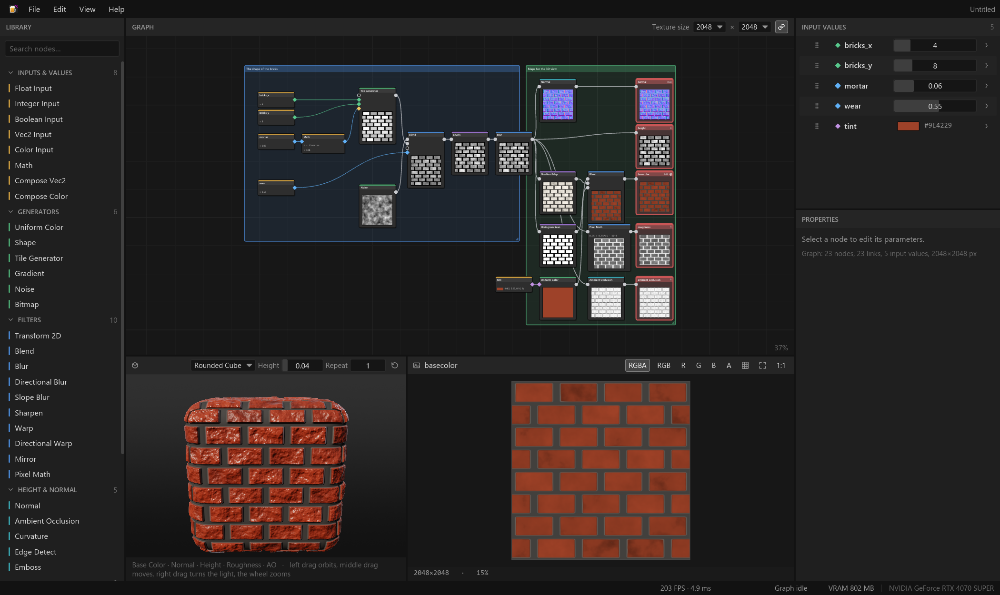

# Ferrotex

Нодовый процедурный редактор текстур в духе Substance Designer.
Rust · **wgpu** (все ноды считаются compute-шейдерами на GPU) · **egui** · **SIMD + многопоточность** (`wide` + `rayon`) для CPU-части.



## Запуск

```bash
cargo run --release
```

Нужен GPU с Vulkan / DX12 / Metal. В `.cargo/config.toml` включён `target-cpu=native`, чтобы SIMD-ядра собирались под AVX2 вашего процессора. Если бинарник нужно переносить на другие машины, эту строку стоит убрать.

При старте открывается демо-граф «кирпичная стена»: входы графа → Math → exposed-параметры, Tile Generator, повёрнутый Transform 2D шум, Blend, Levels, Blur, Gradient Map, Normal, Pixel Math и четыре Output (basecolor, normal, height, roughness).

## Интерфейс

```
column {
    библиотека нод            (слева, drag-n-drop на граф или двойной клик)
    row {
        граф                  (бесконечная плоскость; сверху меню и размер текстуры, по умолчанию 2048×2048)
        2D-превью             (результат ноды, по которой дважды кликнули)
    }
    панель свойств {          (справа, граница между частями перетаскивается по вертикали)
        Input Values графа
        свойства выделенной ноды
    }
}
```

### Граф
- колесо: зум к курсору; средняя/правая кнопка или Alt+ЛКМ: панорама;
- перетаскивание из сокета соединяет; если отпустить на пустом месте, откроется поиск ноды, и новая нода сразу подключится;
- перетаскивание подключённого входа переподключает или удаляет связь;
- типы сокетов: круг — изображение, ромб — значение (цвет по типу: Float, Integer, Boolean, Vec2, Color). Несовместимые соединения (например Image → Float) отклоняются с сообщением; числа конвертируются между собой, а скаляр растягивается в Vec2 или Color;
- Space или двойной клик: поиск ноды; Del: удалить; Ctrl+C/X/V: копировать, вырезать, вставить (через системный буфер); Ctrl+D: дублировать; Ctrl+A: выделить всё; F: показать всё или выделенное; box-select ЛКМ по пустому месту;
- Ctrl+Z / Ctrl+Y: undo/redo; Ctrl+S / Ctrl+O / Ctrl+N: файл; Ctrl+E: экспорт всех Output в PNG; F1: список клавиш.

### 2D-превью
Каналы RGBA/RGB/R/G/B/A, режим «Tiling» (повтор 3×3 по тайлингу ноды), пипетка значений пикселя, 1:1 и Fit. У Transform 2D есть гизмо: центр двигает, кольцо вращает, углы и рёбра масштабируют; с Shift — шаг 15° и равномерный масштаб.

## Ноды

| Категория | Ноды |
|---|---|
| Inputs & Values | Float / Integer / Boolean / Vec2 / Color Input, **Math**, Compose Vec2, Compose Color |
| Generators | Uniform Color, **Shape** (14 фигур и профилей), **Tile Generator**, Gradient, Noise (Perlin/Value fBm, Ridged, Cells, Cell Edges, White), Bitmap |
| Filters | **Transform 2D**, **Blend** (19 режимов), **Blur**, **Sharpen**, Warp, Mirror, Normal, Pixel Math |
| Adjustments | **Levels** (с гистограммой), Invert, Grayscale, HSL, Gradient Map, Channel Shuffle, Posterize |
| Output | **Output**: имя и формат RGBA/RGB/RG/R/G/B/A, 8 или 16 бит |

Общее для всех нод:
- **Тайлинг**: No tiling / Horizontal / Vertical / H and V. На тайлящихся осях выборка заворачивается через край, генераторы получаются бесшовными, Transform 2D повторяет картинку. У value-нод параметр показан, но отключён: они выдают числа, а не изображения.
- **Expose**: у каждого параметра есть переключатель-сокет. Exposed-параметр получает вход слева на ноде, и туда можно подключить значение другой ноды (Input, Math, Compose…). Enum-параметры управляются целым числом.

### Input Values
Входы графа типов Float, Integer, Boolean, Vec2 и Color. У каждого есть имя, значение, **значение по умолчанию, min и max** (для числовых типов), а также описание. Вход можно перетащить из панели на граф: появится нода Input.

### Math
Свойство ноды — строка с выражением, например `(1+x)*sin(myVar)-2.4/cos(myVar2)`. Каждое слово, которое не является функцией или константой, становится входом ноды (`x`, `myVar`, `myVar2`).
- операторы `+ - * / % ^` (или `**`), сравнения, `&& || !`, `cond ? a : b`, неявное умножение `2x`, `3(a+b)`;
- функции: `sin cos tan asin acos atan atan2 sinh cosh tanh sqrt cbrt exp exp2 ln log log2 log10 pow abs sign floor ceil round trunc fract min max clamp saturate lerp/mix step smoothstep mod hypot degrees radians if hash`; константы `pi tau e phi true false`;
- ошибки не роняют программу: нода подсвечивается, в свойствах пишется, что выражение некорректно и что именно не так (с подчёркиванием места ошибки и подсказками вроде «Did you mean 'sin'?»). Пока выражение набирается, сокеты не пропадают;
- неподключённая переменная берёт своё локальное значение или, если включён auto-bind, значение входа графа с тем же именем;
- в свойствах есть подсветка синтаксиса, таблица переменных, справочник функций и график f(x).

**Pixel Math** — то же выражение, но оно компилируется в WGSL и считается для каждого пикселя. Переменные в нём — изображения, встроенные переменные: `u v px py width height`.

## Архитектура

| Модуль | Что внутри |
|---|---|
| `graph` | документ: ноды, типизированные сокеты, связи, проверка циклов, топосортировка, copy/paste, serde |
| `expr` | лексер → Pratt-парсер → AST → свёртка констант → вычислитель и кодоген в WGSL |
| `engine` | инкрементальное вычисление: у каждой ноды есть ключ (хэш типа, эффективных параметров, разрешения и версий входов), пересчитываются только изменившиеся ноды, вся работа кадра пишется в один command encoder |
| `gpu` + `shaders/*.wgsl` | wgpu: ленивая компиляция ядер с перехватом ошибок (error scopes), пул текстур, readback |
| `simd` | `wide::f32x8` + `rayon`: квантование 8/16 бит при экспорте, f16↔f32, гистограммы и статистика для Levels, конвертация битмапов при загрузке |
| `ui` | холст графа, библиотека, панели, 2D-превью с гизмо |

Изображения хранятся как `rgba16float`. Blur считается сепарабельным гауссом, а для больших радиусов — через пирамиду с понижением разрешения, так что время не зависит от радиуса. Параметры вида «px @1K» не зависят от разрешения.

## Проверка

```bash
cargo test                                            # 45 тестов, включая GPU-тесты значений пикселей
cargo run --release -- --ui-test                      # автопилот UI: 31 сценарий с синтетической мышью и клавиатурой
cargo run --release -- --bench                        # замеры GPU и SIMD
cargo run --release -- --contact-sheet sheet.png      # все ядра в одной картинке
```

Замеры (`--bench`) на RTX 4070 SUPER и Ryzen 5 5600, демо-граф 2048×2048:

| | время |
|---|---|
| изменение слайдера (пересчёт 11 нод) | 2.3 ms |
| полный пересчёт всех нод | 29 ms |
| кадр без изменений | 0.09 ms |
| квантование f32→u8, SIMD+потоки против скаляра | 2.5 ms против 12.9 ms (×5.2) |
| гистограмма + min/max/mean | 2.5 ms против 24.3 ms (×9.8) |
