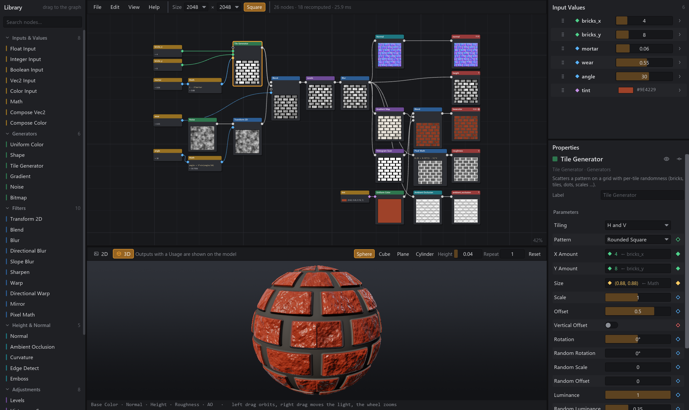

# Tessera

Нодовый процедурный редактор текстур в духе Substance Designer.
Rust · **wgpu** (ноды считаются compute-шейдерами на GPU) · **iced** (интерфейс) · **SIMD + многопоточность** (`wide` + `rayon`) для CPU-части.


## Запуск

```bash
cargo run --release
```

Нужен GPU с Vulkan, DX12 или Metal. В `.cargo/config.toml` включён `target-cpu=native`, чтобы SIMD-ядра собирались под AVX2 вашего процессора. Если бинарник нужно переносить на другие машины, эту строку стоит убрать.

При старте открывается демо-граф «кирпичная стена»: шесть Input Values (`bricks_x`, `bricks_y`, `mortar`, `wear`, `angle`, `tint`), Tile Generator, шум под Transform 2D, Blend, Levels, Blur, Gradient Map, Histogram Scan, Normal, Ambient Occlusion, Pixel Math и пять Output с назначением (Base Color, Normal, Height, Roughness, AO). Их сразу видно на 3D-модели.

## Интерфейс

```
библиотека │ меню · размер текстуры (по умолчанию 2048×2048) │ Input Values
нод        │ граф                                             │
           ├──────────────────────────────────────────────────┤ свойства
           │ 2D / 3D                                          │ выделенной ноды
```

Все границы между панелями перетаскиваются; View → Reset layout возвращает исходную раскладку.

### Граф
- колесо: зум к курсору; средняя кнопка, правая кнопка или Alt+ЛКМ: панорама; ПКМ: контекстное меню;
- перетаскивание из сокета соединяет; если отпустить на пустом месте, откроется поиск, и новая нода сразу подключится (в списке остаются только подходящие ноды);
- перетаскивание подключённого входа переподключает или удаляет связь;
- сокеты типизированы: круг — изображение, ромб — значение (цвет по типу: Float, Integer, Boolean, Vec2, Color). Несовместимые соединения и циклы отклоняются с сообщением; числа конвертируются между собой, скаляр растягивается в Vec2 или Color;
- Space или двойной клик по пустому месту: поиск ноды (↑↓, Enter); Del: удалить; Ctrl+C/X/V, Ctrl+D, Ctrl+A; F: показать всё или выделенное; Ctrl+B: bypass;
- Ctrl+Z / Ctrl+Y: undo/redo (перетаскивание слайдера или набор текста — один шаг); Ctrl+S, Ctrl+O, Ctrl+N; Ctrl+E: экспорт всех Output; F1: все клавиши;
- файл, брошенный на окно: `.tessera` открывается, картинка становится нодой Bitmap.

### 2D и 3D
- **2D**: каналы RGBA/RGB/R/G/B/A, повтор 3×3 по тайлингу ноды, пипетка значений пикселя, 1:1 и Fit. У Transform 2D есть гизмо: центр двигает, кольцо вращает, ручки масштабируют; с Shift — шаг 15° и сохранение пропорций. Exposed-параметры гизмо не меняет.
- **3D**: сфера, куб, плоскость или цилиндр с PBR-освещением. Карты берутся из Output по их Usage (Base Color, Normal, Height, Roughness, Metallic, AO, Emissive), Height смещает вершины. ЛКМ вращает камеру, ПКМ — свет, колесо — зум.



### Параметры и expose
У каждого параметра справа есть ромб expose. Exposed-параметр получает сокет на ноде и сразу блокируется: вместо редактора показывается значение, пришедшее в сокет (с именем ноды-источника, клик по нему выделяет её), или предупреждение, что сокет не подключён. Параметр, скрытый условием (например, Corner Radius, пока у Shape выбрана не Rounded Square), сокета не имеет; связь при этом сохраняется и вернётся, когда параметр снова станет видимым. Тайлинг не экспонируется.

Числовые поля: перетаскивание меняет значение (Shift — точнее, Ctrl — с шагом), клик — ввод с клавиатуры, можно писать выражения вроде `2*pi`.

### Input Values
Работают как параметры материала в Unreal. Переменная графа появляется вместе с нодой Input (Float, Integer, Boolean, Vec2, Color) и определяется своим именем: несколько нод Input с одним именем читают одну переменную, а когда удалена последняя такая нода, переменная исчезает. У каждой переменной в панели есть значение, описание, значение по умолчанию, min/max, «Reset to default» и «Set as default». Строку можно перетащить на граф: появится ещё одна нода Input.

### Math
Свойство ноды — строка с выражением, например `(1+x)*sin(myVar)-2.4/cos(myVar2)`. Каждое слово, которое не является функцией или константой, становится входом ноды.
- операторы `+ - * / % ^` (или `**`), сравнения, `&& || !`, `cond ? a : b`, неявное умножение `2x`, `3(a+b)`;
- функции `sin cos tan asin acos atan atan2 sinh cosh tanh sqrt cbrt exp exp2 ln log log2 log10 pow abs sign floor ceil round trunc fract min max clamp saturate lerp/mix step smoothstep mod hypot degrees radians if hash`, константы `pi tau e phi true false`;
- ошибки не роняют программу: нода подсвечивается, в свойствах подчёркнуто место ошибки и написано, что не так (с подсказками вроде «Did you mean 'sin'?»). Редактор при этом не теряет фокус, а сокеты не пропадают, пока выражение набирается;
- неподключённая переменная берёт своё локальное значение или, если включён Auto-bind, значение Input Value с тем же именем;
- в свойствах есть подсветка синтаксиса, таблица переменных, график f(x) и справочник функций.

**Pixel Math** — то же выражение, но оно компилируется в WGSL и считается для каждого пикселя: переменные — изображения, встроенные переменные — `u v px py width height`.

### Gradient Map
Градиент с любым числом точек (до 64): клик по полосе добавляет точку, ручки перетаскиваются, если утащить ручку вниз, точка удаляется; интерполяция Linear, Smooth или Constant; есть реверс и равномерное распределение. «Pick from 2D view»: протяните линию по картинке в 2D-виде (двойным кликом можно показать другую ноду, например Bitmap с фотографией), и цвета вдоль линии станут градиентом из небольшого числа точек.

### Файлы и экспорт
Проект сохраняется в `.tessera` (JSON). При закрытии, открытии или создании графа с несохранёнными изменениями программа спросит, сохранить ли их. Файлы прежней версии (`.ftx`) открываются и конвертируются; сохраняются они новым файлом `.tessera`, оригинал не перезаписывается. Output экспортируется в PNG 8/16 бит или EXR 32 бит float, в формате RGBA/RGB/RG/R/G/B/A; Ctrl+E сохраняет все Output в выбранную папку под их именами.

## Ноды

| Категория | Ноды |
|---|---|
| Inputs & Values | Float / Integer / Boolean / Vec2 / Color Input, **Math**, Compose Vec2, Compose Color |
| Generators | Uniform Color, **Shape** (14 фигур и профилей), **Tile Generator** (смещение рядов или столбцов), Gradient, Noise (Perlin и Value fBm, Ridged, Cells, Cell Edges, White), Bitmap |
| Filters | **Transform 2D**, **Blend** (19 режимов, маска), **Blur**, Directional Blur, Slope Blur, **Sharpen**, Warp, Directional Warp, Mirror, Pixel Math |
| Height & Normal | Normal, Ambient Occlusion, Curvature, Edge Detect, Emboss |
| Adjustments | **Levels** (гистограмма, Auto levels), Histogram Scan, Invert, Grayscale, HSL, **Gradient Map**, Channel Shuffle, Posterize |
| Output | **Output**: имя, формат RGBA/RGB/RG/R/G/B/A, 8/16/32 бит, назначение для 3D |

У всех нод есть **тайлинг** (No tiling / Horizontal / Vertical / H and V): на тайлящихся осях выборка заворачивается через край, и генераторы получаются бесшовными. У value-нод параметр показан, но отключён. Ноду с входом можно временно выключить (**bypass**, Ctrl+B): она передаст первый вход дальше без изменений.

## Архитектура

Три крейта, зависимости идут только вниз:

| Крейт | Что внутри | Зависит от |
|---|---|---|
| `tessera-core` | модель: реестр нод (`NodeDef`), граф, типы сокетов, переменные, выражения (лексер → Pratt-парсер → AST → свёртка констант → вычислитель и кодоген WGSL), вычисление значений на CPU, команды `Edit`, документ с undo, файлы проекта | serde, log |
| `tessera-engine` | GPU: ядра на wgpu с перехватом ошибок, инкрементальный пересчёт (у ноды есть хэш типа, эффективных параметров, разрешения и версий входов), SIMD-код, экспорт, поток-сервис с запросами и событиями | core, wgpu |
| `tessera` | интерфейс на iced | core, engine, iced |

Интерфейс ничего не меняет сам. Каждое действие пользователя становится сообщением, `App::update` превращает его в команду `Edit`, а `Document` применяет её: проверяет, записывает шаг undo (или объединяет его с предыдущим) и отмечает документ изменённым. Потом граф вычисляется на CPU и уходит в поток движка. Движок отвечает событиями (изображения, миниатюры, статистика), они приходят в интерфейс через подписку. 2D- и 3D-вид рисуют текстуры движка прямо на GPU, без копирования через CPU: iced и движок работают на одном устройстве wgpu.

Изображения хранятся как `rgba16float`. Blur считается сепарабельным гауссом, для больших радиусов — через пирамиду, так что время не зависит от радиуса. Параметры вида «px @1K» не зависят от разрешения.

### Как добавить ноду

1. `tessera-core/src/nodes/<категория>.rs`: описать `NodeDef` — id, имя, категорию, описание, сокеты и параметры (`float`, `int`, `choice`, `color`, `gradient`…, с диапазонами, подсказками и условиями видимости `.when(…)`).
2. `tessera-core/src/nodes/mod.rs`: константа `NodeKind` и строка в `NodeKind::ALL`.
3. `tessera-engine`: шейдер в `src/gpu/shaders/`, строка `kernel!(…)` в `src/gpu/mod.rs` и функция в `src/kernels.rs`, которая передаёт параметры шейдеру; её нужно вписать в `kernel_for`.

Интерфейс менять не нужно: библиотека, поиск, свойства, сокеты, expose, undo, сохранение и экспорт строятся по описанию ноды. Тесты `every_image_node_has_a_kernel` и `every_image_node_runs_with_defaults_in_every_tiling_mode` проверяют, что ничего не забыто.

## Проверка

```bash
cargo test --workspace                                            # 86 тестов
cargo run --release -- --bench                                    # замеры GPU и SIMD
cargo run --release -- --contact-sheet sheet.png                  # все ядра на одной картинке
cargo run --release -- --screenshot ui.png --scenario gradient    # снимок интерфейса (список сценариев: --help)
```

Тесты покрывают модель, GPU-ядра (по значениям пикселей) и интерфейс. UI-тесты строят настоящие панели без окна и подают им события мыши и клавиатуры: например, проверяют, что редактор Math не теряет фокус, пока выражение становится то ошибочным, то верным, и что ноду можно перетащить из библиотеки на граф.

Замеры (`--bench`) на RTX 4070 SUPER и Ryzen 5 5600, демо-граф 2048×2048 (18 нод с изображениями):

| | время |
|---|---|
| изменение слайдера (`mortar`, пересчёт 15 нод) | 6.3 ms |
| полный пересчёт всех нод | 49 ms |
| кадр без изменений | 0.1 ms |
| миниатюры всех нод | 4.4 ms |
| квантование f32→u8, SIMD+потоки против скаляра | 2.1 ms против 13.4 ms (×6.3) |
| гистограмма + min/max/mean | 2.4 ms против 23.9 ms (×9.8) |
