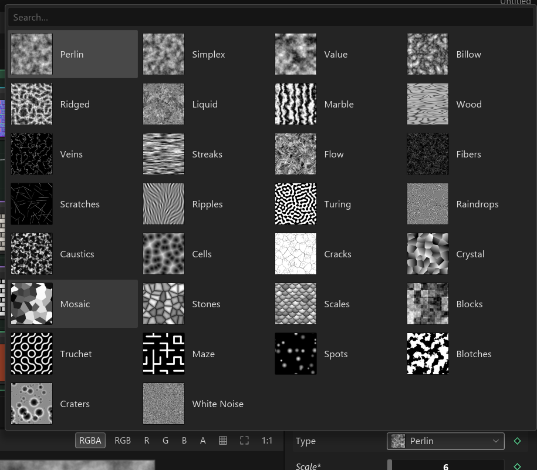

# Brewed Texture Designer

Нодовый процедурный редактор текстур в духе Substance Designer — первая программа семейства Brewed.
Rust · **wgpu** (ноды рисуются на GPU шейдерами WGSL) · **iced** (интерфейс) · **SIMD + многопоточность** (`wide` + `rayon`) для CPU-части.


## Запуск

```bash
cargo run --release
```

Работает на Windows, Linux (X11 и Wayland) и macOS; кроме Rust для сборки ничего не нужно — системные библиотеки (X11, Wayland, PipeWire) подгружаются во время работы и только если понадобятся.

Нужен GPU с Vulkan, DX12 или Metal и процессор с AVX2 (Intel Core с 2013 года, Haswell; AMD с 2015-го) или Apple Silicon (M1 и новее). Под них программа и собирается (`.cargo/config.toml`: `x86-64-v3` и `apple-m1`), на какой бы машине её ни собирали, — а не под «всё, что есть у машины сборки» (`native`: собранное на Ryzen использовало бы SHA-инструкции, которых нет у Intel Core 6–10 поколений, и падало бы там). SIMD-ядра от этого не медленнее (`--bench`). На процессоре без AVX2 программа сразу говорит об этом, а не падает молча.

**Главный экран.** Как у программ Adobe: запущенная без файлов программа открывается на нём, а не на демо. Он живёт в отдельном крейте `home-screen`, который ничего не знает о программе: программа передаёт ему, что показать (имя и логотип, шаблоны, недавние файлы, уроки, ресурсы), и получает, что выбрано. Так тот же экран встаёт в любую программу набора. Слева сверху **New Package…** и **Open…**, под разделителем страницы **Home** и **Learn** (выбранная темнее, белым полужирным), **Back to …**, если в редакторе уже что-то открыто, а внизу, под своим заголовком, **Resources**: Shortcuts, Settings, Third-Party Notices, о программе; сайта, документации, форума и ресурсов сообщества пока нет, они помечены «later». **Home**: приветствие, строка **Start from a template** (по шаблону каждого рода — Base, Studio, Convolution, Noise, Metallic Roughness, Empty — теми же карточками, что в окне нового графа, с картинкой, категорией и (i); шаблон одним щелчком создаёт пакет с размером и точностью из настроек, последняя карточка **More templates…** открывает окно нового графа со всеми шаблонами) и **Recent**: недавно открытые пакеты (столько, сколько предлагает File → Open Recent Package) карточками или списком (переключатель справа). В карточке картинка пакета, имя, папка, когда открывался и сколько весит; в списке колонки Name, Opened, Modified, Size, Location, щелчок по заголовку сортирует, повторный — в обратную сторону. Вид и сортировка запоминаются. Картинка пакета делается при сохранении и лежит в самом файле пакета (`thumbnail.png`): модель 3D-вида в картах материала пакета — с начальной камеры, в студийном свете, как бы ни был повёрнут, сдвинут или приближен вид в этот момент (форма модели, высота и повтор — те, что выбраны); если у графа нет выходов с назначением — миниатюра первого выхода. Картинка — не часть пакета: сохранение, в котором поменялась только она (или вид), новой версией в истории не становится. Файл, которого больше нет, так и подписан. Щелчок открывает пакет, как и файл, брошенный на окно. **Learn** открывает примеры как отдельные пакеты: кирпичную стену (демо), пять программ FX-Map и Pixel Math с векторами; у каждого картинка его модели, а в каждом графе примера рамка объясняет абзацем, что делают ноды внутри и что получается на выходе. Вернуться на главный экран — File → Home Screen или щелчок по логотипу в строке меню; Esc возвращает к открытому. Пока показан главный экран, клавиши редактора не действуют на то, что за ним, кроме New, Open, Settings и Help, а движок уже запущен: About сразу называет видеокарту. Созданный или открытый пакет встаёт на место пустого безымянного, с которым программа стартовала, а не рядом с ним.

**Шрифт.** Интерфейс рисуется шрифтом Inter (SIL Open Font License, файлы в `crates/brewed-texture-designer/assets/fonts`) на всех системах одинаково: у системных шрифтов на Windows, Linux и macOS разные метрики и начертания, а полужирный Segoe UI в мелком тексте почти не отличался от обычного. Inter — вариативный шрифт: полужирный и жирный у него настоящие, как и курсив изменённых параметров.

**Новый граф из шаблона.** File → New Graph… (Ctrl+N), New Graph… на главном экране и «+» в Explorer открывают окно, как «New Substance Graph» в Substance Designer. Слева, на тёмном фоне, шаблоны Substance Designer 16 с его же названиями и выходами — те, что имеют смысл здесь: без шаблонов, которые работают лишь внутри чужих программ или читают чужие форматы (фильтры Painter и Sampler, AxF, CLO), и без Adobe Standard Material — у Adobe это своя модель, которую она с Autodesk сама заменила открытым стандартом OpenPBR. **OpenPBR** — Base, Anisotropy, Coat, Subsurface, Fuzz и Complete: выходы названы, как параметры стандарта (base_color, base_metalness, specular_roughness, height, normal, ambient_occlusion, а у слоёв — coat_weight, fuzz_color и так далее, у Complete все 43), и у каждого Usage своего параметра (Coat Weight, Fuzz Color, Specular IOR …), как в шаблонах Substance Designer; на каждый подан Uniform Color, который нужно заменить своим графом. Значения — как в шаблонах Substance Designer, но такие, чтобы слой был виден и узнаваем: Anisotropy — шлифованный металл с вертикальными бликами (касательная вверх по текстуре, анизотропия 0,7 — блик вытянут, но не в нитку, которая на сфере выглядит швом), Coat — красный металл под прозрачным лаком, Subsurface — кожа (цвет кожи, свет под ней уходит тем дальше, чем краснее), Fuzz — тонкий белый пушок над тёмно-бирюзовой основой, как у персика или киви (вес 0,35, шероховатость 0,6), у Complete — значения стандарта по умолчанию (все слои, кроме основы, выключены); то, что бывает больше 1 (IOR, глубина, яркость в нитах, число Аббе) или меньше 0 (анизотропия рассеяния, от −1 до 1), Output пишет во float, иначе 8 бит держали бы его между 0 и 1. 3D-вид показывает все слои. **HDRi** — Studio: окружение в виде панорамы (квадратной, как в Substance Designer: 3D-вид читает её поперёк один оборот и сверху вниз от зенита до надира, какой бы формы она ни была) в 32-битном float, собранное, как шаблон Substance Designer, из нод HDRI Tools: Gradient Linear (HDRI) даёт серый цвет комнаты, Shape Light — софтбокс над головой с хотспотом, Line Light — косую лампу-трубку справа, Plane Light — большую панель сзади (она заходит за шов, поэтому видна у обоих краёв панорамы); свет ярче белого. Usage у Output — Panorama; 3D-вид освещается ею, только если это попросить на самой ноде Output (переключатель «Light the 3D view with this panorama») или в меню освещения, а экспорт в EXR даёт её для других программ. Выбор этого шаблона сам ставит квадратный размер и 32 бита, а другой шаблон возвращает прежние. **Pixel Processor** — Convolution: серое изображение размывается тем сильнее, чем светлее карта amount (Pixel Math читает его вокруг каждого пикселя). **FX-Map** — Grid (координатная сетка: квадраты x_amount × y_amount на глубинах FX-Map от 0 до 2, мелкие поверх крупных, складываются в линии с делениями между ними) и Noise (шум из сплатов на всех глубинах). **Scan Processing** — Metallic Roughness: материал из скана; цвет, нормали и высота — входы-картинки графа, Make It Tile делает каждую тайлящейся, цвет делится на размытый свет, при котором снимали, шероховатость берётся из цвета, металла в скане нет. **Filters** — Grayscale и Color Filter: вход-картинка графа и выход, граф-нода фильтрует то, что к ней подключено. **Others** — Empty. В каждом шаблоне рамка с описанием объясняет, что в нём и что заменить. Шаблоны показаны карточками — те же карточки, что в строке главного экрана (они в крейте `home-screen`): квадратная картинка, название и категория (или списком — переключатель над ними). Картинки — настоящие рендеры: материалы — на сфере в 3D-виде, в свете тёмной студии с одним софтбоксом слева (половина сферы в свету, половина в тени; лак и металл отражают софтбокс и темноту вокруг, а не светлое небо, в котором край лака светился, как ворс; к софтбоксу добавлен ключевой свет студии оттуда же — от него вытянутый блик анизотропии и блеск ворса): Base — белый пластик, Anisotropy — вертикальный размытый блик шлифованного металла, Coat — отражение софтбокса в лаке над красным металлом, Subsurface — кожа с красноватым терминатором, Fuzz — лёгкая светлая дымка пушка, Complete — все четыре сеткой 2 × 2. HDRi — значок HDR: рамка и буквы HDRI (`assets/templates/studio-panorama.svg`). Grid — то, что шаблон выдаёт: координатная сетка. Convolution — та же сетка, размытая шаблоном тем сильнее, чем правее (карта amount — градиент). Scan Processing — «до и после»: слева фото камня, освещённое неровно, справа материал, который шаблон из него делает, на сфере. Grayscale и Color Filter — слева цветная картинка, справа она же серой и тонированной. Noise — сам шум, Empty — сетка графа. У каждой карточки кружок (i): наведёшь — рядом появляется карточка с названием, типом (Standard material, Environment light, Filter, Generator), описанием и списком выходов; она не пропадает, пока курсор на кружке или на ней самой, и уходит не сразу, а через мгновение. Справа — **Create graph in** (новый пакет, по умолчанию, или один из открытых), имя графа, размер — ширина и высота отдельно, а кнопка-цепочка между ними связывает их, — и точность (по умолчанию из настроек). Созданный в открытом пакете граф — один шаг undo. Окно запоминает последний шаблон и вид.

**Картинка пакета.** При сохранении пакет получает картинку — миниатюру первого Output редактируемого графа (или ноды, которую показывает 2D-вид), PNG 128×128 в `thumbnail.png` внутри файла. Её показывает главный экран, читая из файла только эту запись. У пакета, сохранённого без правки его графа, остаётся та картинка, которая у него была.

При старте с файлом, а также для скриншотов и автопилота открывается демо-граф «кирпичная стена»: пять Input Values (`bricks_x`, `bricks_y`, `mortar`, `wear`, `tint`), Tile Generator, Noise, Blend, Levels, Blur, Gradient Map, Histogram Scan, Normal, Ambient Occlusion, Pixel Math и пять Output с назначением (Base Color, Normal, Height, Roughness, AO). Их сразу видно на 3D-модели. Две рамки-комментария показывают, где в графе форма кирпичей, а где карты для 3D, и объясняют, что делает каждая нода. Все изображения демо тайлятся без шва — это проверяет тест.

## Интерфейс

```
меню: File · Edit · View · Help                                     пакет — граф
───────────┬─────────────────────────────────────────────┬────────────────────────────
Explorer:  │ граф       размер текстуры (по умолч. 2048²) │ Input Values
пакеты,    │                                             ├────────────────────────────
графы,     ├──────────────────────┬──────────────────────┤ свойства выделенной ноды
файлы      │ 3D: FPS, модель      │ 2D: изображение      │
───────────┤                      │                      │
библиотека │                      │                      │
нод        │                      │                      │
───────────┴──────────────────────┴──────────────────────┴────────────────────────────
строка состояния: сообщение, если оно есть          ноды · VRAM · GPU
```

Все границы между панелями перетаскиваются, и программа помнит их: раскладка, размер окна, развёрнуто ли оно на весь экран, режим Real-time Rendering и освещение 3D-вида (окружение, последние картинки, экспозиция, фон) сохраняются при выходе в папку настроек (`%APPDATA%\Brewed Texture Designer`, `~/Library/Application Support/Brewed Texture Designer`, `~/.config/brewed-texture-designer`) и возвращаются при следующем запуске. View → Reset Panel Layout возвращает исходную раскладку. Когда открыто одно меню, наведение на другое переключает его. Окно не бывает больше, чем может нарисовать видеокарта (8192 пикселя по стороне): Windows растягивает окно, переезжающее на экран с бо́льшим масштабом (на телевизор с 300 % — в 2,4 раза), и раньше окно шире 8192 пикселей оставалось пустым навсегда, даже когда его возвращали: iced хранил текстуру для такого размера, которую нельзя создать. Теперь такой размер удерживается до того, как его кто-то увидит (на Windows — подклассом окна, перехватывающим каждое изменение размера; на остальных системах — максимальным размером окна).

Окно не мелькает белым ни при открытии, ни при закрытии: на Windows оно открывается скрытым от экрана (DWM cloaking) и показывается, только когда нарисован первый кадр, а при выходе сначала прячется, потом закрывается.

Строка состояния слева показывает сообщения («Saved …», ошибки) и несколько секунд спустя пустеет. Справа, вплотную и без пустых полей, — что происходит прямо сейчас, за последнюю секунду; старше секунды там ничего не бывает:
- **`23 nodes · 10 recomputed · 7.7 ms`** — сколько нод в графе, сколько из них пересчитало последнее изменение (только те, которых оно коснулось) и сколько в среднем занимают изменения последней секунды: от изменения до момента, когда GPU закончил изображения, миниатюры и 2D/3D. Если за секунду ничего не менялось — `0 recomputed · 0.0 ms`; изменение, которое считается дольше четверти секунды, видно сразу: `computing… 1.2 s`;
- **`VRAM 64 MB`** — сколько видеопамяти занимают изображения; в подсказке — на что именно: что показывают виды, что держится для следующего изменения, рабочие текстуры, файлы (ниже о том, как её мало).

Сколько кадров рисует 3D-вид, он пишет в своей панели: **`144 FPS · 6.9 ms`** — кадры за последнюю секунду и средняя длительность кадра (в подсказке — самый долгий). Считает сам 3D-вид. Он рисует кадр за кадром, как 3D-движок, а View → Real-time Rendering переключает его на отрисовку только при изменениях (тогда без изменений будет `0 FPS`). Граф хранит нарисованное на GPU и перерисовывается, только когда в нём что-то поменялось, поэтому кадр интерфейса стоит на CPU около 0,05 мс.

### Граф
- колесо: зум к курсору; средняя кнопка, правая кнопка или Alt+ЛКМ: панорама; ПКМ: контекстное меню;
- перетаскивание из сокета соединяет; если отпустить на пустом месте, откроется поиск, и новая нода сразу подключится (в списке остаются только подходящие ноды);
- перетаскивание подключённого входа переносит связь (один шаг undo) или, если отпустить на пустом месте, удаляет её; если отпустить на неподходящем сокете, связь остаётся где была;
- сокеты типизированы: круг — изображение, ромб — значение (цвет по типу: Float, Integer, Boolean, Vec2, Color). Несовместимые соединения и циклы отклоняются с сообщением; пока связь тянется, крупнее видны только сокеты, куда её можно бросить (то, что дало бы цикл, находится один раз за кадр: на цепочке из 200 нод — за 0,05 мс, а не за 1,4 с, как раньше); числа конвертируются между собой, скаляр растягивается в Vec2 или Color;
- Space или двойной клик по пустому месту: поиск ноды (↑↓, Enter); Del: удалить; Ctrl+C/X/V, Ctrl+D, Ctrl+A; F: показать всё или выделенное; Ctrl+B: bypass; C: обвести выделенное комментарием (здесь и ниже — клавиши по умолчанию: их можно переназначить в Settings → Shortcuts);
- у ноды сверху полоса цвета её категории, у Output-нод весь заголовок в их цвете: конец графа виден сразу;
- **комментарии** — рамка вокруг группы нод, как в Unreal или Substance Designer: C создаёт её вокруг выделенного, за заголовок она двигается вместе с нодами внутри, за правый нижний угол меняет размер, двойной клик по заголовку ставит курсор в её текст, а ПКМ — «Color…» (любой цвет, той же палитрой, что и остальные цвета) и удаление. Кроме заголовка у рамки есть описание, как Description у Frame в SD: абзац под заголовком, перенесённый по ширине рамки и обрезанный по её краю; он пишется в свойствах рамки многострочным полем, и всё набранное — один шаг undo. Заголовок читается и на общем виде графа (он крупнее текста нод, насколько вмещает полоса), описание — когда граф приближен;
- Ctrl+Z / Ctrl+Y: undo/redo (перетаскивание слайдера или набор текста — один шаг; шаг, который уводит в другой граф, открывает его таким, каким он был — с тем же сдвигом и масштабом); Ctrl+S, Ctrl+O, Ctrl+N (новый пакет); Ctrl+G: выделенные ноды — в отдельный граф; Ctrl+E: окно экспорта; F1: все клавиши;
- сочетания привязаны к клавишам, а не к буквам, которые те печатают: Ctrl+Z работает и на русской раскладке (клавиша «я»), и на греческой, и на любой другой — на всех трёх системах. На раскладках, которые двигают латиницу (AZERTY, QWERTZ), сочетание остаётся на клавише с нужной буквой;
- файл, брошенный на окно: пакет (`.brewtex`) открывается в Explorer, картинка становится нодой Bitmap, векторная графика и шрифты подключаются к пакету.

### 2D и 3D

Оба вида видны сразу, как в Substance Designer: слева модель, справа изображение. Границу между ними можно двигать.

- **2D**: каналы RGBA/RGB/R/G/B/A, пипетка значений пикселя, 1:1 и Fit. У Transform 2D есть гизмо: центр двигает, кольцо вращает, ручки масштабируют; с Shift — шаг 15° и сохранение пропорций. Exposed-параметры гизмо не меняет. У нод HDRI Tools, как в Substance Designer, — точки, которые перетаскивают мышью прямо по панораме: у Gradient Linear (HDRI) — точка, где верхний цвет, у Shape Light и Plane Light — где свет, у Line Light — две точки, начало и конец лампы; с Shift точка идёт вдоль одной оси, за краем панорамы она выходит с другой стороны, exposed-точка стоит на месте. В свойствах те же значения можно ввести числами.
- **Тайлинг** (кнопка с сеткой): изображение повторяется бесконечно по всему виду, все копии одинаковые. Повтор идёт по тому, как нода читает вход: у Transform 2D — вдоль осей гизмо, поэтому при повороте и уменьшении копии сходятся. Если целого повторения в изображении нет (например, поворот без уменьшения), вид показывает правду — само изображение встык с собой. Красная рамка отмечает ту копию, которая и есть текстура, и видна, только когда курсор на ней.
- **3D**: скруглённый куб (по умолчанию), сфера, **Matball** — шейдер-болл «Shader Ball JL 01» (автор Craneo, лицензия CC BY 4.0, см. Help → Third-Party Notices): шар из оболочек и колец на подставке с плоскими, вогнутыми, скруглёнными и мелкими деталями, чтобы видеть, как текстура ложится на разные поверхности (модель переведена из Blender — модификаторы применены, касательные MikkTSpace, поставлена вертикально и в размер других моделей, UV увеличены так, чтобы тайл ложился на неё, как на сферу; её собственные текстуры не используются), куб, скруглённый цилиндр, цилиндр, тор, плоскость или ткань в складках с PBR-освещением. Карты берутся из Output по их **Usage**, а Usage — как в Substance Designer: каждый параметр OpenPBR (Base Weight, Base Color, Metallic, Diffuse Roughness; Specular Weight, Color, Roughness, Anisotropy, IOR; Transmission Weight, Color, Depth, Scatter, Anisotropy, Dispersion Scale, Abbe Number; Subsurface Weight, Color, Radius, Radius Scale, Anisotropy; Coat Weight, Color, Roughness, Anisotropy, IOR, Darkening, Normal, Tangent; Fuzz Weight, Color, Roughness; Emission Luminance и Color; Thin Film Weight, Thickness, IOR; Opacity, Thin Walled, Normal, Tangent, Ambient Occlusion, Height), карты прежних моделей материала (Diffuse, Specular, Glossiness, Specular Level, Displacement, Bump, Detail Normal, Anisotropy Angle, Mask, Ambient, Reflection, Refraction) и **Panorama** — окружение, которое освещает сцену; всего 57. Output с Usage Panorama освещает 3D-вид не сам по себе (делаемую панораму на фоне видеть никто не хочет), а когда это попросили: переключателем «Light the 3D view with this panorama» в свойствах этой ноды Output или пунктом меню освещения; окружение за моделью тоже показывается только по просьбе (Show It Behind the Model, по умолчанию выключено). Пока граф меняется, движок присылает его картинку уменьшенной (512 пикселей в ширину, чтобы свет успевал за правками), а когда всё затихло — целиком, и дальше она идёт тем же путём, что и HDR-файл (облучённость, размытые отражения, фон). В меню освещения она первая — «The Graph's Panorama: <имя выхода>»; выбор студии или картинки ставит их вместо неё, выбор панорамы возвращает её. Меню Usage — один список под заголовками групп (каждую группу можно свернуть и развернуть, по умолчанию развёрнуты все), с поиском (в том числе по именам Substance Designer: baseColor, metalness, sheenColor …) и подсказкой у каждого. 3D-вид рисует материал так, как его складывает OpenPBR, слой за слоем сверху вниз: ворс (fuzz: шин Чарли, видимость Ньюбельта — светится к краям и плавно гаснет к терминатору; в отражении окружения у него нет зеркального блика — волокна ловят свет вдоль поверхности), прозрачный лак (coat: свой GGX со своими шероховатостью, IOR, нормалью и касательной, анизотропия вытягивает и отражение окружения в нём; под ним основа темнее и насыщеннее, как мокрая, и окрашена его цветом по длине пути света в нём), основа — металл (Френель F82 с оттенком краёв из Specular Color) или диэлектрик, который отражает по своему IOR и весу, а под отражением — матовый цвет (Орен — Наяр, упрощённый Фуджи, по Diffuse Roughness), свет под поверхностью (subsurface: свет заворачивает за терминатор, каждый канал на свой радиус — красный дальше; Subsurface Anisotropy — куда свет рассеивается, по фазе Хеньи — Гринстейна: вперёд — уходит глубже и заворачивает дальше, а освещённое сзади светится насквозь, назад — заворачивает меньше и возвращается к свету) или свет насквозь (transmission: окружение, преломлённое по IOR, каждый цвет на свой угол по числу Аббе, окрашенное по глубине и мутное по Scatter; Transmission Anisotropy: рассеяние вперёд мутит меньше и несёт размытое то, что за стеклом, назад — молочнее, светом со стороны глаза; у Thin Walled — без преломления); тонкая плёнка (thin film: интерференция отражений сверху и снизу плёнки по её толщине и IOR — радужные переливы мыльного пузыря) окрашивает отражение основы; анизотропия вытягивает блик вдоль касательной (карта Tangent или Anisotropy Angle), и отражение окружения тоже — его читают в 16 точках вдоль касательной, с весом, который к концам спадает, — а не только сдвигают; свечение — Emission Color × Luminance (1000 нит светятся как сам цвет, а Emission Color без Luminance — как раньше Emissive); Opacity делает поверхность прозрачной (дальние грани рисуются, потом ближние поверх). Каждый слой освещают оба света студии и её небо или окружение (его облучённость и свет, размытый по шероховатости), взвешенные по тому, сколько света слой отражает (таблица GGX и ворса, посчитанная при запуске) и сколько пропускает к слоям под собой. Карт у материала может быть пятьдесят, а GPU, которым рисует iced, даёт шейдеру шестнадцать текстур: однородные карты (Uniform Color — картинка в один пиксель) GPU сам читает в строку значений, по пикселю на параметр; карты-картинки берут по текстуре, а если их больше одиннадцати, остальные копируются в слои ещё одной текстуры со своими mip-уровнями. Тест рендерит шаблоны без окна и проверяет, что каждый слой делает своё: лак даёт белые отражения над красным металлом, ворс светлит края, анизотропия вытягивает блик, подповерхностный свет краснит тень, плёнка добавляет цвета, Opacity, стекло, свечение и металл меняют картинку. Второй тест проходит все 57 Usage по одному: каждый, который 3D-вид показывает, меняет картинку сферы — вместе с тем, без чего его не видно (шероховатость лака — с лаком, цвет стекла — со стеклом, касательная — с анизотропией), а у анизотропии рассеяния и значения меньше 0; Mask, Ambient, Reflection, Refraction, Custom и Panorama (это не карта материала, она освещает вид, когда попросят) не меняют ничего, как и Diffuse при Base Color, Glossiness при Roughness, Specular Level при Specular Weight и Displacement при Height. Этот тест и нашёл, что две карты — Transmission Anisotropy и Subsurface Anisotropy — 3D-вид раньше принимал, но не показывал. Height смещает вершины. Если карты нормалей нет, освещение берёт нормаль той поверхности, которую делает смещение: она наклонена настолько, насколько поднимается высота (градиент высоты по поверхности, как у Микельсена), поэтому рельеф виден и на плоских гранях, а не только на силуэте скруглений. Освещение — студия (ключевой и заполняющий свет под небом; свет стоит на месте в сцене, а камера ходит вокруг, так что каждая грань освещена так, как она стоит к свету, — раньше свет поворачивался вместе с камерой и освещал любую грань, на которую смотришь; ПКМ или поля Turn и Height меню поворачивают его, ниже горизонта он не опускается) или **окружение** из HDR-картинки (`.hdr`, `.exr`): кнопка с солнцем открывает меню со студией, последними картинками и загрузкой новой, экспозицией в стопах (EV), поворотом и фоном — окружение показывается за моделью с нужным размытием. Выбор и последние картинки запоминаются между запусками. ЛКМ вращает камеру вокруг модели, средняя кнопка сдвигает камеру, ПКМ поворачивает свет (или окружение), колесо — зум.


### Параметры и expose
У каждого параметра справа есть ромб expose. Exposed-параметр получает сокет на ноде и сразу блокируется: вместо редактора показывается значение, пришедшее в сокет (с именем ноды-источника, клик по нему выделяет её), или предупреждение, что сокет не подключён. Параметр, скрытый условием (например, Corner Radius, пока у Shape выбрана не Rounded Square), сокета не имеет; связь при этом сохраняется и вернётся, когда параметр снова станет видимым. Тайлинг не экспонируется.

Числовые поля: перетаскивание меняет значение (Shift — точнее, Ctrl — с шагом), клик — ввод с клавиатуры, можно писать выражения вроде `2*pi`.

Тянуть можно сколько угодно: указатель на время перетаскивания возвращается туда, где всё началось, и край экрана драгу не мешает (на Wayland, где программе двигать указатель нельзя, композитор держит его на месте и сообщает, насколько уехала мышь). Отпустили — указатель там же, откуда вы начали.

У большинства ползунков за границами шкалы значения не кончаются: необычные числа дают интересные текстуры. Лимиты есть только там, где за ними нет смысла — гамма, доли и вероятности, количества плиток, число сторон, радиусы (не меньше нуля).

Поле, в котором значение не такое, каким оно пришло, пишет цифры жирным и светлее, полоса ползунка ярче, а подпись становится курсивом со звёздочкой: `Gamma*`. Это одно свойство самого поля, поэтому работает везде одинаково — и у параметров нод, и в Input Values. **Клик средней кнопкой по строке** возвращает исходное значение.

Цвет открывается плавающей палитрой у самого поля — она ничего не сдвигает в панели; клик мимо неё закрывает.

**Выбор по картинкам.** Тип шума, фигура Shape, узор Tile Generator и тип Gradient выбираются не из списка названий, а из меню картинок: рядом с названием — что нода этого типа делает с каждым вариантом, какой она бывает, когда её только добавили. Картинки одни на все ноды типа, движок рисует их один раз за запуск, в фоне, как только такая нода появляется в графе, и больше не пересчитывает. В самом поле — миниатюра самой ноды. Меню открывается под полем или над ним, если там больше места, и никогда его не закрывает. Стрелки ходят по вариантам, Enter выбирает, Esc или клик мимо закрывают; выбор — один шаг undo.

В длинных меню (у шумов их 40) есть **поиск**: он сразу получает клавиатуру, и набранное оставляет варианты, которые так называются или так выглядят. `voronoi` оставит Cells, Voronoi, Voronoi Fractal, Cracks, Crystal, Mosaic и Stones, `hair` — Flow и Fibers, `water` — Raindrops, Caustics и Moisture; названия шумов Substance Designer тоже находят свои: `fractal sum` — Perlin, `creased` — Ridged, `fur` — Fibers, `anisotropic` — Streaks, `bnw spots` — Spots. Несколько слов должны подойти все. Пока в поле есть текст, ←/→ двигают курсор в тексте, ↑/↓ ходят по найденному, Enter выбирает.



### Input Values
Работают как параметры материала в Unreal. Переменная графа появляется вместе с нодой Input (Float, Integer, Boolean, Vec2, Color или **Image Input**) и определяется своим именем: несколько нод Input с одним именем читают одну переменную, а когда удалена последняя такая нода, переменная исчезает. У каждой переменной в панели есть значение, описание, значение по умолчанию, min/max, «Reset to default» и «Set as default»; имя меняется в самой панели, и вместе с ним — у всех нод, которые его читают. Строку можно перетащить на граф: появится ещё одна нода Input.

**Image input — такое же входное значение**, только его значение — картинка. Он стоит в том же списке, с тем же набором: имя, описание, картинка и картинка по умолчанию (изменённая — со звёздочкой, средняя кнопка возвращает), «Reset to default», «Set as default», а ещё **Kind** (Grayscale или Color: что пришло, приводится к этому) и **Color** — что граф видит, пока картинки нет. Картинку можно выбрать или перетащить из Explorer; выбранная становится файлом пакета. Ноды Image Input с одним именем показывают одну картинку.

**Имя, которое набирается** — графа в Explorer, входного значения в панели или в свойствах ноды Input, — принимается не только по Enter, но и по клику в любом другом месте окна; Esc отменяет. Клик в другой программе окно не видит, поэтому имя остаётся недописанным — можно спокойно скопировать слово где-то ещё. Сохранение (Ctrl+S, Save As) сначала принимает набираемое имя, так что в файл попадает то, что видно.

### Math
Свойство ноды — строка с выражением, например `(1+x)*sin(myVar)-2.4/cos(myVar2)`. Каждое слово, которое не является функцией или константой, становится входом ноды.
- операторы `+ - * / % ^` (или `**`), сравнения, `&& || !`, `cond ? a : b`, неявное умножение `2x`, `3(a+b)`;
- функции `sin cos tan asin acos atan atan2 sinh cosh tanh sqrt cbrt exp exp2 ln log log2 log10 pow abs sign floor ceil round trunc fract min max clamp saturate lerp/mix step smoothstep mod hypot degrees radians if hash rand`, константы `pi tau e phi true false`; `rand(k)` — k-е случайное число от 0 до 1: своё у каждого сплата FX-Map и у каждого пикселя Pixel Math, в Math — одно и то же для одного k; `#` начинает комментарий до конца строки;
- ошибки не роняют программу: нода подсвечивается, в свойствах подчёркнуто место ошибки и написано, что не так (с подсказками вроде «Did you mean 'sin'?»). Редактор при этом не теряет фокус, а сокеты не пропадают, пока выражение набирается;
- **векторы**: `vec2`, `vec3`, `vec4` (из чисел и векторов: `vec3(v.xy, 1)`, одно число — во все компоненты), компоненты берутся `.x .y .z .w` или `.r .g .b .a` в любом порядке и сколько угодно раз (`c.bgr`, `v.xx`); арифметика и функции работают покомпонентно, число с вектором — как вектор из этого числа; `dot`, `length`, `distance`, `normalize`, `cross`. У входа-картинки `.rgb`, `.a` и т. п. — её каналы (без `.` — канал Read Channel), `sample(img, x, y).rgb` — каналы в любой точке. Вектор с вектором другой длины, вектор в сравнении или там, где нужно число, — ошибка с тем, как это исправить;
- **имена**: перед значением выражения можно давать имена строками `имя = значение` (или через `;`), `#` — комментарий до конца строки; имя читается в следующих строках и остаётся числом или вектором той же длины, а значение выражения идёт последней строкой:
  ```
  n = normal.rgb * 2 - 1   # нормаль из карты
  saturate(dot(n, normalize(vec3(1, 1, 1))))
  ```
  Неявное умножение не переходит на новую строку: `length(n)` в конце строки и `n / l` на следующей — две строки, а не `length(n) * n / l`;
- неподключённая переменная берёт своё локальное значение или, если включён Auto-bind, значение Input Value с тем же именем;
- в свойствах есть подсветка синтаксиса, таблица переменных, график f(x) и справочник функций.

**Pixel Math** — то же выражение, но оно компилируется в WGSL и считается для каждого пикселя: переменные — изображения, встроенные переменные — `u v px py width height`, а `rand(k)` даёт своё случайное число каждому пикселю. Вектор даёт цветную картинку: `img.bgr` меняет каналы местами, `vec3(u, v, 0)` — цвет из координат. `sample(картинка, x, y)` читает вход-картинку в любой точке (`x` и `y` от 0 до 1, как `u` и `v`; между пикселями — билинейно, через края — по тайлингу ноды): `sample(img, 1 - u, v)` отражает, `(sample(h, u + 1/width, v) - h) * width` — наклон, смещения по карте — деформации. Первый аргумент — имя входа, а не выражение; переменная-значение, прочитанная где угодно, равна себе (так же `sample` работает и в Math на CPU). Одно значение даёт серую картинку, список из двух–четырёх через запятую — цветную: красный, зелёный, синий, альфа (недостающие — 0 и непрозрачность), например `u, v, 0.5` или `sample(img, u, v), 0, img`. Math на CPU даёт одно число и на список отвечает ошибкой. То, что не число (`sqrt(-1)`, `0/0`), Pixel Math пишет как 0, а бесконечность — как самое большое число половинного float (±65504): дальше по графу NaN не расходится (Blur, Levels, Normal его бы размазали). В одном выражении не больше 128 операций подряд (`a + b + c + …`): глубже шейдер видеокарта не принимает, а разбор такого дерева переполнял стек (4096 символов выражения вмещают 2048 сложений). Функции, которые читают аргумент дважды (`fract`, `lerp`), пишутся в шейдер функциями, а не подстановкой: вложенные `fract(fract(fract(…)))` раньше удваивали шейдер на каждом уровне, до гигабайтов.

### Gradient Map
Градиент с любым числом точек (до 64): клик по полосе добавляет точку, ручки перетаскиваются, если утащить ручку вниз, точка удаляется; интерполяция Linear, Smooth или Constant; есть реверс и равномерное распределение. Градиент можно взять пипеткой с экрана (см. ниже).

### Curve
Тоновая кривая в квадрате под строкой параметра: ручки точек перетаскиваются (по горизонтали — только между соседями), клик в пустое место квадрата добавляет точку и сразу тянет её, ручка, вынесенная за квадрат, удаляет точку (две остаются всегда); всё перетаскивание — один шаг undo. Кнопки в строке переворачивают кривую и выпрямляют её. Между точками — монотонный кубический сплайн (Фрича–Карлсона): гладкий и никогда не выходит за свои точки, поэтому растущая кривая нигде не проседает, а значения не выходят за 0 и 1. Кривая запекается на CPU в таблицу из 1024 значений (как градиент Gradient Map), видеокарта читает её с интерполяцией; у цветной картинки меняются выбранные каналы (RGB или один).

### Пипетка
«Pick color» есть у каждого редактора цвета (цветовые параметры, цветовые Input Values — значение и значение по умолчанию, точки градиента), «Pick gradient» — у Gradient Map. Пипетка живая, как системные: ничего не снимается заранее и ничего на экране не останавливается (видео под курсором продолжает идти), берётся ровно то, что на экране сейчас, откуда угодно — с референса на втором мониторе, из браузера, из самой программы.

- **цвет** — клик в любом месте любого монитора. Курсор сам становится круглой лупой: увеличенные пиксели, выбранный обведён; поэтому лупа не отстаёт от мыши и никогда не попадает в то, что читается с экрана;
- **градиент** — зажать и вести мышь как угодно, не обязательно по прямой: за курсором тянется чёрная линия (видно, откуда берутся цвета), а на отпускании цвета вдоль пути становятся градиентом. Точки подбираются так, чтобы он повторял пройденные цвета (до 64 точек);
- сама линия в результат не попадает: пиксели читаются раньше, чем она их закроет;
- Esc, правый клик или смена мониторов отменяют; клик без движения ничего не берёт. У экрана нет прозрачности, поэтому цвет сохраняет альфу того параметра, куда попадает.

На каждой системе это сделано её средствами:

| | как | что берёт на себя система |
|---|---|---|
| Windows | мониторы накрыты невидимыми окнами (прозрачность 1/255 — чтобы клики попадали в них), которые Windows исключает из захвата экрана; пиксели читаются GDI прямо с экрана, путь рисует сквозное окно | — |
| X11 | указатель и клавиатура захватываются, экран ничем не накрыт; пиксели читаются `GetImage`, путь рисуют два окна с формой (SHAPE), лупа — ARGB-курсор | — |
| Wayland (Sway, Hyprland, river, niri…) | прозрачные слои поверх мониторов ловят мышь, пиксели читаются по областям через `wlr-screencopy` | — |
| Wayland (GNOME, KDE) | то же, но пиксели идут живым потоком экрана | цвет берёт системная пипетка (портал `PickColor`), поток экрана даёт портал ScreenCast через PipeWire; разрешение спрашивается один раз и запоминается |
| macOS | — | цвет берёт системная лупа `NSColorSampler`; градиент берётся на снимке экрана, показанном пиксель в пиксель (нужно разрешение «Запись экрана») |

PipeWire подгружается только там, где без него никак, и только в момент работы пипетки: для сборки он не нужен.

### Пакеты и графы

Проект — это **пакет**, как в Substance Designer: в одном файле `.brewtex` несколько графов и список файлов, которые они используют (картинки, векторная графика, шрифты). Панель **Explorer** над библиотекой нод показывает все открытые пакеты: их графы и файлы. Двойной клик по графу открывает его в редакторе; ПКМ по пакету, графу или файлу — его меню (новый граф, переименовать, дублировать, удалить; подключить файлы; сохранить, закрыть; найти файл заново). Открыть можно сколько угодно пакетов сразу: File → Open Package добавляет пакет в Explorer, а безымянный нетронутый (демо при запуске, пустой новый) уступает ему место. Последние восемь открытых или сохранённых пакетов предлагает подменю File → Open Recent Package — по имени и папке (нет ни одного — оно так и пишет); пакет, которого на месте уже нет, при клике убирается из списка, а Clear Recent Packages очищает его. Список хранится в `workspace.json` вместе с раскладкой окна.

**Файлы пакета** лежат в его папке **Resources**, графы — в корне пакета, все графы равны. Папки Resources нет, пока нет файлов; пока файлы одного вида, они лежат прямо в ней; как только видов больше одного, у каждого своя папка: **Bitmaps**, **Vector Graphics**, **Fonts**. Каждый файл показывает свою картинку: картинку уменьшенной, векторную графику нарисованной, шрифт — буквами «Aa» этим шрифтом; при наведении — крупнее, с размером, форматом пикселей и весом файла. Картинки делаются в фоне, а файлы на диске программа просматривает раз в две секунды тоже в фоне: файл пропал, появился или изменился — его отметка и картинка это покажут, окно само к диску не обращается. Файл, изменённый в другой программе (или вернувшийся на место), перечитывается сам: текстуры, которые его читают, пересчитываются без кнопки Reload. Справа у файла отметка, где он: цепочка — пакет **ссылается** на файл на диске, коробка — файл **лежит в самом пакете** (встроен в `.brewtex`). Ещё правее, как в Substance Designer, ⓘ: наведите — **Notes**, кто это использует («Used by Brick Wall ×2» у графа, «Read by Bitmap in Brick Wall» у файла); у чего нет ⓘ, то ничем не используется, и при чистке проекта это видно сразу. ⚠ — **Warnings**: файла нет там, где он сказан. ПКМ по пакету или по папке Resources: **Link Files…** (ссылки), **Import Files…** (файлы кладутся в пакет), **Embed the Linked Files** (все ссылки — в пакет), **Remove Unused Files** (убрать файлы, которые не читает ни одна нода); ПКМ по файлу: **Rename** (имя файла в пакете: сам файл и то, как его читают ноды, не меняются), **Embed in the Package** или, для встроенного, **Save as a File and Link It…**. Встроенный файл лежит в `.brewtex` отдельной записью, байт в байт, и называется по своему содержимому (`embedded:<sha256>.<расширение>`; имя, которое показывает Explorer, хранится отдельно и переименовывается): одно имя — всегда одни и те же байты, поэтому нода, скопированная в другой пакет, приносит свой файл с собой, а у двух пакетов с одним файлом он один (и в файле пакета — одна запись, сколько бы имён у него ни было). SHA-256 считается в фоне, пока файл читается с диска, а при открытии пакета — на всех ядрах; файл, байты которого не совпадают со своим именем (пакет правили руками или он повреждён), не берётся: пакет открывается и говорит, какого файла нет. В параметрах ноды встроенный файл показан именем, а не путём; Collect Files его не трогает — он и так внутри.

**Поле файла** у Bitmap, SVG, Text и картинок image input одно и то же: картинка файла, его имя (путь — при наведении, вместе с размером и форматом), кнопки «выбрать» и «убрать» (перечитывать руками не нужно: файл, изменённый на диске, перечитывается сам). Файл можно не выбирать в диалоге, а **перетащить из Explorer** прямо на поле: пока он тащится, каждое поле сразу говорит, возьмёт ли его — «Drop to use bricks.png» или красным «✕ letters.ttf is not a picture», если это файл не того вида. Выбранный файл становится файлом пакета (появляется в Resources). Картинка больше 8192² не декодируется вовсе, а сразу получает понятную ошибку; самые большие допустимые (8192² в 32-битных float, 1 ГБ в памяти) открываются — раньше их не пускал встроенный лимит декодера в 512 МБ. Файлы больше 2 ГБ не читаются: это заведомо не картинка и не шрифт, а память бы кончилась. Не читается и то, что не файл, — папка, устройство (`/dev/zero`), канал: их читали бы вечно. Так же читаются и пакеты, графы которых использует открытый пакет: путь к ним записан в его файле и может быть каким угодно.

**Граф как нода.** Любой граф, перетащенный из Explorer на другой граф, становится там нодой — своего пакета или чужого. Её входы — ноды **Image Input** графа (серые или цветные: что пришло, приводится к этому), выходы — его Output, параметры — его Input Values, с их диапазонами; параметры можно открыть сокетом (expose) и вести значениями, как любые другие.

**Картинки входов — параметры, как все.** Image input графа у ноды, которая этот граф использует, — обычный параметр в общем списке Parameters, среди остальных входных значений и в их порядке. У него поле картинки: пусто — граф показывает свою («the graph's: bricks.png» или его цвет), а можно выбрать свою картинку или перетащить её из Explorer — только для этой ноды (изменённый параметр — со звёздочкой, средняя кнопка возвращает картинку графа). И у него, как у любого параметра, есть **expose**: пока он не открыт, у ноды **нет пина** — ничего не воткнуть случайно в эмблему, которая должна быть просто картинкой; открыт — появляется сокет того вида, что вход берёт (серый или цветной), и что по нему пришло, то граф и видит (ничего не пришло — предупреждение и своя картинка). Порядок всегда такой: что пришло по открытому сокету, потом картинка ноды, потом картинка графа, потом его цвет. Серый вход делает серым всё, что показывает; цвет без картинки — один пиксель, как Uniform Color (у Uniform Color теперь тоже есть Output: Color или Grayscale, как в Substance Designer). Картинка, которую не удалось прочитать, даёт ошибку на самом входе или на ноде, которая использует граф. Вход, переименованный или удалённый в графе, теряет и данную ему картинку — как теряет и провода. Проекты прошлой версии открываются как были: у Image Input их имя, вид, картинка и цвет становятся входным значением, а подключённые входы нод остаются подключёнными (открытыми). Если граф поменялся, все ноды, которые его используют, меняются вместе с ним — в открытых пакетах сразу. ПКМ → **Open Reference** открывает граф, который использует нода: если он в другом пакете, этот пакет появляется в Explorer. **Ctrl+G** (ПКМ → Create Graph from Selection) превращает выделенные ноды в новый граф пакета и ставит на их место ноду, которая его использует: всё, что приходило в выделение извне, становится его входами (картинки — Image Input, значения — Input Values с тем же значением и диапазоном параметра), всё, что уходило, — его выходами. Input Values, которые читают и выделенные ноды, и остальные, остаются снаружи и ведут параметр нового графа, так что их изменение по-прежнему доходит до всех. Граф из выделения считает ровно то же, что считали его ноды, — это проверяет тест, который превращает в граф случайные выделения демо и графа со всеми трудными случаями (цвет на сером входе, одна картинка в серый и в цветной вход, канал цветной картинки, значения по имени и через сокет) и сравнивает все выходы попиксельно, и ещё раз, делая граф из части нового графа. Выделение, между нодами которого есть невыделенная (то, что делает одна выделенная нода, доходит до другой через неё), графом не становится: такая нода оказалась бы и до, и после новой, и строка состояния называет, какие ноды выделить ещё. Граф не может использовать сам себя, ни прямо, ни через другие, и программа говорит это сразу, пока граф ещё тащится: подсказка у курсора и надпись на холсте становятся красными и называют причину («'Brick Wall' cannot use itself», «'Wall' uses 'Bricks': a graph cannot use a graph that uses it»), курсор над графом — «нельзя»; брошенный всё же, граф не добавляется, и строка состояния повторяет причину. Так же не вставляется из буфера обмена нода, которая использует этот граф или граф, который его использует («Not pasted: …»). Два Output с одним именем получают предупреждение, а у графа как ноды выход этого имени — верхний из них. Ноды, которые используют графы пакета без файла, вставляются только в этот пакет: другой находит графы по файлу, поэтому такую вставку программа не делает, а просит сохранить пакет. Номер удалённого графа новый граф не получает никогда, и после сохранения тоже: нода, которая использовала удалённый граф, не подхватит чужой.

Нода, чей граф не найден, остаётся со всеми сокетами, связями и значениями и говорит, чего не хватает: стоит файлу найтись — всё работает, как было.

**Пути.** Файлы, которые использует пакет, и пакеты, графы которых он использует, записываются относительно файла пакета, где это возможно (`textures/bricks.png`, `../lib/stone.brewtex`; на другом диске Windows — полным путём). Папку проекта можно перенести или отдать целиком, и всё найдётся. Если при открытии пакета какой-то файл не там, где он сказан, программа показывает список отсутствующих: для каждого можно указать, где он теперь (пакет берётся, только если в нём есть нужные графы), и остальные, лежавшие в той же папке, ищутся рядом с ним. Пакет с этого момента помнит новое место — это обычный шаг undo. Отсутствующее можно и оставить: оно просто ничего не делает.

**Collect Files** (File и меню пакета в Explorer) собирает файлы пакета рядом с ним: всё, что лежит вне папки пакета, копируется в папку `<имя пакета>_files` рядом с его файлом (одинаковые имена нумеруются — `bricks (2).png`, существующие файлы не перезаписываются), и пакет использует копии — одним шагом undo; после сохранения пути записаны относительно пакета, и его папку можно переносить или отдавать целиком. Копирование идёт в фоне; то, что скопировать не удалось, перечисляется в строке состояния. У несохранённого пакета собирать некуда — программа попросит сначала сохранить его.

Движок про графы-ноды не знает: перед вычислением каждый используемый граф раскладывается в граф, который его использует, нода за нодой, со значениями, которые ему дали, на любую глубину. У разложенных нод свои постоянные идентификаторы, поэтому инкрементальный пересчёт и кэш работают как обычно: поменялся параметр ноды-графа — пересчитывается только то, что от него зависит. Граф-нода считает ровно то же, что считали бы те же ноды без неё, пиксель в пиксель.

### Файлы и экспорт
Пакет сохраняется в `.brewtex` — это ZIP-архив, его откроет любой архиватор: `package.json` (какие в пакете графы и файлы и как они называются), по JSON на граф в `graphs/<id>.json`, встроенные файлы как есть в `files/<sha256>.<расширение>` и `editor.json` (какой граф был открыт, где стоял вид). В `package.json` ничего не сказано дважды: где в архиве граф или файл, какого вида файл, какие пакеты используются — всё это следует из остального и не повторяется (повтор мог бы только разойтись с оригиналом). А то, без чего пакет открыть можно (счётчик, подпись программы, имя файла), при мусоре внутри берётся по умолчанию: пакет из-за этого не перестаёт открываться. Формат описан для других программ в [docs/package-format.md](docs/package-format.md) — прочитать пакет можно хоть из Python стандартным `zipfile` — и растёт, как glTF: незнакомые поля читатель пропускает, `extras` (у пакета, графа, ноды, файла) и чужие записи архива сохраняются как были, а то, без чего пакет прочитать нельзя, пакет называет сам (`extensions_required`) — и программа, которая этого не знает, лучше откажется, чем откроет неправильно и сохранит без него. Пакет более новой версии формата программа не откроет, а скажет обновиться. Выбранный вариант параметра записывается по имени (`"format": {"choice": "directx"}`), а не по номеру в списке, так что варианты можно добавлять и переставлять; тест сверяет со списком `tests/fixtures/nodes.txt`, что ни тип ноды, ни сокет, ни параметр, ни вариант, которые могут быть в файлах, не пропали и не переименовались. Один и тот же пакет всегда сохраняется в одни и те же байты (время записей зафиксировано) — в git видно только настоящие изменения. Пакет, распакованный и запакованный заново (`zip -r`, Python, Compress-Archive Windows), открывается как был; при сохранении JSON графов и сжатие готовятся на всех ядрах, а каждая часть JSON перед записью проверяется на то, что читается обратно. При закрытии пакета или выходе с несохранёнными изменениями программа спросит, сохранить ли их — про каждый пакет по очереди. Выход, отменённый на полпути (Cancel или Esc), в следующий раз снова спрашивает про каждый пакет — и про тот, который в этот раз решили не сохранять: он мог измениться (раньше после Esc его изменения при следующем выходе пропадали без вопроса). Пока открыт диалог, клавиатура принадлежит ему: Ctrl+S, Ctrl+O и Ctrl+E под ним не срабатывают. Если сохранение перед выходом не удалось (диск полон, файл только для чтения), выход отменяется целиком: раньше он ждал своего часа, и следующее удачное Ctrl+S неожиданно закрывало программу. Восстановленный пакет, файл которого сохранили уже после снимка (другой копией программы), открывается безымянным: Ctrl+S спросит, куда сохранить, и не запишет старое поверх нового. Файловые диалоги не запрещают работать с окном, пока они открыты, поэтому их ответ относится к тому пакету и графу, для которых диалог открывали: если за это время переключиться на другой, программа вернётся к нужному и сделает всё там (сохранит тот пакет, даст файл той ноде, выгрузит выходы того графа), а если его закрыли, не сделает ничего. Раньше ответ доставался тому, что было открыто в момент ответа: сохранялся не тот пакет, а закрываемый через «Save» закрывался несохранённым. Output экспортируется в PNG 8/16 бит или EXR 32 бит float, в формате RGBA/RGB/RG/R/G/B/A; Ctrl+E сохраняет все Output в выбранную папку под их именами. С видеокарты изображение читается полосами не больше 256 МБ — столько может занимать один буфер на устройстве, которое создаёт iced: цвет 8192² в 16- и 32-битных float (512 МБ и 1 ГБ) раньше не экспортировался вовсе (автопилот теперь экспортирует 8192² во всех форматах).

**Открытие и сохранение не держат окно.** Пакет читается — вместе с пакетами, чьи графы в нём используются, — и пишется в отдельном потоке: пакет на сотни мегабайт встроенных файлов не подвешивает интерфейс, а работать можно и пока он пишется. Записывается пакет таким, каким он был, когда его начали сохранять: правка, сделанная во время записи, остаётся несохранённой (пакет сохранён, только если он таков, каким записан). Повторное сохранение того же пакета во время записи ждёт её, файл, который как раз пишется, открывается после записи, а выход и закрытие пакета ждут, пока всё сохраняемое будет записано.

**Несохранённая работа не пропадает.** Раз в 2 минуты (или как сказано в настройках) пакеты с несохранёнными изменениями записываются в фоне снимками — только те, что изменились со своего прошлого снимка. Снимки лежат в папке `Recovery` рядом с настройками, а не во временной папке: её система может очистить, перезапускаясь после отключения питания, то есть именно тогда, когда снимки нужны. Файлы, которые пакет держит в себе, лежат там отдельно и по одному разу (они названы хэшем своих байтов и никогда не меняются), а снимки на них ссылаются: пакет с гигабайтом встроенных текстур не переписывается целиком при каждом снимке. Сам файл пакета программа не трогает — его сохраняет пользователь, и тогда же снимок удаляется; пакет, закрытый без сохранения, теряет и снимок; нормальный выход не оставляет ничего. Каждый запуск программы — это сессия, которая держит свой файл заблокированным, пока программа работает; блокировку снимает система, как бы программа ни остановилась — упала, была убита или погасло питание. Поэтому следующий запуск отличает упавшую программу от работающей рядом (снимки работающей он не трогает) и спрашивает, что делать с найденным: **Recover** — пакеты открываются с изменениями, которые были, несохранёнными и там, где были сохранены (Ctrl+S запишет на место), **Later** — спросить в следующий раз, **Discard** — удалить. У каждого пакета видно, когда он был записан и не сохраняли ли его файл после этого. Две программы, запущенные одновременно, одну упавшую сессию не делят: её держит та, что нашла первой.

**Прежние версии пакетов — без мусора рядом с пакетом.** Каждое сохранение оставляет версию пакета — как Local History в IDE JetBrains, а не как `.blend1` в Blender: версии лежат в папке `History` рядом с настройками, и рядом с пакетом никогда ничего не появляется. Перед тем как перезаписать файл, программа сохраняет и его прежнее содержимое, если в истории его ещё нет: файл сохранила другая программа, его изменили снаружи (пришёл из git или облака) или он сохранён до появления истории; файл, который не читается как пакет, сохраняется байт в байт. Файлы, которые пакет держит в себе, хранятся отдельно и по одному разу, по хэшу байтов, как в снимках для восстановления: пакет с гигабайтом текстур, сохранённый 50 раз, занимает в истории гигабайт и 50 раз по нескольку килобайт. Новая версия появляется, только когда пакет действительно изменился: повторное Ctrl+S или сдвинутый вид графа версии не создают (положение и масштаб вида в пакете больше не хранятся — пакет открывается с графом целиком). Хранятся 20 последних версий каждого пакета (Settings → Recovery → Earlier versions, от 0 до 100; 0 — не хранить). Старые версии уходят сами, как и файлы, на которые больше не ссылается ни одна версия, — но не раньше чем через час: вторая запущенная программа может как раз записывать версию, которая на них ссылается. **File → Package History…** показывает версии пакета с датой и временем по часам системы, новые сверху. **Restore** ставит версию на место пакета несохранённой: Ctrl+S запишет её в файл, а до тех пор файл не меняется. Несохранённые изменения, которые она заменяет, сначала сами становятся версией, так что ничего не теряется. **Open a Copy** открывает версию рядом, без файла. Сохранение, при котором версию записать не удалось (например, кончилось место), всё равно сохраняет пакет и говорит, что версии нет.

**Сохранение не портит файлы.** Пакет, экспортированная текстура и настройки пишутся рядом с файлом, принудительно сбрасываются на диск (fsync) и одним шагом встают на его место (на Linux и macOS на диск сбрасывается и запись о файле в папке): что бы ни остановилось по дороге — программа, система, питание, — файл либо прежний, либо новый целиком. Движок, который следит за папкой с текстурами (Unreal, Unity), не импортирует половину файла. Файл, который на Windows на мгновение держит антивирус, индексатор или OneDrive, программа ждёт до секунды, а не сообщает об ошибке. Раньше пакет писался рядом и переименовывался, но без fsync: после отключения питания на месте файла мог оказаться пустой.

**Окно экспорта** (File → Export…, Ctrl+E) пишет открытый граф: его Output как есть — каждый с именем, каналами и форматом своей ноды, как раньше, — или файлы, которые ждёт от материала игровой движок. Такой пресет собирает файлы из Output по их назначению (Usage):

- **Unreal Engine** — `T_<граф>_BaseColor`, `_Normal` (нормали DirectX, Y−), `_ORM` (ambient occlusion, roughness и metallic в красном, зелёном и синем), `_Height` и `_Emissive`, если они в графе есть;
- **Unity (URP)** — `<граф>_BaseMap`, `_Normal` (OpenGL, Y+), `_MetallicSmoothness` (metallic, в альфе гладкость = 1 − roughness), `_Occlusion`, `_Height`, `_Emission`;
- **Unity (HDRP)** — `_BaseMap`, `_Normal`, `_MaskMap` (metallic, occlusion, detail mask, гладкость), `_Height`, `_Emission`;
- **glTF 2.0** — `_baseColor`, `_normal`, `_occlusionRoughnessMetallic` (один файл читают обе текстуры материала glTF), `_emissive`.

Пресет берёт изображение, которое приходит в Output, с точностью графа (по умолчанию 16 бит float) и в натуральную величину: собственные каналы и формат Output относятся к его собственному файлу. Поэтому PNG 16 бит из пресета — настоящие 16 бит, даже если сам Output пишет 8, а Output, который пишет только альфу, не превращает базовый цвет в белый лист. Файл пресета всегда размером с текстуру, даже если карта — один пиксель Uniform Color. Канал упакованного файла, для которого в графе нет Output, получает значение по умолчанию: без AO — 1, без roughness — 0,5, без metallic — 0. Если Output нужного Usage нет, берётся тот, что его заменяет, как и в 3D-виде: Diffuse — как base color, Glossiness — перевёрнутым как roughness (а гладкость Unity — сама Glossiness), Displacement — как Height. Opacity становится альфой базового цвета (у glTF и Unity её оттуда и читают); если базового цвета в графе нет, его RGB — 0,8, как у OpenPBR. Нормали граф делает в одном соглашении (переключатель OpenGL/DirectX, по умолчанию — как у его нод Normal); если пресету нужно другое, зелёный канал переворачивается. Файлы пресетов — PNG 8 или 16 бит. До записи окно показывает, какие файлы получатся и что лежит в каждом канале; пресет и папка запоминаются, пока программа открыта. Файлы пресета собираются полосами прямо в отсчёты файла, как и обычный экспорт, без промежуточной копии всей картинки.

Экспорт читает изображение Output таким, каким его хранит видеокарта (RGB 8 бит — 4 байта на пиксель, R 8 бит — один), и переводит его в отсчёты файла полосами по миллиону пикселей: памяти он берёт на само изображение и на готовый файл, не больше. Пять карт демо в 8192² экспортируются примерно в 1,4 ГБ оперативной памяти; раньше каждая карта сначала становилась RGBA float (1 ГБ на карту), и все пять шли одновременно — около 7 ГБ. Так же, полосами, считается гистограмма Levels. Имя Output становится именем файла одинаково на всех системах: запрещённые символы заменяются на `_`, имена, которые Windows оставляет устройствам (`aux`, `con`, `nul`, `com1`…), получают `_` (`aux_.png`), длинное имя обрезается до 200 байт.

**Рендер без окна** — для скриптов и сборки игры, как `sbsrender` у Substance: графы пакета считаются на видеокарте без интерфейса, и их Output записываются так же, как их пишет File → Export… с пресетом Outputs as They Are. Графы, которые пакет использует из других пакетов, читаются из их файлов, как бы глубоко они ни шли.

```bash
brewed-texture-designer --render walls.brewtex --out textures
brewed-texture-designer --render walls.brewtex --graph "Brick Wall" --set bricks_x=6 --set tint=#9E4229 --size 4096 --precision 32 --out textures/red
```

`--graph` выбирает графы, и его можно повторять; при нескольких графах каждый пишется в папку своего имени, при одном — прямо в `--out`. Без `--graph` рендерятся **готовые текстуры пакета** — графы, которые не используются как ноды в других его графах; вспомогательные (граф «Кирпичи» внутри «Стены») считаются внутри тех, что их используют, и отдельно не выгружаются — stderr говорит о каждом (`note: 'Bricks' is used in other graphs…`), а `--graph "Bricks"` выгрузит и его. `--set ИМЯ=ЗНАЧЕНИЕ` задаёт Input Value (`0.5`, `4`, `true`, `0.2,0.8`, `#9E4229` или `0.6,0.3,0.2` — по типу значения, а image input — файлом картинки: `--set emblem=logo.png`; то, что оно ведёт в графах, которые граф использует, тоже его получает), `--size` — размер текстуры (`2048` или `2048x1024`), `--precision 8|16|32` — точность изображений (по умолчанию — как сказано в графе; нода со своей точностью её сохраняет). Каждый записанный файл печатается строкой в stdout, проблемы (нода с ошибкой, пакет-зависимость, который не читается) — в stderr; код выхода 0 — всё хорошо, 1 — что-то пошло не так по дороге, 2 — рендер невозможен (нет пакета, графа или Input Value с таким именем, значение не того типа).

Картинки нод Bitmap декодируются в фоне и держатся в видеопамяти, пока их читает хотя бы одна нода Bitmap: удалённая нода или другой открытый документ их отпускают. 8- и 16-битные картинки переводятся из своих каналов прямо в половинные float по таблице, на всех ядрах, без промежуточного float-буфера: 8K RGBA по пути занимает не больше 0,8 ГБ оперативной памяти вместо 1,9 (значения бит в бит те же — это проверяет тест). Если файл сменили, пока он загружался, старая загрузка в видеопамять не попадает.

### Настройки

**Edit → Settings…** (Ctrl+, — клавиша запятой на любой раскладке) открывает настройки — как в Substance Designer или Unreal: слева страницы, справа настройки только выбранной страницы, каждая отдельной полосой (что это — слева, значение — справа, полосы через одну светлее и разделены линией). Изменения не действуют сразу: изменённая, но не применённая настройка отмечена полосой у левого края своей строки и точкой у своей страницы. **Apply** выключена, пока ничего не изменено, и применяет всё изменённое; **Cancel** (и Esc) забывает изменения и закрывает окно, а когда забывать нечего, кнопка называется **Close**. Esc в поле, где набирают число, только прекращает набор. Настройку, которая не такая, как по умолчанию, возвращает кнопка ↺ в её строке, всю страницу — **Reset Page to Defaults**. Щелчок мимо окна его не закрывает: изменения ушли бы вместе с ним. Окно открывается на странице, которая была открыта последней.

Настройки выносят то, что было зашито в программу, и по умолчанию она ведёт себя как прежде:

- **General** — **Undo steps**: сколько шагов назад помнит Undo в каждом пакете (10–1000; по умолчанию 256, как было всегда); **Recent packages**: сколько пакетов предлагает File → Open Recent Package (0–20; по умолчанию 8, как было; программа помнит 20, так что увеличенное число сразу показывает и более старые); **File dialogs open in**: **Automatic** (по умолчанию — как было: Save As и сохранение файла пакета открываются в папке пакета, поиск пропавшего файла — там, где он был, остальные — где их откроет система), **Package** (все — в папке пакета, который редактируется; для ещё не сохранённого — где отвечали последним) или **Last used** (все — там, где отвечали последним; папка запоминается между запусками, а если её уже нет, берётся папка пакета); **Invert zoom**: колесо мыши зумирует наоборот — в графе, 2D- и 3D-виде одинаково.
- **Packages** — **A file chosen or dropped**: что станет с файлом, выбранным в поле ноды или брошенным на окно: **Embed in the package** (по умолчанию) — пакет держит его в себе и остаётся одним файлом, который можно скопировать или отправить; **Link to the file** — пакет ссылается на файл там, где он лежит. Встраиваемый файл читается и хэшируется в фоне и достаётся тому пакету и графу, где его выбрали, — одним шагом undo. Link Files… и Import Files… в Explorer по-прежнему делают ровно то, что написано. **New Graphs** — размер нового графа, ширина и высота отдельно (в `settings.toml` одно число — квадрат — или `[ширина, высота]`), и его точность.
- **Library** — папки, пакеты из которых показывают свои графы в панели Library (см. «Библиотека пакетов»): **Add Folder…** и **Remove**; под каждой папкой написано, сколько графов в ней нашлось. По умолчанию папок нет, и Library показывает только собственные ноды программы, как было.
- **Recovery** — хранить ли несохранённую работу для восстановления после сбоя и как часто (по умолчанию раз в 2 минуты, от минуты до получаса): снимок пишется только для пакетов, которые изменились с прошлого раза. Выключили — уже записанные снимки этого сеанса удаляются, новые не пишутся. **Earlier versions** — сколько прежних версий каждого пакета хранить при сохранении (см. «Прежние версии пакетов»). Это не вынесенная константа, а новая возможность: раньше сохранение просто перезаписывало файл. Она включена по умолчанию (20 версий), потому что выключенная резервная копия выручает только тех, кто включил её заранее; 0 возвращает прежнее поведение, а при следующем запуске программа убирает уже записанные версии.
- **Graphics** — **Graphics API** и **Antialiasing** (сглаживание краёв связей, нод и кривых, которые рисует программа; по умолчанию включено, как было; выключенное экономит видеопамять, больше всего на больших экранах) помечены **Restart**: программа берёт их при запуске. Пока они применены, но программа с ними ещё не запускалась, в строке написано «Taken when the program starts again», а после Apply появляется предложение **Restart the program?** — в окне настроек над кнопками, а когда окно закрыто, плашкой в правом нижнем углу, как в Unreal: **Later** убирает его, **Restart Now** спрашивает о несохранённых изменениях, как при выходе («before restarting»; отмена — предложение возвращается), и запускает программу заново с теми же открытыми пакетами. API: Vulkan или DirectX 12 на Windows, Vulkan на Linux, Metal на macOS, по умолчанию выбирает wgpu — из них, и никогда не OpenGL, даже там, где других нет (без Vulkan-драйвера на Linux программа говорит, что его нужно поставить, а не падает молча); переменная окружения `WGPU_BACKEND`, если задана, важнее (это написано в строке). Если выбранный API не запустился (нет драйвера), программа говорит об этом и в следующий раз выбирает сама — иначе она бы больше не запустилась. OpenGL в списке нет: wgpu делит один контекст OpenGL между потоками и считает поток, который ждёт его дольше секунды, зависшим, — а окно ждёт, пока движок компилирует большой шейдер (Tile Sampler), и программа падала.
- **Shortcuts** — клавиши всех команд, по группам (Packages, Editing, Graph, 2D View, Program): щелчок по клавише — и следующая нажатая клавиша встаёт на её место (Esc — передумать), «Add a key» — вторая клавиша, × — убрать, ↺ — вернуть клавиши команды по умолчанию. Клавиша, которую уже занимала другая команда там же (Space над графом и Space над 2D-видом друг другу не мешают), уходит от неё, и страница говорит, у какой команды что осталось. Как и раньше, лишние Shift и Alt не мешают: Shift+Del удаляет, Ctrl+Shift+C копирует — если только такое сочетание не дано другой команде. Команды файлов работают и во время набора текста, но только клавишей с Ctrl или F-клавишей — клавиша-буква печатает. Меню, контекстные меню и F1 показывают клавиши такими, какие они сейчас. Esc всегда закрывает открытое и не переназначается.

Настройки хранятся в `settings.toml` рядом с `workspace.json` (Windows — `%APPDATA%\Brewed Texture Designer`, macOS — `~/Library/Application Support/Brewed Texture Designer`, Linux — `~/.config/brewed-texture-designer`); пока ни одна настройка не менялась, файла нет. Это обычный TOML с комментариями, и его можно править руками. В нём записано только то, что отличается от умолчаний: настройка, которой в файле нет, следует умолчанию программы, даже если оно потом поменяется, а настройку, возвращённую к умолчанию, программа из файла убирает (в `[shortcuts]` — только клавиши, которые отличаются от клавиш по умолчанию: `redo = ["Ctrl+Y"]`, `frame = []` — без клавиши; Ctrl на macOS — ⌘). Меняя настройку, программа переписывает только её значение, а комментарии, порядок и незнакомые ей ключи остаются как были (незнакомое — например, от другой версии — просто не читается). Файл первой версии настроек, где записаны все значения по умолчанию того времени, читается как есть: `[files] new`, `[new_graphs]`, `[recovery] keep` и `[graphics] api` значат то же, что значили, а `[recovery] every` в секундах больше не читается (интервал теперь `every_minutes`, и действует умолчание — 2 минуты). То, что взять нельзя (значение не того вида или вне диапазона, клавиша, которую не прочитать), показывается вверху окна настроек и берётся по умолчанию или ближайшим допустимым; файл, который вообще не TOML, программа не перезаписывает, а говорит почему. Настройки — в TOML, раскладка окна — в JSON: первое пишет человек, второе — программа. Автопилот и снимки экрана для README настроек не читают и не пишут.

## Ноды

| Категория | Ноды |
|---|---|
| Inputs & Values | Float / Integer / Boolean / Vec2 / Color Input, **Math**, Compose Vec2, Compose Color, **Image Input** (вход графа, используемого как нода) |
| Generators | Uniform Color, **Shape** (14 фигур и профилей), **Tile Generator** (смещение рядов или столбцов), **Tile Sampler** (паттерны по сетке: до четырёх картинок на выбор случайно, карты маски, масштаба, поворота и цвета, свои цвета плиток, наложение Max, Add или Stack), **FX-Map** (сплаты, каждый как скажет программа: где, какой, как повёрнут, какой яркости или цвета, в сетке, которая делится на четыре на каждой глубине), Gradient, **Noise** (40 шумов, каждый своим способом, все тайлятся: Perlin, Simplex, Value, Gaussian, Billow, Ridged, Plasma, Liquid, Marble, Wood, Veins, Streaks, Flow, Curl, Fibers, Scratches, Directional Scratches, Ripples, Waveform, Turing, Raindrops, Caustics, Cells, Voronoi, Voronoi Fractal, Cracks, Crystal, Mosaic, Stones, Scales, Weave — полотняное, саржевое, рогожка и атлас, Blocks, Truchet, Maze, Spots, Blotches, Moisture, Dirt, Craters, White Noise), Bitmap (PNG, JPEG, TGA, BMP, TIFF, EXR, HDR), **SVG** (векторная графика из файла: в своих цветах или маской покрытия), **Text** (строка текста своим шрифтом или встроенным Inter) |
| Filters | **Transform 2D**, **Blend** (19 режимов, маска), **Blur**, Directional Blur, **Non-uniform Blur** (радиус по карте), Slope Blur, **Sharpen**, Warp, Directional Warp, Mirror, Pixel Math, **Distance** (поле расстояний), **Flood Fill** (случайный серый или цвет каждой отдельной фигуре маски), **Make It Tile** (делает тайлящейся картинку, которая не тайлится) |
| Height & Normal | Normal, Ambient Occlusion, Curvature, Edge Detect, Emboss, **Bevel** (фаска по маске: линейная, плавная, скруглённая, вогнутая, внутрь или наружу), **Height Blend** (две карты высот, выше та, что выше), **Normal Combine** (детали одной normal map на другой: Reoriented, Whiteout, UDN) |
| Adjustments | **Levels** (гистограмма, Auto levels), **Curve** (тоновая кривая: точки тянутся мышью, клик добавляет, вынос за квадрат удаляет; RGB или один канал), Histogram Scan, Invert, Grayscale, HSL, **Gradient Map**, **Gradient Dynamic** (градиент — картинка: цвета вдоль её строки или столбца, выбранных параметром или картой по пикселям), Channel Shuffle, **RGBA Merge** (четыре серые карты в каналы одной картинки: ORM для движков), Posterize |
| HDRI Tools | Панорамы окружения, как в Substance Designer: **Gradient Linear (HDRI)** (от цвета в точке панорамы к цвету напротив, с контрастом и экспозицией; по умолчанию — от белого к чёрному, чтобы сразу было видно, какой цвет где), **Shape Light** (софтбокс — прямоугольник или диск, обращённый к центру сцены, с хотспотом), **Line Light** (лампа-трубка по дуге большого круга между двумя точками; поперёк — Smooth Square, Sharp Square, Cone или Hemisphere), **Plane Light** (панель, обращённая к центру, или потолок, или пол; сплошная, полосами или сеткой). Каждый свет рисуется там, где его видно из центра сцены (в панораме — скруглённым, если он далеко от её середины), поверх панорамы, поданной на вход Background; яркость — в EV (каждая ступень вдвое), цвет — RGB или цветовая температура в кельвинах (локус Планка по Kim et al.); края сглажены по пикселю панорамы. Тест проверяет, что градиент сверху — верхнего цвета, а снизу — нижнего, софтбокс виден спереди и не виден сзади, трубка лежит на дуге между точками, потолок сверху, а под ногами его нет |
| Output | **Output**: имя, формат RGBA/RGB/RG/R/G/B/A, 8/16/32 бит, Usage (57 вариантов, см. 3D-вид) |

У всех нод есть **тайлинг** (No tiling / Horizontal / Vertical / H and V): на тайлящихся осях выборка заворачивается через край, и генераторы получаются бесшовными. У value-нод параметр показан, но отключён. Ноду с входом можно временно выключить (**bypass**, Ctrl+B): она передаст первый вход дальше без изменений.

**Серые и цветные изображения**, как в Substance Designer. Шумы, фигуры, градиенты, AO, Curvature, Histogram Scan делают серое изображение (один канал), Gradient Map, Normal, Uniform Color и Bitmap — цветное (RGBA), а фильтры отдают то, что получили. Сокеты и связи показывают это цветом: серые — серым, цветные — оранжевым; вход, которому годится любое, окрашивается тем, что в него пришло. Цветное на сером входе читается как яркость (маска Blend тоже), серое на цветном — как серый во всех каналах. Gradient Map берёт любое: канал, который он читает, может быть каналом цветной картинки.

**SVG и Text** рисуют векторы на CPU (resvg) ровно в размер текстуры и сразу со своим сдвигом, поворотом и масштабом, поэтому края резкие при любом разрешении; полосами на всех ядрах, в фоне, как декодируются файлы Bitmap. Пока новая картинка рисуется, нода показывает прошлую: перетаскивание ползунка не мигает пустотой. Где текстура тайлится, фигура, ушедшая за край, возвращается с другой стороны. Текст раскладывается usvg (с shaping через rustybuzz) шрифтом ноды, а чего в нём нет — встроенным Inter (SIL Open Font License, `crates/brewed-texture-engine/assets/fonts`): один и тот же текст выглядит одинаково на всех системах. Так делается, например, параметрический пол-пазл из векторного контура деталей: SVG маской, Flood Fill даёт каждой детали свой цвет, Bevel — фаску.

**SVG читается безопасно, что бы ни было в файле.** `.svgz` распаковывается не больше чем в 256 МБ и один раз (дважды упакованный файл не распаковывается дважды): иначе небольшой файл-«бомба» разворачивался бы в гигабайты. Группы с прозрачностью, обрезкой, маской или фильтром рисуются каждая в свой слой, пока рисуется то, что в ней; такие группы вложены не глубже 8, а полосы, где они есть, становятся уже и рисуются не все сразу — так их слои никогда не займут больше гигабайта (resvg разрешает слою быть в 5 раз шире и выше полосы). Ссылки `<image href>` читаются только на SVG — из самого файла (`data:`) или файлом на этом компьютере, по умолчанию рядом с файлом; такой SVG сам уже ничего не подгружает. Растровые картинки внутри SVG программа не рисует, поэтому и не читает. Сетевые пути (`\\сервер\папка`) и то, что не файл, не читаются: такую ссылку никто не видит, а Windows, открывая общую папку, отдаёт серверу учётные данные пользователя. Текст внутри SVG рисуется встроенным Inter, если его шрифта нет, — системные шрифты не ищутся, и файл выглядит одинаково везде (раньше такой текст не рисовался вовсе).

**Tile Sampler** раскладывает паттерны по сетке, как Tile Generator (смещение рядов или столбцов, случайные сдвиг, масштаб, поворот, яркость, пропуски), и каждую плитку ещё меняют карты, прочитанные в её центре: Mask Map оставляет плитку, где карта не темнее порога (или, с инверсией, не светлее), Scale Map уменьшает, Rotation Map поворачивает, Color Map красит. Фигура плитки — одна из 14 или одна из подключённых картинок (до четырёх), своя у каждой плитки случайно; плитки можно случайно отражать, красить в собственные случайные цвета. Каждый пиксель смотрит только на плитки соседних клеток, которые могут до него дотянуться. Картинка читается из своих mip-уровней — из того, чей пиксель размером с пиксель плитки (картинки без mip-уровней копируются в изображение с ними), поэтому большая картинка на мелких плитках не рябит. Перекрытия: ярче (Max), сумма (Add) или одна поверх другой (Stack): у каждой плитки случайная глубина, пиксель держит четыре верхние по глубине и кладёт их друг на друга снизу вверх, со сглаженными краями.

**FX-Map** — программируемый «разбрызгиватель», как FX-Map в Substance Designer, только вместо графа из нод Quadrant, Iterate и Switch и функций в каждом параметре — одна программа. Картинка делится на четыре снова и снова: на глубине 0 она одна клетка, на 1 — четыре, на 2 — 16 (**Depth**); каждая клетка каждой глубины от **From Depth** до **Depth** рисует **Count** сплатов, более мелкие поверх крупных, по порядку. Программа — строки `имя = значение` (или через `;`, `#` — комментарий), и каждое заданное имя дальше читается как переменная:
```
# Каждый сплат: где он в своей клетке, какого размера, как повёрнут и насколько ярок.
x = rand(1)
y = rand(2)
size = 0.05 + 0.15 * rand(3)
angle = 360 * rand(4)
value = 0.3 + 0.7 * rand(5)
```
Сплат задают `x`, `y` (где в клетке, от 0 до 1; по умолчанию 0,5 — середина), `size` (доля клетки, или два значения — ширина и высота; 1), `angle` (градусы против часовой, 0), `value` (яркость, 1), `color` (красный, зелёный, синий и альфа — тогда картинка цветная), `opacity` (1), `draw` (0 — не рисовать, 1) и `image` (какой из входов Pattern 1–4 рисовать, 1). Читать можно `i` (номер сплата в клетке, с 0), `count`, `depth`, `cells` (клеток в ряду на этой глубине), `col` и `row` (клетка), `u` и `v` (середина клетки на картинке, от 0 до 1), `seed`, `width` и `height` (размер картинки в пикселях) и `rand(k)` — k-е случайное число сплата, от seed, глубины, клетки и номера. Любое другое имя — вход ноды, как в Pixel Math: подключённая картинка читается в середине клетки (`sample(картинка, x, y)` — где угодно: так карты управляют размером, поворотом, выпадением), а имя Input Value графа читает его значение. Сплат — одна из 14 фигур Shape (со своими мягкостью, числом сторон и т. д.) или картинка со входа Pattern 1–4: серая закрывает то, что под ней, настолько, насколько светла, цветная — по своей альфе; картинка читается из mip-уровня размером со сплат. Наложение (**Blending**): Max, Add, Stack (позже нарисованный поверх), Subtract, Min, Multiply — поверх входа **Background** или чёрного (непрозрачного в цветной картинке). Например, облака, как в SD делают Clouds: `size = 1.4` и `value = (rand(1) - 0.5) * 0.6^depth` на глубинах 0–8 гауссианами через Add поверх серого; кирпичи: два сплата в клетке, `y = 0.25 + 0.5 * i`, `x = 0.5 * i`, `size = 0.94, 0.44` скруглёнными квадратами на глубине 3.

Каждый сплат — четырёхугольник, который рисует видеокарта, смешивая его с тем, что под ним (аппаратное смешивание сохраняет порядок): программа выполняется в вершинном шейдере для каждого угла, а то, какой это сплат, выводится из номера экземпляра — глубина, клетка, номер, — поэтому буфера сплатов нет вовсе, и миллион сплатов не занимает памяти. Сплат, который заходит за край тайлящейся оси, рисуется ещё раз с другой стороны: каждый сплат — три на три копии (на тайлящихся осях), и те, что мимо картинки, отбрасываются до растеризации. Сплаты рисуются пачками, каждая не больше примерно 16 млн пикселей (сколько закрывают сплаты глубины, узнаётся, выполнив программу на процессоре для 32 из них): видеокарту, занятую одной командой больше двух секунд, система сбрасывает. На 2048² (RTX 4070 SUPER, Vulkan; DX12 так же): 1000 сплатов — 0,7 мс, 87 тысяч (глубины 0–8) — 0,9 мс, 1,4 млн (0–10) — 8 мс, 4,2 млн — 22 мс. Не больше 16,7 млн сплатов (Count × клетки на всех глубинах), иначе нода говорит, что их слишком много. Картинку во float 32 бит видеокарта смешивать не обязана (это особая возможность WebGPU), поэтому в графе 32 бит FX-Map рисует в копию в половинном float и переносит её. Программа — это WGSL, собранный один раз для программы и режима наложения: за 12 мс на Vulkan и 0,2 с на DX12 (он держит собранное по тексту), в потоке движка, не интерфейса.

**Библиотека пакетов**, как library paths в Substance Designer. В Settings → Library задаются папки. Каждый пакет в них (на любой глубине вложенности) показывает в панели Library свои графы, у которых есть Output: под категорией, которую граф называет сам, или, если не называет, под именем пакета. Их перетаскивают на граф (или добавляют двойным щелчком), как ноды программы, и они становятся нодами, использующими этот граф; пакет при этом читается в фоне вместе с пакетами, которые использует он сам. Что граф говорит о себе, задаётся в свойствах, когда в графе ничего не выделено (раздел Attributes). **Description** — что он делает: это подсказка в Library и описание в свойствах нод, которые его используют. **Category** — где он лежит в Library (`Noises/Grunge`). **Show in Library** выключают для вспомогательного графа, который нужен другим графам, но не сам по себе. Поиск в Library находит такие графы по имени, описанию, категории и имени пакета. Папки просматриваются в фоне: при запуске, после Apply, когда окно снова получает фокус (раз в 2 с, не чаще), после сохранения пакета в такую папку и по ⟲ в заголовке Library. Заново читаются только файлы, у которых изменились размер или время, и из них — только графы, без встроенных картинок. Если файл не читается, это написано на странице настроек. Ссылки на папки не раскрываются, глубина — 12 уровней, всего просматривается не больше 50 тысяч записей: папка с целым диском не читается бесконечно.

**Distance, Bevel и Flood Fill** считаются на видеокарте полями расстояний jump flooding: каждый пиксель узнаёт ближайший пиксель фигуры за log₂ прохода (плюс один), и только до нужного расстояния; где текстура тайлится — через её края. Координаты хранятся целыми числами (`r32uint`: место 8192 не помещается точно во float 32), это вдвое меньше памяти, чем пары float. Flood Fill метит пиксели каждой фигуры наименьшим местом в ней: метки растекаются по соседям, прыгают на всё вписанное в фигуру расстояние (поле расстояний до её края), вдоль строк и столбцов до концов фигуры и по указателям (пиксель берёт метку пикселя, на который указывает его метка). После каждой пачки проходов видеокарта сравнивает метки до и после последнего прохода, сводит разницу максимумом до одного пикселя, и проходы повторяются, пока метки меняются: у каждой фигуры одно значение при любой её форме — кирпичи, змейка из тонких полос, спираль (тесты сверяют число значений с числом фигур, посчитанным на CPU).

**Шумы** сделаны каждый своим способом, а не как варианты одного: градиентный шум на квадратной решётке (Perlin) и на треугольной (Simplex), шум значений, гауссовы колокола случайного веса, рассыпанные по клеткам (Gaussian, разреженная свёртка — без следа решётки), гребни мультифрактала, фрактал, свёрнутый синусом сам в себя (Plasma), поля, закрученные шумом (Liquid, Marble), линии уровня (Wood), нули фрактала (Veins), размазывание зерна вдоль течения (Flow) и вдоль ротора шума — течения без истоков и стоков, которое кружит вихрями (Curl), пряди и царапины — во все стороны или почти в одну (Directional Scratches), шум Габора (Ripples) и одна его длина волны, разрезанная пополам (Turing), столбики громкости звука (Waveform), кольца волн от капель (Raindrops), свет, собранный волнами как линзами (Caustics), клетки Вороного семью разными способами (расстояние до края клетки — Voronoi, он же октава за октавой — Voronoi Fractal) и чешуя, нити ткани, которые круглые и то поднимаются над поперечными, то уходят под них, как их переплетает выбранное плетение (Weave; масштаб округляется до целого числа повторов плетения, чтобы ткань тайлилась), блоки, плитки Трюше и лабиринт, пятна, кляксы, мокрые пятна с каймой там, где вода высохла последней (Moisture), грязь пятнами, крапинками трёх размеров и зерном (Dirt), кратеры и белый шум. Одинаковый seed у разных типов даёт разные узоры.

## Архитектура

Три крейта, зависимости идут только вниз:

| Крейт | Что внутри | Зависит от |
|---|---|---|
| `brewed-texture-core` | модель: реестр нод (`NodeDef`), граф, типы сокетов, переменные, выражения (лексер → Pratt-парсер → AST → свёртка констант → вычислитель и кодоген WGSL), вычисление значений на CPU, команды `Edit`, пакеты (графы, файлы, графы как ноды и их раскладка), документ с undo, файлы проекта (ZIP, JSON) | serde, log, flate2, sha2, rayon |
| `brewed-texture-engine` | GPU: ядра на wgpu с перехватом ошибок, инкрементальный пересчёт (у ноды есть хэш типа, эффективных параметров, разрешения и версий входов), SIMD-код, экспорт, поток-сервис с запросами и событиями | core, wgpu |
| `brewed-texture-designer` | интерфейс на iced (демон: главное окно и окна пипетки) | core, engine, iced |

Интерфейс ничего не меняет сам. Каждое действие пользователя становится сообщением, `App::update` превращает его в команду `Edit` (правка графа) или `PackageEdit` (правка пакета), а `Document` применяет её: проверяет, записывает шаг undo (или объединяет его с предыдущим) и отмечает документ изменённым. Шаг undo — пакет, каким он был: графы в нём общие со снимками (`Arc`), и правка копирует только тот граф, который меняет. Потом граф вычисляется на CPU, в него раскладываются используемые графы, и он уходит в поток движка. Движок отвечает событиями (изображения, миниатюры, статистика), они приходят в интерфейс через подписку. 2D- и 3D-вид рисуют текстуры движка прямо на GPU, без копирования через CPU: iced и движок работают на одном устройстве wgpu.

Граф рисуется так, что каждая нода лежит в своём слое рендера: в пределах одного слоя iced рисует картинки поверх всех фигур, и иначе миниатюра проступала бы сквозь ноду над ней.

Логотип — обычный SVG (`crates/brewed-texture-designer/assets/logo.svg`), его можно править в любом векторном редакторе. При сборке `build.rs` растрирует его и вставляет в `.exe` в восьми размерах вместе с информацией о версии, без внешнего компилятора ресурсов; окна рисуют его из того же файла. Демо-граф — обычный проект `crates/brewed-texture-core/assets/demo.brewtex`: его можно открыть в программе, поменять и сохранить поверх, и следующая сборка откроется уже с ним. Оба файла вшиваются в программу при сборке, она остаётся одним исполняемым файлом.

**Видеопамять.** Серое изображение хранится в `r16float` (2 байта на пиксель: 8 МБ при 2048²), цветное — в `rgba16float` (8 байт); при точности 8 бит — в `r8unorm` и `rgba8unorm`, при 32 бит float — в `r32float` и `rgba32float`. Ядра — не compute-шейдеры, а рендер-проходы: один треугольник накрывает изображение, и фрагментный шейдер ядра считает каждый его пиксель. Рендер-проход пишет любой формат, в который видеокарта умеет рисовать, а compute-шейдер на устройстве, которое создаёт iced (без дополнительных возможностей), мог записать один канал только 32-битным: серое изображение считалось в `r32float` (16 МБ при 2048²) и отдельным проходом сохранялось в `r16float`, теперь оно пишется сразу. Ядро пишется один раз, а для входов конвейер собирается с override-константами `GRAY0…GRAY7`: серый вход читается через `widen`.

**Точность.** Как в Substance Designer: у графа есть точность по умолчанию (в заголовке графа, рядом с размером текстуры), а у каждой ноды с изображением — своя (**Precision** в её параметрах, под Tiling): **As the Graph** (как у графа), 8 bits, 16 bits float или 32 bits float; выделив несколько нод, точность можно поставить всем сразу. По умолчанию граф считает в 16 bits float — для игр этого хватает с запасом, а демо занимает 64 МБ видеопамяти. 8 бит — 256 ступеней от 0 до 1, вчетверо меньше памяти, чем float; значения за 0 и 1 обрезаются. Половинный float (16 бит) хранит значения и за 0 и 1, но точность у него — 11 бит: около белого шаг 1/2048, ниже мельче. Поэтому очень пологий склон высоты на большой текстуре в нём становится ступеньками, которые normal map показывает полосами (склон в двухсотую долю диапазона через 256 пикселей — меньше 20 разных значений). Где это важно, ноде высоты (или всему графу) ставится 32 bits float: 24 бита точности, вдвое больше памяти, и тот же склон — все 256 значений. Настоящего «16 бит целыми», как в SD, здесь нет: такие форматы wgpu даёт только с особой возможностью устройства (`TEXTURE_FORMAT_16BIT_NORM`), а устройство создаёт iced без неё. 16-битные серые картинки Bitmap загружаются во float, 8-битные — в половинный. Non-uniform Blur и Tile Sampler читают свои входы на всех масштабах (из mip-уровней) в той точности, какая у входа: трилинейное чтение сделано в шейдере (`trilinear` в `common.wgsl`, через `textureLoad`), потому что фильтровать float 32 бит умеет не каждое устройство (это отдельная возможность WebGPU), а аппаратный фильтр к тому же взвешивает пиксели шагами в 1/256; mip-уровни таких входов движок строит в их собственном формате. Ambient Occlusion делает около двухсот чтений на пиксель и читает высоту аппаратным фильтром — во float из копии в половинном float с mip-уровнями (затенению этой точности хватает); 2D- и 3D-вид показывают такую же копию. Тест проверяет, что склон во float проходит через Non-uniform Blur (и неразмытым — бит в бит, и размытым — прямой, как позволяет float) и через Tile Sampler без ступенек, а нода со своей точностью держит её в графе любой. Точность хранится в графе и в ноде.

Output хранит то, что он записывает: свой вход в своих каналах (**Channels**: RGBA, RGB, RG, R, G, B, A) и в своём формате (**Format**, как у Output в Substance Designer): **8 bits** и **16 bits** — PNG, **16 bits float** и **32 bits float** — OpenEXR, **DXT1/BC1, DXT2/BC2, DXT3/BC2, DXT4/BC3, DXT5/BC3** — DDS, сжатый так, как текстуры читают игровые движки, со всеми mip-уровнями (DXT2 и DXT4 — с цветом, умноженным на альфу; сжатие — `texpresso`, на всех ядрах). RGB 8 бит — это `rgba8unorm`, 4 байта на пиксель (трёхканальных текстур у видеокарт нет, альфа просто непрозрачная), R 8 бит — `r8unorm`, один байт, DXT — тоже 8 бит; 16 bits float — половинный float, 32 bits float — float, а 16 bits — то, что пришло, в той точности, в какой пришло (половинный float или float: 16-битный PNG из float получает все свои ступени). Это изображение и рисуют 3D-модель и 2D-вид, без копий, с mip-уровнями (+⅓: без них текстура, которая на экране мельче себя, рябит), — кроме float, которое они рисуют из копии в половинном float. Его же пишет экспорт. Выключенные ноды своего изображения не имеют и показывают вход, Uniform Color — один пиксель, и Output от него тоже.

**Окружение 3D-вида** — HDR-картинка всей сферы (равнопромежуточная проекция), которая освещает модель. Файл читается в фоне (больше 2048 пикселей в ширину — уменьшается вдвое, пока не станет не больше), и готовится один раз. На CPU — рассеянный свет: освещённость со всех сторон как девять сферических гармоник на канал (Ramamoorthi–Hanrahan), по ним шейдер получает свет матовой поверхности для любой нормали. На GPU — сама картинка с mip-уровнями и глянцевый свет: картинка, размытая лепестком GGX для шести шероховатостей (0; 0,2 … 1), по mip-уровню на каждую. Каждый пиксель усредняет 128 направлений лепестка по выборке по значимости и читает каждое из того mip-уровня, чей пиксель размером с ту часть сферы, за которую отвечает выборка, — так сотня выборок не даёт шума. Поверхность берёт глянцевый свет из уровня своей шероховатости и умножает его на долю отражённого (аппроксимация Кариса для второй половины split-sum), рассеянный — на оставшуюся. Фон за моделью — сама картинка с нужного mip-уровня через кубический B-сплайн (четыре фильтрованных чтения): размытие без квадратов mip-уровней и без длинных хвостов GGX, которые разнесли бы солнце по всему небу. Поверхность, видимая с изнанки (плоскость, ткань), освещается с той стороны, которая видна. Тесты проверяют гармоники по точным значениям (равномерный свет, небо над горизонтом), чтение `.hdr` и `.exr`, что mip-уровни хранят свет, что равномерное окружение остаётся равномерным при любой шероховатости, полосы в 10° видны при шероховатости 0,2 и уходят в серое к 1, а солнце с шероховатостью тускнеет и расплывается, не освещая то, что от него отвёрнуто; у каждой модели каждый треугольник смотрит туда же, куда нормали, и текстура на нём не зеркальна.

Движок держит только то, что кто-то прочитает: изображения, которые показывают виды; те, о которых спросили (статистика, пипетка, экспорт); и то, что последнее изменение читало извне себя, — пока тянут ползунок, это же читает следующий шаг. Остальные изображения живут, пока их читают ноды того же вычисления: изображение уходит в пул, как только его прочитала последняя из них, и следующая нода того же размера пишет в ту же текстуру. Считаются ноды цепочками: выход сразу после того, что он читает, чтобы ветка заканчивалась и отдавала свои текстуры до начала следующей (в порядке графа выходы стоят последними, и все изображения ждали бы их). Нода, которую пришлось посчитать заново, не изменившись, сохраняет версию, и ноды после неё не пересчитываются. Текстура, которую получил вид, в пул не возвращается: вид рисует её, пока не получит новую. Через полсекунды без изменений движок отпускает всё, кроме того, что показывают виды.

Демо в 2048² после этого занимает 64 МБ, что бы до этого ни меняли: 48 МБ — пять карт модели (base color и normal по 16, height 8, roughness и AO по 4) и 16 МБ — их mip-уровни (раньше 802, потом 331, 219 и 117). Двойной клик по ноде сразу даёт итог: карты модели и изображение этой ноды (64 + 11 МБ для серой, 64 + 43 для цветной). Цепочка до неё считается заново в рабочих текстурах, которые нужны на миллисекунды (при клике по цветному Blend демо — до 163 МБ за 12 мс) и отпускаются сразу же, как и изображение ноды, которую показывали до этого.

Между вычислениями рабочие текстуры остаются, только если следующее изменение уже ждёт, то есть пока тянут ползунок, и то не все. Новая текстура стоит выделения памяти у драйвера: на Vulkan около 0,7 мс плюс 0,06 мс на мегабайт. Поэтому держатся самые маленькие, пока помещаются в память шести серых изображений размера текстуры (48 МБ в 2K в половинном float), а цветную в 32 МБ дешевле сделать заново. Держатся и входы, которые читает следующий шаг (16 МБ). AO читает высоту с её собственными mip-уровнями, без копии (во float — из копии), Non-uniform Blur и Tile Sampler — любой точности. Перетаскивание `wear` в 2K: 108 МБ при шаге 11 мс (Vulkan, RTX 4070 SUPER; DX12 — 8,3 мс). Если держать все рабочие текстуры, было бы 172 МБ и 9,7 мс, если ни одной — 80 МБ и 13,4 мс; до перехода на рендер-проходы было 204 МБ и 12 мс.

Работа уходит на видеокарту частями — по 64 прохода или 16 миллионов пикселей, — и каждая следующая часть отправляется, когда видеокарта закончила предыдущую. Интерфейс и движок работают на одном устройстве, и кадр окна ждёт не всю работу изменения, а две части: переход на 8192² или шаг ползунка на большом графе больше не подвешивает интерфейс на 200–400 мс (за 10 минут автопилота на Vulkan кадр ни разу не ждал дольше 0,25 с). Видеокарта считает часть, пока записывается следующая: полный пересчёт демо на 12 % быстрее. И списки команд остаются короткими: аллокатор команд D3D12 держит память самого длинного списка, который в нём когда-то был, а wgpu хранит аллокаторы, чтобы пользоваться ими снова, — граф из 207 нод, записанный целиком, оставлял на DX12 около 220 МБ системной памяти насовсем, частями — около 30. Параметры проходов пишутся в буфер, общий для части, одной записью, а не в новый буфер на каждый проход (это были два выделения памяти на проход, на D3D12 по 64 КБ каждое).

Шум собирается отдельным конвейером на каждый тип (override-константа `KIND`): так тип собирается примерно за 15 мс, а шейдер со всеми тридцатью собирался 3,7 с. Blur считается сепарабельным гауссом, для больших радиусов — через пирамиду, так что время не зависит от радиуса. Параметры вида «px @1K» не зависят от разрешения.

`%` от отрицательного числа в шейдерах не используется: Vulkan-драйвер NVIDIA (проверено на 616.92 Studio) в некоторых ядрах считает его неверно, хотя DX12, Mesa и спецификация WGSL сходятся. Поэтому `wrap_i` берёт остаток только от неотрицательных чисел — и только от беззнаковых: в шейдерах DX12 нет деления знаковых целых, и компилятор FXC разворачивает каждое в десяток с лишним инструкций, а таких мест в ядре, читающем картинки с повтором, десятки (в Tile Sampler — около сотни). Из-за этого Tile Sampler на DX12 собирался почти 2 с, а все ядра вместе — 10 с. Кроме того, билинейное чтение спрашивает размер картинки и заворачивает её столбцы и строки один раз, а не для каждого из четырёх пикселей; паттерны Tile Sampler выбираются только в самом чтении пикселя, без четырёх копий трилинейного фильтра; и то, какие входы серые, передаётся вместе с размером рисуемой картинки, а не собирается в конвейер. Теперь одно ядро — один шейдер для любых входов (DX12 держит собранные шейдеры по их тексту, и повторная сборка занимает 3–5 мс), Tile Sampler собирается за ~0,7 с, все ядра — за 2,6 с (на Vulkan — 0,14 и 1,4 с). А пока пользователь открывает пакет, отдельный поток заранее собирает каждое ядро для цветных и серых картинок (3 с на DX12, меньше секунды на Vulkan): первая нода любого типа, Tile Sampler в том числе, собирается за миллисекунды.

### Как добавить ноду

1. `brewed-texture-core/src/nodes/<категория>.rs`: описать `NodeDef` — id, имя, категорию, описание, сокеты и параметры (`float`, `int`, `choice`, `color`, `gradient`…, с диапазонами, подсказками и условиями видимости `.when(…)`).
2. `brewed-texture-core/src/nodes/mod.rs`: константа `NodeKind` и строка в `NodeKind::ALL`.
3. `brewed-texture-engine`: шейдер в `src/gpu/shaders/`, строка `kernel!(…)` в `src/gpu/mod.rs` и функция в `src/kernels.rs`, которая передаёт параметры шейдеру; её нужно вписать в `kernel_for`.

Интерфейс менять не нужно: библиотека, поиск, свойства, сокеты, expose, undo, сохранение и экспорт строятся по описанию ноды. Тесты `every_image_node_has_a_kernel` и `every_image_node_runs_with_defaults_in_every_tiling_mode` проверяют, что ничего не забыто. У каждого варианта `choice` есть id — то, чем он записывается в файл (маленькие буквы, цифры и `_`); без него, с повтором или неверным id программа не соберётся. Новая нода, параметр или вариант дописываются в список того, что бывает в файлах: `BREWED_WRITE_NODES=1 cargo test -p brewed-texture-core what_files_say`. Переименовать или убрать то, что уже есть в списке, нельзя — тест не даст: файлы с этим именем перестали бы читаться.

## Проверка

```bash
cargo test --workspace                                            # 345 тестов
WGPU_BACKEND=dx12 cargo test --workspace                          # они же на другом бэкенде (vulkan, dx12, metal)
cargo test --workspace -- --ignored                               # живые тесты пипетки и захвата указателя (нужен рабочий стол), замеры, стресс-тесты
cargo run --release --features dev-tools -- --autopilot 30 --seed 3                  # программа 30 минут гоняет себя сама (ниже)
cargo run --release --features dev-tools -- --bench                                  # замеры GPU и SIMD
cargo run --release --features dev-tools -- --contact-sheet sheet.png                # все ядра на одной картинке
cargo run --release --features dev-tools -- --screenshot ui.png --scenario gradient  # снимок интерфейса (сценарии: --help)
cargo run --release --features dev-tools -- --scenario "template:pbr;shape:sphere" --picture pbr.png         # рендер шаблона (картинки шаблонов и уроков: --picture, --export, --compose)
cargo run --release --features dev-tools -- --third-party                          # заново собрать лицензии всех крейтов для Help → Third-Party Notices
```

**Third-Party Notices** (Help → Third-Party Notices…, такой же пункт в Resources главного экрана и кнопка в About) — окно, как у настроек: слева поиск и список чужих работ, из которых сделана программа, по разделам (Models — Matball, Fonts — Inter, Software — стандартная библиотека Rust и все 559 крейтов Cargo.lock, всех платформ и фич), справа выбранная: версия, лицензия, авторы, где она, для чего и что в ней изменено (так требует CC BY), и тексты её уведомлений и лицензий — как их дал сам крейт (файлы LICENSE*, COPYING*, NOTICE*), а если крейт их не положил, стандартный текст каждой лицензии его выражения (из тулчейна Rust или assets/third-party), MIT — с его авторами. Список крейтов собирается командой `--third-party` из `cargo metadata` и хранится сжатым (70 КБ: 313 разных текстов на 559 крейтов); тест проверяет, что в нём есть каждый пакет Cargo.lock и у каждого есть текст, — новый крейт без обновлённого списка не пройдёт тесты. About больше не перечисляет, на чём собрана программа: это всё в этом окне.

Инструменты разработки — автопилот, снимки интерфейса, замеры и contact sheet — собираются только с фичей `dev-tools`. В обычной сборке, которую получает пользователь, их нет вовсе: ни кода, ни флагов (`--autopilot` для неё — неизвестный флаг), ни строк в исполняемом файле. Тесты собирают снимки и автопилот всегда, поэтому этот код не устаревает; `cargo clippy --workspace --all-targets --all-features` проверяет его и в сборке с фичей.

Тесты покрывают модель, GPU-ядра (по значениям пикселей) и интерфейс. UI-тесты строят настоящие панели без окна и подают им события мыши и клавиатуры: например, проверяют, что редактор Math не теряет фокус, пока выражение становится то ошибочным, то верным, что ноду можно перетащить из библиотеки на граф, что связь переносится одним шагом, что меню картинок открывается по клику, не закрывает своё поле, слушается стрелок и ищет по названиям и по виду, что в реальном времени 3D-вид просит кадр за кадром и пишет свои FPS, строка состояния показывает ноды, пересчёт и память и ничего не держит дольше секунды, что раскладка панелей возвращается такой, какой её сохранили, и что пипетка по нарисованному «экрану» даёт нужный цвет и градиент. GPU-тесты проверяют, что неподключённая нода не держит изображения и не пересчитывается зря, что серое изображение хранится в одном канале (16 бит, половинный float) и так и показывается, что картинки меню одни на все ноды типа и не рисуются второй раз, что каждый из 40 шумов (Weave — в каждом плетении) и каждое изображение демо тайлятся: разница между соседними пикселями через край не больше, чем между любыми двумя соседними столбцами внутри. Каждое ядро собирается во всех вариантах, в каких его собирает движок (серые и цветные входы и выходы, все типы шума). С `BREWED_UI_SNAPSHOTS=<папка>` они сохраняют отрисованные состояния окна в PNG.

**Стресс-тесты.** `--autopilot [минуты] [--seed N]` запускает программу в обычном окне, и она гоняет себя сама, как гонял бы человек, только быстрее: размеры текстуры от 16² до 8192²; перетаскивание каждого Input Value и параметров нод; показ каждой ноды; ноды каждого типа, подключённые и показанные; значения далеко за ползунками; сотни undo и redo; сохранение и открытие, в том числе битых, пустых и чужих файлов; экспорт во всех форматах с чтением файлов обратно и экспорт в 8192²; Bitmap из файлов от 1×1 до 4096², 16-битных, EXR, битых и пустых, и смена файла, пока он грузится; граф из 207 нод; документы, которые меняются, пока движок считает предыдущий; выходы с именами вроде `aux`, `..`, `🎨 цвет` и в 300 символов; 3D-вид на всех моделях, в студии и с окружениями — небом, квадратной картинкой, пропавшим и битым файлом, с крайними экспозицией и размытием; окно размером 20000×12000, больше, чем может нарисовать GPU. Потом — случайные действия до конца времени. После каждой сцены автопилот открывает демо заново и проверяет, что видеопамять вернулась к тем же 64 МБ; кроме того — что GPU не сообщал ошибок, интерфейс не замирал дольше секунды, а движок не считал дольше двух. Всё, что он делает, пишется с памятью движка в журнал `brewed-autopilot-<seed>/autopilot.log` во временной папке, найденное помечено `FINDING`; тот же seed повторяет те же действия. Файловых диалогов, буфера обмена и пипетки он не трогает, настройки окна не сохраняет.

Без окна те же проверки идут тестами (`--ignored`): «обезьяна» подаёт настоящим панелям сотни тысяч случайных событий мыши и клавиатуры (клики, перетаскивания, связи, колесо, сочетания клавиш, файлы, брошенные в окно, изменение размера окна) и после каждого проверяет, что граф цел; другой тест ставит каждый параметр каждой ноды на края ползунка и далеко за них (выражения Pixel Math вроде `1/0` и программы FX-Map тоже), по одному и случайными наборами при разных размерах, и следит за ошибками GPU и временем на 4K. Так нашлись и исправлены: картинки Bitmap, которые оставались в видеопамяти после удаления ноды (130 МБ после трёх файлов), экспорт, который на 8K брал бы около 7 ГБ оперативной памяти, имена файлов, которые не записать, системная память, которую на DX12 насовсем оставлял пересчёт большого графа (около мегабайта на ноду), интерфейс, который замирал на время тяжёлого пересчёта, Blur и Sharpen, которые при огромном радиусе считали 4K по 1,6 с, и Slope Blur при огромной силе, и текст, который в узкой панели наезжал на соседний. Каждое ядро теперь рисует полосами не больше миллиона пикселей: система сбрасывает видеокарту, которую одна команда держит слишком долго (на Windows около двух секунд), а полоса коротка при любом ядре и размере изображения.

Файлы проверяются так же. Случайные правки (`any_edits_keep_the_graph_whole`: 40 серий по 400 правок, в том числе бессмысленных) и случайные графы, использующие друг друга, проверяют, что граф после любых правок остаётся таким, каким его прочитал бы файл, а отвергнутая правка ничего не меняет. Файл может сказать что угодно, и программа это переживает: id нод, комментариев и графов, которых программа не делает (`u64::MAX`, или со старшим битом, которым помечены ноды, разложенные из графов-нод), при чтении получают новые номера вместе со связями и ссылками на графы — раньше на `max + 1` счёт переполнялся; из миллиона точек градиента остаются 1024 (столько в таблице, через которую он рисуется), равномерно; выражение — не глубже, чем разбирается; SVG — не больше, чем помещается. Автопилот нашёл, что два экспорта в одну папку подряд (второй — пока идёт первый) писали через один и тот же временный файл и перемешивали его: теперь у каждой записи свой. Записи одного файла идут по очереди (разные файлы — параллельно), так что файл — от экспорта, заказанного последним, даже если предыдущий пишется дольше; файлы, заказанные перед тем, как открыт другой документ, пишутся из того документа, в котором их заказали, а движок, забыв документ, не пересчитывает его, пока не придёт новый. Программа не выходит, пока файлы не дописаны, и не оставляет половинных. Раскладка графов, которые программа делает сама (примеры Learn и шаблоны нового графа), проверяется тестом по настоящим размерам нод: ни одна не налезает на другую, каждая целиком в рамке или вне её и ниже её описания, а в каждом графе примера есть рамка с описанием.

Перетаскивание значения без края экрана проверяется там же, где это единственный способ: тест в своём Sway создаёт окно, просит композитор захватить указатель над ним и толкает мышь на сорок экранов вперёд, а потом столько же назад — счёт сходится. На остальных системах указатель возвращают на место, и тесты его не двигают вовсе: они подставляют свой.

Пипетка проверяется по-настоящему, на каждой системе, и настоящую мышь при этом не трогает:
- **Windows** — тест показывает своё окно с эталонным градиентом и ведёт по нему «мышь» сообщениями в окна самой пипетки; проверяется, что цвета взяты из картинки, а нарисованная линия в них не попала (в том числе в режиме, где окна пипетки видны в захвате экрана, как на старых версиях Windows). Отдельный тест рисует курсор-лупу в картинку и смотрит, что прозрачность понята верно;
- **X11** — то же в своём Xvfb, ввод через XTEST;
- **Wayland** — то же в своём Sway без монитора: эталон показывается слоем, мышь — виртуальный указатель протокола wlroots. Прогоняется при масштабах 100, 125, 150 и 200 % и на повёрнутых мониторах; в отдельном окружении (с шиной D-Bus, PipeWire и порталом) — путь GNOME и KDE: портал ScreenCast, поток PipeWire и полноэкранные окна вместо слоёв. Параметры, с которыми открывается поток, сверяются байт в байт с теми, что строит сам PipeWire.

Замеры (`--bench`) на RTX 4070 SUPER и Ryzen 5 5600, демо-граф 2048×2048 (17 нод с изображениями):

| | время |
|---|---|
| изменение слайдера (`mortar`, пересчёт 10 нод) | 7.7 ms |
| полный пересчёт всех нод | 23 ms |
| кадр без изменений | 0.15 ms |
| миниатюры всех нод | 4.3 ms |
| квантование f32→u8, SIMD+потоки против скаляра | 2.4 ms против 13.0 ms (×5.5) |
| гистограмма + min/max/mean | 2.5 ms против 23.5 ms (×9.4) |
